# Phase 2 · Record (R₂(d) on walls, step profile, no RF)

Results of the modified simulator (branch `cc/near-surface-r2`, layer implemented by plan `docs/superpowers/plans/2026-10-01-near-surface-layer-walls.md`).
Baselines are in [baseline_record.md](baseline_record.md). The baseline θ_relax model is a **reference**, not the true answer.

- Code: [research/phase2/](phase2/) (harness, expectations, scripts); tests: `julia --project=research/baseline -t 8 research/phase2/test/runtests.jl`
- Raw outputs: [research/results/phase2/](results/phase2/), each with `summary.json` (provenance: git commit, versions, hardware)

**Reference configuration:** `Walls(repeats=2)` (w = 2 µm), D = 3 µm²/ms, no RF, spins start transverse in a ±500 µm box, readouts 0, 5, …, 50 ms, τ = 1e-2 ms, seeds 1–10, 10⁵ spins per seed, step-profile layer on both faces, ΔR₂(0) = 0.1 ms⁻¹ (ρ = ΔR₂(0)·h), R₂_bulk = 0 unless stated. Uncertainty of a mean = SEM over seeds.

## Summary

| ID | Test | Criterion | Outcome |
|---|---|---|---|
| P2.2.9 | Single-spin trace with the layer on | every step: \|M⊥_sim/M⊥_pred − 1\| ≤ 1e-6; ≥ 1 reflection inside the layer | **PASS**: max error 5.0e-08; 4848 steps with a reflection inside the layer |
| P2.1.3 | Harness reproduces B1, B2 and one B4 curve (same seeds) | exact / CSV precision | **PASS**: B1 = 1 exactly, B2 = e^(−t/80) to 1e-11, B4 θ = 0.01 curve to 1e-8 (`research/phase2/test/`) |
| P2.1.5 | Exact expectations and B4 interpolation | unit-tested before any run | **Done**: `research/phase2/expected.jl` (21 tests) |
| P2.1.4 | Noise floor and spin count | neighbouring h in the sweep differ by > 10 SEM | σ(50) = 4.8e-05 (h = 0.1), 1.6e-05 (h = 0.5); worst neighbour separation 4287 SEM → **100000** spins per seed (no increase needed) |
| P2.3.1 | V0b: ρ = 0 vs no layer (bulk off / on), default τ | bit-identical positions and M⊥ | **PASS** / **PASS** |
| P2.3.4(a) | Exact end point h = w/2 (bulk off / on) | per spin ≤ 1e-10; ensemble ≤ roundoff bound | **PASS** / **PASS**: per spin ≤ 1.4e-13, ensemble ≤ 2.6e-12 |
| P2.3.11 | Additivity R₂_bulk + ΔR₂ (h = 0.2 µm) | same positions; per spin ≤ 1e-10; ensemble ≤ roundoff bound | **PASS**: per spin 6.6e-14, ensemble 7.5e-14 |
| P2.3.2 | V9 density with the layer on (τ = 0.04, 1e-2) | positions == no-layer run; histogram \|z_χ²\| ≤ 3 | **PASS** |
| P2.3.3 | Occupancy within h of either face (**gate**) | fraction = 2h/w, \|z\| ≤ 2 for h = 0.05–0.5 | **PASS** |
| P2.3.4(b) | Attenuation vs h (characterisation), τ = 1e-2 | recorded with SEM | S(50) from 1 (h = 0) to 0.00674 (h = 1.0); 100000 spins × 10 seeds |
| P2.3.5 | Monotonicity in h (proposal §3.2 VI) | every step > 2 combined SEM | **PASS**: 13 of 13 steps |
| P2.3.6 | Decay shape (curvature of ln S) | characterisation | curvature 0 within noise at every h (\|c\| ≤ 5e-08 ms⁻², ≤ 1.3 SEM) |
| P2.3.7 | V11: endpoint rule vs exact overlap (toy, h = 0.1) | bias quantified (sign not assumed); toy exact = MCMR within 2 SEM | bias at τ = 1e-3 / 1e-2 / 4e-2: -0.1 / -1.4 / +5.2 SEM; cross-check **PASS** (+1.8 SEM) |
| P2.3.12 | Side-specific layer: exact mirror check + characterisation | positive layer on −x walls == negative layer on +x walls (identical) | **PASS** (bit-identical); paired statistical difference reported (max 3.2 SEM, 1.3 SEM at 50 ms); S(50): both 0.36847, one side 0.60771, asymmetric 0.36834 |
| P2.3.9 | V4: h*(θ) fit to the B4 reference (τ = 1e-2, ΔR₂(0) = 0.1) | h* found for every θ, with uncertainty and residuals (no pass/fail) | **12 of 12 θ fitted**; h* from 0.00977 to 0.48681 µm; at h* the model matches the reference curve within 4e-05 relative (≤ 0.4 combined SEM) at every readout |
| P2.4.3 (trace) | Single-spin trace, linear profile | every step: \|M⊥_sim/M⊥_pred − 1\| ≤ 1e-6; ≥ 1 reflection inside the layer | **PASS**: max error 2.4e-12; 4848 steps with a reflection inside the layer |
| P2.4.3 (exact) | Linear profile: V0b, uniform case h = w (bulk off / on), additivity | bit-identical; per spin ≤ 1e-10; ensemble ≤ roundoff bound | **PASS** (all four): uniform per spin ≤ 1.4e-13, ensemble ≤ 2.6e-12; additivity 6.5e-14 / 8.7e-14 |
| P2.4.3 (sweep) | Linear profile: attenuation vs h, monotonicity, decay shape (τ = 1e-2) | every step > 2 SEM; curvature reported | **PASS**: 15 of 15 steps; curvature 0 within noise (max 1.3 SEM); S(50) from 1 to 0.00674 (h = 2.0) |
| P2.4.7 (linear) | V4: h*(θ) of the linear profile fitted to B4 (τ = 1e-2, ΔR₂(0) = 0.1) | h* found for every θ, uncertainty and residuals (no pass/fail) | **12 of 12 θ fitted**; h* from 0.01954 to 0.97272 µm; whole curve matched within 5e-05 relative (≤ 0.5 combined SEM) |
| P2.4.8 (step vs linear) | Profile comparison at fixed ΔR₂(0) (characterisation) | differences reported with σ | ρ* agrees within 9.2e-4 (h* ratio 1.998–2.000), with a small drift (linear below step) growing with θ, z up to −2.4 (conservative); both fit every θ within 0.5 SEM |
| P2.4.5 (trace) | Single-spin trace, exponential profile (cutoff = w) | every step ≤ 1e-6; ≥ 1 reflection inside the layer | **PASS**: max error 7.1e-13; 4848 steps with a reflection inside the layer |
| P2.4.5 (identity) | Mean-exponent identity E[−ln M] = 2ρt/w, step / linear (incl. overlapping h = 1.5) / exponential, τ = 1e-2 and 4e-2 | \|z\| ≤ 3 | **PASS** (10 of 10; \|z\| ≤ 1.1) |
| P2.4.5 (sweep) | Exponential profile: attenuation vs h, monotonicity, decay shape (τ = 1e-2) | every step > 2 SEM; curvature reported | **PASS**: 15 of 15 steps; curvature 0 within noise (max 1.1 SEM); S(50) from 1 to 0.00180 (h = 2.0) |
| P2.5.0 | Conventional model at the same ρ: θ = ρ√(π/D), mean-exponent identity at D = 1, 3, 6, τ = 1e-2, 4e-2 | \|z\| ≤ 3 | **PASS** (6 of 6, \|z\| ≤ 0.9); layer and baseline follow identical trajectories |
| P2.5.1–P2.5.5 | Sensitivity to the spatial distribution at fixed ρ (layer vs conventional model, and profile vs profile; paired), sweeps h, w, D, ρ | characterisation vs MC SEM and SNR 100/200 | 41 distinct configurations: none reaches SNR 100 or 200 (32 MC-resolved, 9 not); max \|ΔS\| = 2.4e-3 (exponential, ρ = 0.1). Profiles separate from each other beyond 3σ in 39 of 40 pairs, by ≤ 1.7e-3. Shapes fall on one curve vs centroid within noise; curves mono-exponential (residual ≤ 1.4e-4) **Superseded in part by Review C1 (timestep bias); see the C1 rows.** |
| P2.5.6 (prerequisite) | Idealised spin echo (instantaneous pulses) = free decay, conventional and exponential layer, TE = 50 ms | \|z\| ≤ 3 | **PASS** (both z = 0.00: equal to 6 digits) |
| P2.5.6, P2.5.7 | Apparent T₂ vs microstructure and vs TE (paper Figs. 9, 8A analogues), conventional + three profiles at fixed ρ; same h and same centroid | ΔT₂/T₂ vs paired SEM and T₂ noise at SNR 100/200 | none observable at SNR 100/200; ΔT₂/T₂ ≤ 5.7e-3; same h: profiles separate (34/52 distinct pairs > 3σ, unpaired SEM, ≤ 3.8e-3); same centroid: residual ≤ 2.9e-4 (2/51 > 3σ unpaired); ΔT₂/T₂ flat in TE **Superseded in part by Review C1 (timestep bias); see the C1 rows.** |
| Review C1 | Timestep bias of the fixed-ρ profile effect (P2.5, P2.5.6/7): paired ΔS at τ = 1e-2, 2.5e-3, 6.25e-4 vs exact 1D continuum | characterisation | **confirmed**: ΔS converges to the continuum as τ falls; thin-layer positive ΔS at τ = 1e-2 is an artefact; \|ΔS\| underestimated 10–65 % at h = 0.2 |
| Review C1 follow-up | P2.5, P2.5.6/7 recomputed with the exact 1D continuum benchmark; wider ρw/D map with best-fit conventional | validated vs MC within 2.6 SEM | all ΔS, ΔT₂/T₂ < 0 (no sign change); ∝ ρ and ∝ 1/D; same centroid: profiles within 11 %; separable from a fitted conventional model (single curve, SNR 200) only for ρw/D ≳ 3 with h/w ≳ 0.1–0.5 depending on profile (beyond the conventional model's ceiling D·π²/w² no θ fits) |
| P2.5.9 | Overlapping layers (linear, exponential): profile realism; comparison with the conventional model vs overlap and ρw/D; D dependence | profile check pass/fail; MC spot check \|z\| ≤ 3; comparison characterisation | **profiles realistic** (never higher mid-gap; step h > w/2 flagged); MC **PASS** 8/8; overlap saturates the fixed-ρ difference; best-fit residual ≤ 0.021; overlapping layers ~D-independent (≤ 0.5 % / 4.6 %) vs conventional +5.5 % / +47 % (ρ = 0.1 / 1) |
| P2.6.1 | V1: timestep plateau (toy, h = 0.1, ΔR₂(0) = 0.1, τ = 1e-5–0.1 ms) + MCMR at 4 τ | τ_conv at 1 % / 0.1 %; MCMR = toy within 2 SEM | 1 % never exceeded (τ_conv ≥ 0.1 ms); τ_conv(0.1 %) = 0.086 ms; bias at 0.1 ms −1.1e-3 (less attenuation); MCMR vs toy **PASS** (\|z\| ≤ 1.3) |
| P2.6.2, P2.6.3 | V2 (h²) and V3 (1/D) scaling of τ_conv; decision point (rate) | τ_conv·D/h² and τ_conv·D constant within ±30 % | **V2 FAIL, V3 FAIL** (no h² or 1/D scaling; h/D trends at ΔR₂(0) = 0.1 within noise). τ_conv set by ΔR₂(0)·τ: 0.048–0.13 (1 %), 0.0028–0.0065 (0.1 %) over h = 0.01–0.4, D = 1–3; bias at 0.1 ms ∝ ΔR₂(0) |
| P2.6.4 | Profile dependence of the timestep error (linear vs step, toy + MCMR check) | record whether the constraint depends on shape | linear less demanding in every pair (bias at 0.1 ms 0.53–0.78× step); error at c = 0.005 at most 1.2e-3 ± 3e-4 (linear), 1.5e-3 ± 4e-4 (step), 8.3e-4 ± 2e-4 (exponential) → same c for all three; MCMR = toy for linear (\|z\| ≤ 1.3) |
| P2.6.5 | Layer constraint in the simulator's timestep | constraint active; binding term reported | **Done** (user decision): option `layer`, τ ≤ c/ΔR₂(0)_max, default c = 0.005; verbose message names it when it binds; suite 2894/2894 |
| P2.6.8, P2.6.10–P2.6.12 | Cost with the layer; consequences for τ = 1e-2 results | cost tabulated; earlier results judged | layer overhead ×1.2–1.4 vs B5 (×2.1 at h = 0.01); full run ≤ 0.11 h up to ΔR₂(0) = 2, 0.63 h at 10; all earlier τ = 1e-2 results (ΔR₂(0) = 0.1) biased ≤ 6.4e-4 in R → **no reruns needed** |

## P2.2.9: single-spin trace with the layer on

Script [p2_2_9_layer_trace.jl](phase2/p2_2_9_layer_trace.jl) → [results/phase2/p2_2_9_layer_trace/](results/phase2/p2_2_9_layer_trace/) (`trace_spin1.csv`: every step of spin 1)

**What / why.** The P1.2.6 trace repeated with the layer on. Each step's change in M⊥ is predicted from the simulator's own reflected path, with the layer time on every straight piece computed by brute-force sampling (10⁴ points per piece), independently of the `Layers` code. Agreement shows that distance, crossings, reflection handling, segmentation and the M⊥ update (P2.2.1–P2.2.7) work together.

| Field | Value |
|---|---|
| Configuration | walls every 2 µm; step layer on both faces, h = 0.5 µm, ΔR₂(0) = 0.1 ms⁻¹; R₂_bulk = 1/80 ms⁻¹; D = 3 µm²/ms; τ = 0.01 ms |
| Spins / steps | 100 spins × 500 steps (50 000 steps); `Random.seed!(20261003)` |
| Max relative error per step | **5.0e-08** (tolerance 1e-6; the sampling resolution is about 1e-7 per step, so this is sampling error) |
| Steps with a reflection inside the layer | 4848 |
| Runtime | ≈ 15 s (1 thread) |
| Outcome | **PASS** |

## P2.1.4: noise floor and spin count

Script [p2_1_4_noise_floor.jl](phase2/p2_1_4_noise_floor.jl) → [results/phase2/p2_1_4_noise_floor/](results/phase2/p2_1_4_noise_floor/) (`pilot_pairs.csv`)

| h (µm) | S(50) | σ(50) (one seed) | SEM(50) (10 seeds) | max σ over readouts | runtime (10 seeds) |
|---|---|---|---|---|---|
| 0.1 | 0.60686 | 4.78e-05 | 1.51e-05 | 6.58e-05 | 73 s |
| 0.5 | 0.08240 | 1.56e-05 | 4.93e-06 | 9.00e-05 | 79 s |

Pilot sweep (3 seeds, 10⁵ spins): the closest pair of neighbouring h values (0.02 → 0.03 µm) is separated by **4287 SEM**, far above the required 10, so the sweep keeps **100000 spins per seed**. The per-spin variance is small because every spin spends a similar fraction of 50 ms in the layer.

H_GRID coverage of the B4 range (1 − S(50) from 0.048 to 0.912): pilot 1 − S(50) = 0.0488 at h = 0.01 and 0.9176 at h = 0.5 → **covered**; h = 1.0 gives S(50) = 0.00674 (= e⁻⁵ = 0.00674, the exact end point).

## P2.3.1, P2.3.4(a), P2.3.11: exact checks at full size

Script [p2_3_exact_checks.jl](phase2/p2_3_exact_checks.jl) → [results/phase2/p2_3_exact_checks/](results/phase2/p2_3_exact_checks/)

These hold in any diffusion regime, so they are pass/fail to floating-point precision. Same seeds (1–10) and 100000 spins per seed throughout.

| Check | Configuration | Max deviation per spin | Max deviation ensemble | Bound | Outcome |
|---|---|---|---|---|---|
| V0b, bulk off | ρ = 0, h = 0.5 vs no layer; default τ = 0.04 ms | identical (==) | identical | — | **PASS** |
| V0b, bulk on (1/80) | same | identical (==) | identical | — | **PASS** |
| h = w/2, bulk off | h = 1.0, ΔR₂(0) = 0.1, τ = 1e-2 | 8.5e-14 | 2.6e-12 | 2.3e-11 | **PASS** |
| h = w/2, bulk on | same + R₂_bulk = 1/80 | 1.4e-13 | 1.9e-12 | 2.3e-11 | **PASS** |
| additivity | h = 0.2, ΔR₂(0) = 0.1, R₂_bulk 0 vs 1/80; positions identical: True | 6.6e-14 | 7.5e-14 | 2.3e-11 | **PASS** |

## P2.3.2, P2.3.3: density and occupancy with the layer on

Script [p2_3_2_density_occupancy.jl](phase2/p2_3_2_density_occupancy.jl) → [results/phase2/p2_3_2_density_occupancy/](results/phase2/p2_3_2_density_occupancy/)

The layer changes |Mxy| only, so final positions with the layer on (h = 0.5 µm, ΔR₂(0) = 0.1 ms⁻¹) are compared with the no-layer run (same seeds); the B3 statistics are then recomputed on the layer-on positions at t = 50 ms (10⁶ spins pooled).

| τ (ms) | Positions identical to no layer | χ²/dof (z) | Occupancy z for h = 0.05 / 0.1 / 0.2 / 0.4 / 0.5 | Outcome |
|---|---|---|---|---|
| 0.04 (default) | True | 0.948 (-0.36) | +0.08 / +0.09 / -1.03 / -0.90 / -0.58 | **PASS** |
| 1e-2 | True | 0.949 (-0.36) | -0.01 / +0.54 / -0.37 / -1.52 / -1.11 | **PASS** |

At the default τ the histogram statistic equals B3's value at t = 50 ms (χ²/dof 0.948), as expected: same seeds, same positions.

## P2.3.4(b), P2.3.5, P2.3.6: h sweep

Script [p2_3_4_h_sweep.jl](phase2/p2_3_4_h_sweep.jl) → [results/phase2/p2_3_4_h_sweep/](results/phase2/p2_3_4_h_sweep/) (`sweep.csv` per seed, figure `p2_3_4_h_sweep.png`). Step profile, both faces, ΔR₂(0) = 0.1 ms⁻¹, τ = 1e-2 ms (provisional until P2.6), 100000 spins × 10 seeds.

| h (µm) | S(25) | S(50) ± SEM | 1 − S(50) | curvature c ± SEM (ms⁻²) |
|---|---|---|---|---|
| 0.0 | 1.00000 | 1.00000 ± 0.0e+00 | 0.00000 | -0.0e+00 ± 0.0e+00 |
| 0.005 | 0.98758 | 0.97531 ± 1.9e-06 | 0.02469 | 1.7e-09 ± 1.4e-09 |
| 0.01 | 0.97531 | 0.95123 ± 3.9e-06 | 0.04877 | 3.7e-09 ± 2.8e-09 |
| 0.02 | 0.95124 | 0.90486 ± 6.1e-06 | 0.09514 | 6.5e-09 ± 6.1e-09 |
| 0.03 | 0.92777 | 0.86076 ± 7.7e-06 | 0.13924 | 7.9e-09 ± 8.6e-09 |
| 0.05 | 0.88256 | 0.77893 ± 9.8e-06 | 0.22107 | 1.1e-08 ± 1.4e-08 |
| 0.07 | 0.83957 | 0.70489 ± 1.2e-05 | 0.29511 | 1.7e-08 ± 1.9e-08 |
| 0.1 | 0.77900 | 0.60686 ± 1.5e-05 | 0.39314 | 2.7e-08 ± 2.5e-08 |
| 0.15 | 0.68764 | 0.47286 ± 1.5e-05 | 0.52714 | 2.7e-08 ± 3.7e-08 |
| 0.2 | 0.60701 | 0.36847 ± 1.6e-05 | 0.63153 | 3.0e-08 ± 4.8e-08 |
| 0.3 | 0.47300 | 0.22374 ± 1.2e-05 | 0.77626 | 4.5e-08 ± 6.7e-08 |
| 0.5 | 0.28705 | 0.08240 ± 4.9e-06 | 0.91760 | 4.5e-08 ± 7.1e-08 |
| 0.7 | 0.17401 | 0.03028 ± 1.6e-06 | 0.96972 | 3.3e-08 ± 5.5e-08 |
| 1.0 | 0.08208 | 0.00674 ± 2.9e-19 | 0.99326 | -4.5e-16 ± 0.0e+00 |

**Interpretation.**
- Attenuation rises with h at every step (13 of 13, each by thousands of SEM) → **P2.3.5 PASS** (proposal §3.2 VI: fixed profile and ΔR₂(0), larger h gives more attenuation).
- ln S(t) is a straight line at every h: the fitted curvature is zero within 1.3 SEM everywhere, so in this configuration (w = 2 µm, D = 3, up to 50 ms) the decay of the whole ensemble is single-exponential at this precision. h = 0 and h = w/2 = 1.0 are exactly single-exponential by construction.
- An empirical observation (not an assumption used anywhere): S(50) is close to exp(−ΔR₂(0)·(2h/w)·50 ms), i.e. ΔR₂(0) weighted by the measured layer occupancy 2h/w (P2.3.3):

| h (µm) | occupancy 2h/w | S(50) simulated | exp(−ΔR₂(0)·(2h/w)·50) |
|---|---|---|---|
| 0.005 | 0.0050 | 0.97531 | 0.97531 |
| 0.01 | 0.0100 | 0.95123 | 0.95123 |
| 0.02 | 0.0200 | 0.90486 | 0.90484 |
| 0.03 | 0.0300 | 0.86076 | 0.86071 |
| 0.05 | 0.0500 | 0.77893 | 0.77880 |
| 0.07 | 0.0700 | 0.70489 | 0.70469 |
| 0.1 | 0.1000 | 0.60686 | 0.60653 |
| 0.15 | 0.1500 | 0.47286 | 0.47237 |
| 0.2 | 0.2000 | 0.36847 | 0.36788 |
| 0.3 | 0.3000 | 0.22374 | 0.22313 |
| 0.5 | 0.5000 | 0.08240 | 0.08208 |

It agrees to 4–5 digits for thin layers and drifts slightly for thicker ones (0.08240 vs 0.08209 at h = 0.5). This is a description of this geometry and diffusivity only. The differences from the baseline are what V4 measures.

## P2.3.7: V11, endpoint rule vs exact overlap

Script [p2_3_7_endpoint.jl](phase2/p2_3_7_endpoint.jl) → [results/phase2/p2_3_7_endpoint/](results/phase2/p2_3_7_endpoint/). 1D toy walk identical to MCMR's x-motion between walls ([toy.jl](phase2/toy.jl)); h = 0.1 µm, ΔR₂(0) = 0.1 ms⁻¹, T = 50 ms, seeds 1–10. The **exact** rule integrates the layer time along every reflected straight piece (as MCMR does); the **endpoint** rule charges a whole step to the layer if the step's end point is inside it.

| τ (ms) | spins per seed | S(50) exact ± SEM | S(50) endpoint ± SEM | bias (endpoint − exact) | bias in SEM |
|---|---|---|---|---|---|
| 0.001 | 20000 | 0.60679 ± 2.6e-05 | 0.60678 ± 2.5e-05 | -4.9e-06 | -0.1 |
| 0.01 | 100000 | 0.60690 ± 1.4e-05 | 0.60687 ± 1.1e-05 | -2.5e-05 | -1.4 |
| 0.04 | 100000 | 0.60707 ± 1.9e-05 | 0.60721 ± 1.8e-05 | +1.4e-04 | +5.2 |

Cross-check: toy exact vs MCMR (P2.3.4(b), h = 0.1, τ = 1e-2): 0.60690 vs 0.60686 (+1.8 SEM) → **PASS** (independent random streams, so the check is statistical).

**Interpretation.**
- The endpoint rule's bias is small here and **changes sign with τ**: indistinguishable from zero at τ = 1e-3 ms, slightly negative (more attenuation) at 1e-2, and positive (less attenuation, +1.4 × 10⁻⁴) at 4e-2 ms. The tracker's expectation "endpoint under-counts" is therefore not confirmed as a general rule for this configuration; the bias depends on τ and is small because the end points of steps sample the layer occupancy without bias in a uniform ensemble.
- The exact rule itself also moves with τ (S(50) = 0.60679 → 0.60690 → 0.60707 for τ = 1e-3 → 1e-2 → 4e-2 ms, i.e. +4.6 × 10⁻⁴ relative over the range). That is the straight-line timestep effect of the proposal §3.2 V, to be quantified in V1 (P2.6). At τ = 1e-2 it is +1.8 × 10⁻⁴ relative to τ = 1e-3, larger than the 10⁻⁵ SEM, so results at τ = 1e-2 are not yet timestep-converged at this precision.

## P2.3.12: side-specific layer

Script [p2_3_12_sides.jl](phase2/p2_3_12_sides.jl) → [results/phase2/p2_3_12_sides/](results/phase2/p2_3_12_sides/) (first version kept in `first_pass/`). h = 0.2 µm, ΔR₂(0) = 0.1 ms⁻¹ unless stated; asymmetric: positive h = 0.2 / ΔR₂(0) = 0.1, negative h = 0.4 / ΔR₂(0) = 0.05 (same ρ = 0.02 µm/ms on both sides).

| Case | S(25) ± SEM | S(50) ± SEM |
|---|---|---|
| both sides | 0.60701 ± 2.0e-05 | 0.36847 ± 1.6e-05 |
| positive only | 0.77959 ± 2.4e-05 | 0.60771 ± 2.8e-05 |
| negative only | 0.77948 ± 2.4e-05 | 0.60765 ± 2.4e-05 |
| asymmetric | 0.60691 ± 1.9e-05 | 0.36834 ± 1.5e-05 |

**Exact mirror check → PASS.** A positive-side layer on walls whose normal points along −x is geometrically the same as a negative-side layer on walls along +x. With the same seeds the two runs give **bit-identical** signals at every readout (and identical positions), so the code treats the two sides exactly symmetrically.

**Statistical mirror comparison (reported, not graded).** Positive-only minus negative-only on the same +x walls, paired per seed, z at t = 5…50 ms: -0.8 / -0.4 / +0.3 / +2.1 / +2.7 / +3.2 / +2.2 / +2.3 / +2.0 / +1.3. The difference is at most 1.1 × 10⁻⁴ (relative 2 × 10⁻⁴), changes sign between early and late readouts, and is 1.3 SEM at 50 ms. Because the exact check rules out the code, this is a property of the finite spin sample carried through strongly correlated readouts (the same spins at every time).

**Criterion change (recorded).** The plan graded the statistical comparison as "|z| ≤ 2 at every readout", with unpaired SEMs. The first run gave max |z| = 3.15 → FAIL (kept in `first_pass/`). That criterion was mis-specified: the two runs share their spins, and 11 correlated readouts were each required to stay within 2σ. The pass criterion is now the exact flipped-normal identity, which tests the code directly.

**Characterisation.** Layers on both sides attenuate more than a layer on one side (0.368 vs 0.608 at 50 ms). The asymmetric layer, with the same ρ on both sides but different h and ΔR₂(0), gives almost the same S(50) as the symmetric one (0.36834 vs 0.36847, a 1.3 × 10⁻⁴ difference that is resolved at this precision). No baseline exists for asymmetric surfaces, because MCMR's θ_relax is the same on both sides.

## P2.3.9: V4, h*(θ) fitted to the baseline reference

Scripts [p2_3_9_fit_h.jl](phase2/p2_3_9_fit_h.jl) (start and parabola refinement) and [p2_3_9b_gauss_newton.jl](phase2/p2_3_9b_gauss_newton.jl) (final step) → [results/phase2/p2_3_9_fit_h/](results/phase2/p2_3_9_fit_h/) (`h_star_final.csv`, figure `p2_3_9_fit_h.png`; earlier stages in `first_pass/` and `parabola_pass/`). Step profile, both faces, ΔR₂(0) = 0.1 ms⁻¹, τ = 1e-2 ms, seeds 1–10, 10⁵ spins. The baseline is a reference, not the truth: residuals show where the two models differ.

**Method (three stages, recorded as rulings).**
1. Start: h from the P2.3.4(b) sweep, S(t; h) interpolated linearly in h. The residuals of direct runs at this h were 8–660 SEM. That was interpolation error between grid points, because the SEM (about 10⁻⁵) is far below the interpolation accuracy (`first_pass/`).
2. Parabola: χ² from direct runs at h·(1 − 5%, 1, 1 + 5%), vertex as the new h. The residuals still had one sign at every θ (up to 23 SEM), so this was not yet the minimum at this precision (`parabola_pass/`). The jackknife σ(h*) below comes from this stage.
3. One Gauss–Newton step (slope dS/dh from the sweep), then a final direct run. Residuals are now mixed in sign and below 0.4 SEM everywhere.

| θ_relax | h* (µm) | σ_jack (µm) | h*/θ | χ²/dof | max \|residual\| (SEM) | max \|S_model/S_ref − 1\| | S(50) reference | S(50) model |
|---|---|---|---|---|---|---|---|---|
| 0.001 | 0.00977 | 4e-06 | 9.772 | 0.05 | 0.4 | 1.9e-06 | 0.95232 | 0.95232 |
| 0.0015 | 0.01466 | 4e-06 | 9.772 | 0.04 | 0.4 | 2.3e-06 | 0.92934 | 0.92934 |
| 0.002 | 0.01954 | 8e-06 | 9.772 | 0.03 | 0.3 | 2.6e-06 | 0.90692 | 0.90692 |
| 0.003 | 0.02932 | 5e-06 | 9.773 | 0.02 | 0.3 | 2.5e-06 | 0.86369 | 0.86370 |
| 0.005 | 0.04887 | 2e-05 | 9.773 | 0.02 | 0.2 | 2.5e-06 | 0.78335 | 0.78335 |
| 0.007 | 0.06841 | 3e-05 | 9.773 | 0.03 | 0.4 | 5.3e-06 | 0.71051 | 0.71051 |
| 0.01 | 0.09772 | 5e-05 | 9.772 | 0.02 | 0.3 | 7.7e-06 | 0.61379 | 0.61380 |
| 0.015 | 0.14655 | 4e-05 | 9.770 | 0.01 | 0.1 | 6.7e-06 | 0.48106 | 0.48106 |
| 0.02 | 0.19534 | 3e-05 | 9.767 | 0.03 | 0.2 | 1.2e-05 | 0.37713 | 0.37713 |
| 0.03 | 0.29277 | 6e-05 | 9.759 | 0.03 | 0.2 | 1.7e-05 | 0.23196 | 0.23196 |
| 0.04 | 0.38994 | 3e-04 | 9.748 | 0.04 | 0.3 | 2.9e-05 | 0.14281 | 0.14281 |
| 0.05 | 0.48681 | 2e-04 | 9.736 | 0.05 | 0.3 | 4.0e-05 | 0.08802 | 0.08802 |

**Timestep check** (h* fixed at the parabola value, τ = 1e-2 → 1e-3 ms, S(50) shift): θ = 0.002: +0.38 SEM (+3.6e-06); θ = 0.01: -0.99 SEM (-3.8e-05); θ = 0.05: -1.00 SEM (-1.2e-04). At these h the fitted model moves by at most about 1 SEM when τ is reduced tenfold.

**Bulk on** (θ = 0.01, R₂_bulk = 1/80, at the parabola h*): the residuals equal the bulk-off residuals at the same h (max 15.79 in both), as expected from the exact factorisation (P2.3.11).

**Caveat.** Model and reference share seeds 1–10 (same initial positions), so √(SEM₁² + SEM₂²) overestimates the noise of their difference. That is why χ²/dof is far below 1. Residuals in SEM are therefore conservative.

**Interpretation.**
- For every θ in the B4 grid, a single layer thickness h* reproduces the **whole** baseline curve S_θ(t), 0–50 ms, to within a few 10⁻⁵ relative. In this configuration (walls 2 µm apart, D = 3 µm²/ms, up to 50 ms) the step-profile layer and the baseline θ_relax model cannot be told apart from the signal once h is fitted. Any difference in curve shape is below about 10⁻⁵.
- h* is almost exactly proportional to θ: h*/θ = 9.74–9.77 µm per unit θ over the whole range, drifting by 0.3% from the smallest to the largest θ. Equivalently, the fitted integrated relaxivity ρ* = ΔR₂(0)·h* = 0.974–0.977·θ in these units. This is an empirical result of the fit, reported as found.
- Whether the shape of the decay ever distinguishes the two models (narrower gaps, thicker layers, other profiles, curved geometry) is the subject of the shape comparison (P2.5) and Phase 3.

## Gate for section 2.4 (2026-10-03)

P2.2.9 single-spin trace: **PASS**. P2.3.3 occupancy: **PASS**. P2.3.4(a) exact end point h = w/2: **PASS**. → Section 2.4 (other profiles) may start. Characterisation results above are at τ = 1e-2 ms. The V4 timestep check moved the fitted model by at most about 1 SEM, while the V11 toy shows a τ-shift of the exact rule of order 10⁻⁴ relative. The timestep study (P2.6) settles convergence.

## P2.6.1: V1, timestep plateau

Toy 1D walk (exact segment rule, step profile, both faces, w = 2 µm, D = 3 µm²/ms), h = 0.1 µm, ΔR₂(0) = 0.1 ms⁻¹, T = 10 ms, 100000 spins × 10 seeds, τ = 1e-5 … 0.1 ms (3 per decade). Observable R = −ln S(T_eff)/T_eff; reference = τ = 1e-5. Script `research/phase2/p2_6_scan.jl`; output `research/results/phase2/p2_6_scan_V1_h0.1/`.

| τ (ms) | R (ms⁻¹) | SEM | R/R_ref − 1 |
|---|---|---|---|
| 1e-5 | 9.98899e-03 | 1.1e-06 | 0 |
| 2.15e-5 | 9.98741e-03 | 8.7e-07 | −1.6e-04 |
| 4.64e-5 | 9.98803e-03 | 1.5e-06 | −9.6e-05 |
| 1e-4 | 9.99133e-03 | 1.7e-06 | +2.3e-04 |
| 2.15e-4 | 9.99159e-03 | 1.3e-06 | +2.6e-04 |
| 4.64e-4 | 9.99037e-03 | 1.2e-06 | +1.4e-04 |
| 1e-3 | 9.99025e-03 | 1.5e-06 | +1.3e-04 |
| 2.15e-3 | 9.98823e-03 | 1.1e-06 | −7.6e-06 |
| 4.64e-3 | 9.98849e-03 | 1.3e-06 | +5.0e-05 |
| 1e-2 | 9.98642e-03 | 1.6e-06 | −2.6e-04 |
| 2.15e-2 | 9.98557e-03 | 1.6e-06 | −3.4e-04 |
| 4.64e-2 | 9.98424e-03 | 1.7e-06 | −4.8e-04 |
| 0.1 | 9.97774e-03 | 1.5e-06 | −1.13e-03 |

- τ_conv at 1 %: **≥ 0.1 ms** (no τ in the range fails; lower bound). τ_conv at 0.1 %: **0.086 ms**.
- Bias at the largest τ: −1.13e-3 relative, i.e. **less attenuation** at large τ, the sign the proposal (§3.2 V) expects.
- Points from 1e-5 to 1e-3 scatter by up to ±2.6e-4 (about 2 SEM): this is the precision floor of the scan, and it is below the 0.1 % tolerance.

**MCMR confirmation** (`p2_6_1_mcmr_check.jl`, same configuration, 100000 spins × 10 seeds, independent random stream):

| τ (ms) | R MCMR | R toy | z |
|---|---|---|---|
| 0.1 | 9.97614e-03 ± 2.0e-06 | 9.97774e-03 ± 1.5e-06 | −0.65 |
| 1e-2 | 9.98929e-03 ± 1.5e-06 | 9.98642e-03 ± 1.6e-06 | +1.31 |
| 1e-3 | 9.99003e-03 ± 1.1e-06 | 9.99025e-03 ± 1.5e-06 | −0.12 |
| 1e-4 | 9.99071e-03 ± 1.6e-06 | 9.99133e-03 ± 1.7e-06 | −0.27 |

→ **PASS**: the toy represents MCMR's τ dependence at this precision, so the dense scans below use the toy.

Sizing (ledger rulings): 100000 spins per seed (relative SEM of R ≈ 1.6e-4 < tol/3 at 0.1 %); reference τ = 1e-5 for V1 only and 1e-4 for the other scans, since R is flat from 1e-5 to 1e-3 (V1, and a probe at h = 0.01).

## P2.6.2, P2.6.3: scaling of τ_conv

Same toy, 100000 spins × 10 seeds, T = 10 ms, τ = 1e-4 … 0.1 ms, reference τ = 1e-4 (V1: 1e-5). Besides the planned V2/V3 scans, the probes during sizing showed no τ dependence for a thin layer but a growing one with the rate, so the tracker's decision point (τ_conv vs ΔR₂(0)) was measured too: ΔR₂(0) = 0.5, 1, 2 at h = 0.1, and h = 0.01 at ΔR₂(0) = 10 (same ρ = ΔR₂(0)·h as h = 0.1 at 1) to separate ΔR₂(0) from ρ. Script `research/phase2/p2_6_2_scaling.jl`; output `research/results/phase2/p2_6_2_scaling/`.

| scan | h (µm) | ΔR₂(0) (ms⁻¹) | ρ (µm/ms) | D | bias at τ = 0.1 ms | τ_conv 1 % (ms) | τ_conv 0.1 % (ms) |
|---|---|---|---|---|---|---|---|
| V2_h0.01 | 0.01 | 0.1 | 0.001 | 3 | −4.6e-04 | ≥ 0.1 | ≥ 0.1 |
| V2_h0.05 | 0.05 | 0.1 | 0.005 | 3 | −1.08e-03 | ≥ 0.1 | 0.086 |
| V1_h0.1 | 0.1 | 0.1 | 0.01 | 3 | −1.13e-03 | ≥ 0.1 | 0.086 |
| V2_h0.2 | 0.2 | 0.1 | 0.02 | 3 | −1.56e-03 | ≥ 0.1 | 0.057 |
| V3_D1 | 0.1 | 0.1 | 0.01 | 1 | −1.48e-03 | ≥ 0.1 | 0.043 |
| V3_D6 | 0.1 | 0.1 | 0.01 | 6 | −1.04e-03 | ≥ 0.1 | 0.089 |
| V2_rate0.5 | 0.1 | 0.5 | 0.05 | 3 | −6.80e-03 | ≥ 0.1 | 6.3e-03 |
| V2_rate1 | 0.1 | 1 | 0.1 | 3 | −1.34e-02 | 0.063 | 3.0e-03 |
| V2_rate2 | 0.1 | 2 | 0.2 | 3 | −2.60e-02 | 0.025 | 1.5e-03 |
| V2_h0.01_rate10 | 0.01 | 10 | 0.1 | 3 | −3.09e-02 | 0.013 | 6.5e-04 |
| V2_h0.4_rate1 | 0.4 | 1 | 0.4 | 3 | −1.44e-02 | 0.062 | 4.9e-03 |
| V3_D1_rate1 | 0.1 | 1 | 0.1 | 1 | −1.72e-02 | 0.048 | 2.8e-03 |

Every bias is negative: large τ gives less attenuation. The last two rows and the τ = 1e-5 reference of V2_h0.01_rate10 were added after the final review (I2, I3; see below).

**Noise.** At ΔR₂(0) = 0.1 the total bias at 0.1 ms is only ≈ 1e-3, while each point's R − R_ref carries ≈ 2–4e-4 of noise (relative SEM 1–3e-4 per τ point). The 0.1 % τ_conv values at ΔR₂(0) = 0.1 are therefore uncertain by about a factor of 2, and `tau_conv_*` stops at the first point beyond the tolerance, so one noisy point can shorten it. Trends in h or D at ΔR₂(0) = 0.1 are not resolvable; only the absence of h² or 1/D scaling (factors of 16 and 6) is.

- **V2 (τ_conv ∝ h²/D): FAIL.** At 1 % nothing is testable at ΔR₂(0) = 0.1 (no scan reaches 1 %). At 0.1 %, τ_conv·D/h² = 103, 26, 4.3 for h = 0.05, 0.1, 0.2 (h = 0.01: lower bound): h² would require these to be equal, i.e. τ_conv to grow 16× from h = 0.05 to 0.2; it does not (0.086, 0.086, 0.057 ms, equal within the noise above). A thin layer (h = 0.01 µm, step length up to 25× h) shows no τ effect beyond 5e-4.
- **V3 (τ_conv ∝ 1/D): FAIL.** At 0.1 %, τ_conv = 0.043, 0.086, 0.089 ms for D = 1, 3, 6 at ΔR₂(0) = 0.1: 1/D would require a 6× fall from D = 1 to 6; there is none (differences within the noise above). At ΔR₂(0) = 1, where the bias is resolved, D = 1 is moderately stricter than D = 3: ΔR₂(0)·τ_conv = 0.048 vs 0.063 (1 %), 0.0028 vs 0.0030 (0.1 %).
- **Decision point (τ_conv vs 1/ΔR₂(0)).** The bias at τ = 0.1 ms is proportional to ΔR₂(0) (−1.1e-3, −6.8e-3, −1.34e-2, −2.6e-2 for ΔR₂(0) = 0.1, 0.5, 1, 2; figure, right panel). ΔR₂(0)·τ_conv is 0.063 and 0.051 at 1 % (ΔR₂(0) = 1, 2; within 11 %) and 0.0032, 0.0030, 0.0031 at 0.1 % (ΔR₂(0) = 0.5, 1, 2; within 4 %). At ΔR₂(0) = 0.1 the 0.1 % value (0.0086) is set by the small h- and D-dependent part of the bias (≈ 1e-3 at 0.1 ms), not by the rate.
- **ΔR₂(0), not ρ.** At the same ρ = 0.1 µm/ms, h = 0.01/ΔR₂(0) = 10 has a larger bias at τ = 0.1 ms (−3.1e-2) than h = 0.1/ΔR₂(0) = 1 (−1.3e-2), so ρ alone does not set the error. Per unit of ΔR₂(0)·τ, though, the thin layer is about 2× *more* tolerant: ΔR₂(0)·τ_conv = 0.13 (1 %) and 0.0065 (0.1 %) vs 0.063 and 0.0030 at h = 0.1. (Final review I2: the first run of this scan used a τ = 1e-4 reference; rerun with τ = 1e-5, the 0.1 % value moved from 0.0056 to 0.0065; R is flat from 1e-5 to 2e-4 within ±2e-4.) h = 0.4 at ΔR₂(0) = 1 is also slightly more tolerant than h = 0.1 (0.062 at 1 %, 0.0049 at 0.1 %).
- Empirical summary: the per-step layer exponent ΔR₂(0)·τ is the leading control of the timestep error. Over h = 0.01–0.4 µm, D = 1–3, ΔR₂(0) = 0.5–10, the 1 % threshold is ΔR₂(0)·τ = 0.048–0.13 and the 0.1 % threshold 0.0028–0.0065; the strictest case is D = 1 (h = 0.1). At the adopted default ΔR₂(0)·τ = 0.005 the measured error is at most 1.5e-3 (± 2–4e-4) in these scans (interpolated in log τ, P2.6.4 script: D = 1 and ΔR₂(0) = 2: 1.54e-3; h = 0.4: 1.0e-3; h = 0.01, ΔR₂(0) = 10: 7.5e-4; an earlier version of this line quoted the nearest grid point, 1.4e-3). Not covered: D > 3 at high rate, h between 0.4 and w/2 at high rate. The spec's form τ ≤ c_h·h²/D (Eq. 11) is not supported in this geometry.

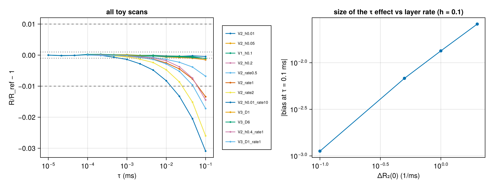

## P2.6.5: layer timestep constraint

Decision (user, 2026-10-06) after P2.6.2/P2.6.3: the constraint follows the measured control, ΔR₂(0)·τ, not the spec's c_h·h²/D.

- `src/timesteps.jl`: new option `layer` in `TimeStep`, giving τ ≤ `layer` / ΔR₂(0)_max, where ΔR₂(0)_max = max ρ/h over all layer sides with ρ > 0 (`Internal.max_layer_rate`; 0 without a layer, so the option is Inf and existing timesteps are unchanged). Override with `Simulation(...; timestep=(layer=...,))`.
- Default c = **0.005**: ΔR₂(0)·τ ≈ 0.05 gives 1 % error in R (P2.6.2), divided by 10. At ΔR₂(0)·τ = 0.005 the measured error is 1.4e-3 (ΔR₂(0) = 0.5, τ = 1e-2) and 1.3e-3 (ΔR₂(0) = 1, τ ≈ 4.6e-3 grid point), i.e. about 0.1 %.
- When it binds: for w = 2 µm, D = 3 the tortuosity default is 0.04 ms, so the layer constraint binds for ΔR₂(0) > 0.125 ms⁻¹. At the Phase 2 reference ΔR₂(0) = 0.1 it does not bind.
- Tests: `test/test_layer.jl` "layer timestep constraint" (max rate with side-specific values, ρ = 0 ignored, binding value, unchanged without a layer, default, verbose message).

## P2.6.8, P2.6.10–P2.6.12: cost and consequences

Script `research/phase2/p2_6_8_cost.jl`; output `research/results/phase2/p2_6_8_cost/`. Runtimes are single runs (1 seed, 10000 spins) on the same machine; B5 was measured on an earlier day, so ratios carry a load uncertainty of order 10–20 %.

**Runtime per spin-step with the layer** (h = 0.1, ΔR₂(0) = 0.1) vs B5 (no layer):

| τ (ms) | with layer (µs) | B5 (µs) | ratio |
|---|---|---|---|
| 0.1 | 0.0319 | 0.0265 | 1.21 |
| 1e-2 | 0.0236 | 0.0169 | 1.40 |
| 1e-3 | 0.0226 | 0.0163 | 1.39 |
| 1e-4 | 0.0195 | 0.0155 | 1.26 |

**Runtime vs h** (τ = 1e-2, ΔR₂(0) = 0.1, constraint not binding): 0.0353 / 0.0246 / 0.0207 / 0.0201 / 0.0215 µs per spin-step for h = 0.01 / 0.05 / 0.1 / 0.2 / 0.5 (×2.1 … ×1.2 vs B5). A full reference run (1e5 spins × 50 ms × 10 seeds) takes ≈ 0.03–0.05 h at every h. The h = 0.01 value is the first run after the τ loop and may include load noise.

**Runtime vs ΔR₂(0) at the new default timestep** (h = 0.1, τ = min(0.005/ΔR₂(0), 0.04)):

| ΔR₂(0) (ms⁻¹) | τ (ms) | µs per spin-step | full run (h) | σ penalty at fixed budget √(0.04/τ) |
|---|---|---|---|---|
| 0.1 | 0.04 | 0.0219 | 0.01 | 1.0 |
| 0.5 | 0.01 | 0.0191 | 0.03 | 2.0 |
| 1 | 5e-3 | 0.0200 | 0.06 | 2.8 |
| 2 | 2.5e-3 | 0.0204 | 0.11 | 4.0 |
| 10 | 5e-4 | 0.0227 | 0.63 | 8.9 |

- Noise cost (P2.6.11): at a fixed compute budget the number of spins scales with τ, so σ grows as √(τ_default/τ) (last column). The cost of the constraint grows linearly with ΔR₂(0) and does not depend on h.
- Accuracy–cost (P2.6.12): `cost.png` (toy error vs MCMR runtime per spin per ms, V1 and ΔR₂(0) = 1, 2). Recommended setting: the default (c = 0.005, ≈ 0.1 % in R); `timestep=(layer=0.05,)` for ≈ 1 % at a tenth of the cost.

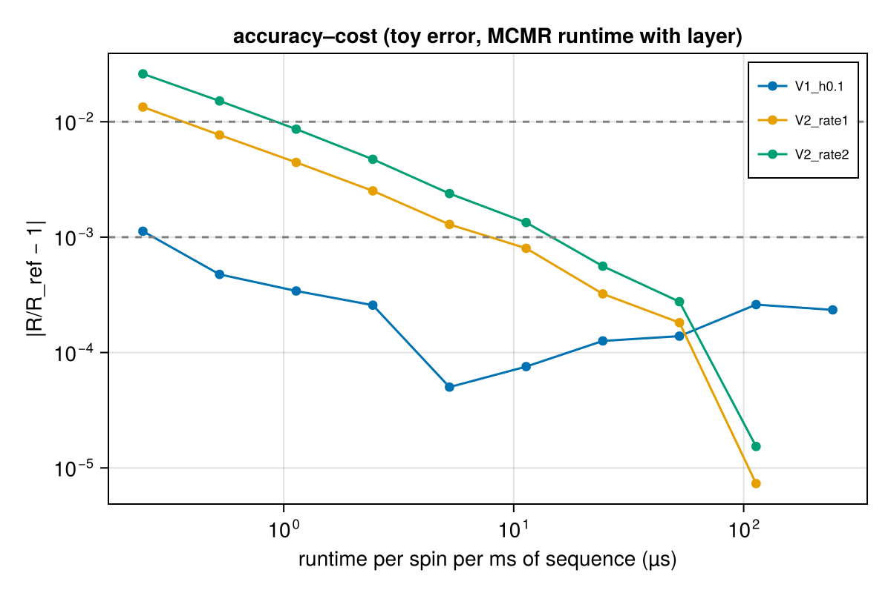

**Consequences for earlier results.** All Phase 2 characterisation runs (P2.3.4(b) sweep, P2.3.9 V4) used τ = 1e-2 ms at ΔR₂(0) = 0.1, i.e. ΔR₂(0)·τ = 1e-3, below the default constraint (0.005). Measured bias of R at τ = 1e-2 in the toy scans at ΔR₂(0) = 0.1: −2.6e-4 to −6.4e-4 (h = 0.01–0.2, D = 1–6). For V4 this corresponds to a relative shift in h* of the same order (≈ 2.6e-4 at h = 0.1, i.e. 2.5e-5 µm against σ_jack = 5e-5 µm), within about 1 σ, consistent with the V4 timestep check (≤ 1 SEM). → **No reruns needed.** The linear-profile plan may keep τ = 1e-2 at ΔR₂(0) = 0.1 (its shape dependence is P2.6.4).

## P2.4.3: linear profile — single-spin trace

Script [p2_2_9_layer_trace.jl](phase2/p2_2_9_layer_trace.jl) with `SHAPE=linear` → [results/phase2/p2_2_9_layer_trace_linear/](results/phase2/p2_2_9_layer_trace_linear/). Same configuration as P2.2.9 (h = 0.5 µm, ΔR₂(0) = 0.1 ms⁻¹ so ρ = 0.025 µm/ms, R₂_bulk = 1/80, τ = 0.01 ms, 100 spins × 500 steps). The prediction samples g(d/h) = 2(1 − d/h) along every piece, independently of the `Layers` code.

| Max relative error per step | Steps with a reflection inside the layer | Outcome |
|---|---|---|
| 2.4e-12 | 4848 | **PASS** |

The error is far below the step trace's 5.0e-08 because midpoint sampling integrates a piecewise-linear g exactly up to the few samples straddling the layer edge, where g is continuous (g(1) = 0); the step profile's jump at d = h is what limits the step trace's sampled prediction.

## P2.4.3: linear profile — exact checks at full size

Script [p2_4_3_linear_exact.jl](phase2/p2_4_3_linear_exact.jl) → [results/phase2/p2_4_3_linear_exact/](results/phase2/p2_4_3_linear_exact/). Seeds 1–10, 100000 spins per seed, τ = 1e-2 ms.

**Exact case.** With the linear profile on both faces and h = w, a point at u in the gap is inside both layers, and ΔR₂(u) = (2ρ/w)(1 − u/w) + (2ρ/w)(1 − (w − u)/w) = 2ρ/w, the same everywhere. Since ΔR₂(0) = (ρ/h)·g(0) = 2ρ/w, every spin decays at exactly ΔR₂(0) whatever its path: S = e^(−ΔR₂(0)·t) (× e^(−R₂_bulk·t) with bulk on). The case uses overlapping layers, so it also tests the overlap sum end to end.

| Check | Configuration | Max deviation per spin | Max deviation ensemble | Bound | Outcome |
|---|---|---|---|---|---|
| V0b, bulk on (1/80) | linear, ρ = 0, h = 0.5 vs no layer | identical (==) | identical | — | **PASS** |
| h = w, bulk off | linear, h = 2.0, ΔR₂(0) = 0.1 (ρ = 0.1) | 8.5e-14 | 2.6e-12 | 2.3e-11 | **PASS** |
| h = w, bulk on | same + R₂_bulk = 1/80 | 1.4e-13 | 1.9e-12 | 2.3e-11 | **PASS** |
| additivity | linear, h = 0.2, ΔR₂(0) = 0.1, R₂_bulk 0 vs 1/80; positions identical: true | 6.5e-14 | 8.7e-14 | 2.3e-11 | **PASS** |

## P2.4.3: linear profile — h sweep, monotonicity, decay shape

Script [p2_3_4_h_sweep.jl](phase2/p2_3_4_h_sweep.jl) with `SHAPE=linear` → [results/phase2/p2_3_4_h_sweep_linear/](results/phase2/p2_3_4_h_sweep_linear/). Linear profile, both faces, ΔR₂(0) = 0.1 ms⁻¹ (ρ = ΔR₂(0)·h/2), h ∈ H_GRID_LINEAR (to h = w = 2 µm), τ = 1e-2 ms, 100000 spins × 10 seeds.

| h (µm) | S(25) | S(50) ± SEM | 1 − S(50) | curvature c ± SEM (ms⁻²) |
|---|---|---|---|---|
| 0 | 1.00000 | 1.00000 ± 0.0e+00 | 0.00000 | -0.0e+00 ± 0.0e+00 |
| 0.005 | 0.99377 | 0.98758 ± 1.1e-06 | 0.01242 | 7.0e-10 ± 7.9e-10 |
| 0.01 | 0.98758 | 0.97531 ± 1.9e-06 | 0.02469 | 1.8e-09 ± 1.5e-09 |
| 0.02 | 0.97531 | 0.95123 ± 3.6e-06 | 0.04877 | 3.5e-09 ± 3.0e-09 |
| 0.03 | 0.96320 | 0.92776 ± 4.7e-06 | 0.07224 | 4.7e-09 ± 4.4e-09 |
| 0.05 | 0.93943 | 0.88253 ± 6.4e-06 | 0.11747 | 6.3e-09 ± 7.0e-09 |
| 0.07 | 0.91625 | 0.83952 ± 7.8e-06 | 0.16048 | 8.3e-09 ± 9.7e-09 |
| 0.1 | 0.88255 | 0.77891 ± 9.7e-06 | 0.22109 | 1.2e-08 ± 1.3e-08 |
| 0.15 | 0.82914 | 0.68749 ± 1.2e-05 | 0.31251 | 1.8e-08 ± 1.9e-08 |
| 0.2 | 0.77898 | 0.60682 ± 1.3e-05 | 0.39318 | 2.0e-08 ± 2.5e-08 |
| 0.3 | 0.68758 | 0.47278 ± 1.3e-05 | 0.52722 | 2.7e-08 ± 3.5e-08 |
| 0.5 | 0.53569 | 0.28697 ± 1.1e-05 | 0.71303 | 3.4e-08 ± 4.9e-08 |
| 0.7 | 0.41726 | 0.17411 ± 7.2e-06 | 0.82589 | 3.3e-08 ± 5.2e-08 |
| 1 | 0.28672 | 0.08221 ± 3.0e-06 | 0.91779 | 3.2e-08 ± 4.4e-08 |
| 1.5 | 0.15337 | 0.02352 ± 3.1e-07 | 0.97648 | 1.1e-08 ± 1.6e-08 |
| 2 | 0.08208 | 0.00674 ± 2.9e-19 | 0.99326 | -4.5e-16 ± 0.0e+00 |

**Interpretation.**
- Attenuation rises with h at every step: 15 of 15 by more than 2 SEM → **monotonicity PASS**.
- Curvature of ln S is zero within noise at every h (max |c|/SEM = 1.3); h = 0 and h = w = 2.0 (the exact uniform case, S(50) = e⁻⁵ = 0.00674) are single-exponential by construction.
- 1 − S(50) spans 0.0124 (h = 0.005) to 0.993 (h = 2.0), covering the B4 range 0.048–0.912 needed for V4.
- Empirical observation: S(50) of the linear layer at h is close to S(50) of the step layer at h/2 (same ΔR₂(0)): within 2e-5 relative for h ≤ 0.1 µm, with the linear layer attenuating increasingly more as h grows (−1.7e-4 at h = 0.3, −2.3e-3 at h = 1.0, both far beyond the SEM of ≈ 1e-5–6e-5), and equal again at h = 2.0 / 1.0, where both are exact uniform cases:

| h linear (µm) | S(50) linear | S(50) step at h/2 | ratio − 1 |
|---|---|---|---|
| 0.01 | 0.97531 | 0.97531 | -5.9e-07 |
| 0.02 | 0.95123 | 0.95123 | -1.3e-07 |
| 0.1 | 0.77891 | 0.77893 | -1.8e-05 |
| 0.2 | 0.60682 | 0.60686 | -7.2e-05 |
| 0.3 | 0.47278 | 0.47286 | -1.7e-04 |
| 1 | 0.08221 | 0.08240 | -2.3e-03 |
| 2 | 0.00674 | 0.00674 | +0.0e+00 |

## P2.4.7 (linear): V4, h*(θ) fitted to the baseline reference

Scripts [p2_3_9_fit_h.jl](phase2/p2_3_9_fit_h.jl) and [p2_3_9b_gauss_newton.jl](phase2/p2_3_9b_gauss_newton.jl) with `SHAPE=linear` → [results/phase2/p2_3_9_fit_h_linear/](results/phase2/p2_3_9_fit_h_linear/). Same three stages as the step V4 (start from the linear sweep, parabola refinement over h₀·(1 ± 5 %), one Gauss–Newton step), linear profile on both faces, ΔR₂(0) = 0.1 ms⁻¹, τ = 1e-2 ms, 100000 spins × 10 seeds, reference = B4 (τ = 1e-2). After the parabola stage the residuals were 5.6–26 SEM, all of one sign (negative) at every θ, as in the step fit; after the Gauss–Newton step every θ has residuals of both signs, so no further step was run.

| θ_relax | h* (µm) | σ_jack (µm) | h*/θ | χ²/dof | max \|residual\| (SEM) | max \|S_model/S_ref − 1\| | S(50) reference | S(50) model |
|---|---|---|---|---|---|---|---|---|
| 0.001 | 0.01954 | 3e-06 | 19.543 | 0.04 | 0.4 | 1.6e-06 | 0.95232 | 0.95232 |
| 0.0015 | 0.02932 | 5e-06 | 19.544 | 0.03 | 0.3 | 1.9e-06 | 0.92934 | 0.92934 |
| 0.002 | 0.03909 | 7e-06 | 19.545 | 0.02 | 0.2 | 2.0e-06 | 0.90692 | 0.90692 |
| 0.003 | 0.05864 | 1e-05 | 19.545 | 0.02 | 0.2 | 2.2e-06 | 0.86369 | 0.86370 |
| 0.005 | 0.09772 | 3e-05 | 19.545 | 0.02 | 0.3 | 3.5e-06 | 0.78335 | 0.78335 |
| 0.007 | 0.13681 | 4e-05 | 19.544 | 0.02 | 0.3 | 4.1e-06 | 0.71051 | 0.71051 |
| 0.01 | 0.19542 | 5e-05 | 19.542 | 0.01 | 0.1 | 4.5e-06 | 0.61379 | 0.61380 |
| 0.015 | 0.29304 | 4e-05 | 19.536 | 0.01 | 0.1 | 6.9e-06 | 0.48106 | 0.48106 |
| 0.02 | 0.39056 | 2e-05 | 19.528 | 0.02 | 0.2 | 1.0e-05 | 0.37713 | 0.37713 |
| 0.03 | 0.58521 | 7e-05 | 19.507 | 0.03 | 0.2 | 2.0e-05 | 0.23196 | 0.23196 |
| 0.04 | 0.77927 | 8e-05 | 19.482 | 0.05 | 0.4 | 3.3e-05 | 0.14281 | 0.14281 |
| 0.05 | 0.97272 | 2e-04 | 19.454 | 0.07 | 0.5 | 5.2e-05 | 0.08802 | 0.08802 |

**Timestep check** (h* fixed at the parabola value, τ = 1e-2 → 1e-3 ms, S(50) shift): θ = 0.002: +0.36 SEM (+3.3e-06); θ = 0.01: -0.31 SEM (-1.1e-05); θ = 0.05: +0.02 SEM (+1.4e-06).

**Bulk on** (θ = 0.01, R₂_bulk = 1/80, at the parabola h*): residuals equal the bulk-off residuals at the same h (max 11.45 in both), as for the step profile.

**Caveat.** Model and reference share seeds 1–10, so √(SEM₁² + SEM₂²) overestimates the noise of their difference; χ²/dof far below 1 follows from that.

**Interpretation.**
- For every θ in the B4 grid a single linear-layer thickness h* reproduces the whole baseline curve S_θ(t), 0–50 ms, within 5e-05 relative (max residual 0.46 combined SEM). As for the step profile, the fitted linear layer and the baseline cannot be told apart from the signal in this configuration.
- h*/θ = 19.45–19.55 µm per unit θ, drifting by 0.5 % from the smallest to the largest θ.

## P2.4.8 (step vs linear): profile comparison at fixed ΔR₂(0)

Script [p2_4_8_compare_step_linear.jl](phase2/p2_4_8_compare_step_linear.jl) → [results/phase2/p2_4_8_compare_step_linear/](results/phase2/p2_4_8_compare_step_linear/). Reads the two sweeps and the two V4 fits; ΔR₂(0) = 0.1 ms⁻¹ for both profiles, so ρ = ΔR₂(0)·h (step) and ΔR₂(0)·h/2 (linear). σ of the ρ* ratio = jackknife σ of each fit added in quadrature (written by the script). Two caveats on σ: the jackknife is from the parabola stage while the ratio uses the Gauss–Newton h*; and both fits share seeds 1–10 and the B4 reference, so their errors are correlated and this σ is an overestimate (z conservative).

| θ_relax | h* step (µm) | h* linear (µm) | h* ratio | ρ* ratio − 1 ± σ | z | max \|res\| step (SEM) | max \|res\| linear (SEM) |
|---|---|---|---|---|---|---|---|
| 0.001 | 0.00977 | 0.01954 | 2.0000 | +3.5e-06 ± 4e-04 | +0.0 | 0.4 | 0.4 |
| 0.0015 | 0.01466 | 0.02932 | 2.0000 | -7.4e-06 ± 3e-04 | -0.0 | 0.4 | 0.3 |
| 0.002 | 0.01954 | 0.03909 | 2.0000 | -1.2e-06 ± 5e-04 | -0.0 | 0.3 | 0.2 |
| 0.003 | 0.02932 | 0.05864 | 1.9999 | -2.7e-05 ± 3e-04 | -0.1 | 0.3 | 0.2 |
| 0.005 | 0.04887 | 0.09772 | 1.9999 | -7.3e-05 ± 5e-04 | -0.1 | 0.2 | 0.3 |
| 0.007 | 0.06841 | 0.13681 | 1.9998 | -8.2e-05 ± 6e-04 | -0.1 | 0.4 | 0.3 |
| 0.01 | 0.09772 | 0.19542 | 1.9997 | -1.3e-04 ± 5e-04 | -0.2 | 0.3 | 0.1 |
| 0.015 | 0.14655 | 0.29304 | 1.9996 | -2.2e-04 ± 3e-04 | -0.7 | 0.1 | 0.1 |
| 0.02 | 0.19534 | 0.39056 | 1.9993 | -3.3e-04 ± 2e-04 | -2.1 | 0.2 | 0.2 |
| 0.03 | 0.29277 | 0.58521 | 1.9989 | -5.7e-04 ± 2e-04 | -2.4 | 0.2 | 0.2 |
| 0.04 | 0.38994 | 0.77927 | 1.9984 | -7.8e-04 ± 9e-04 | -0.9 | 0.3 | 0.4 |
| 0.05 | 0.48681 | 0.97272 | 1.9982 | -9.2e-04 ± 4e-04 | -2.2 | 0.3 | 0.5 |

**Interpretation.**
- ρ* = ΔR₂(0)·h*/g(0) of the two profiles agrees within 9.2e-4 at every θ (h* ratio 1.9982–2.0000). There is a small systematic drift: the linear ρ* is below the step ρ* by an amount growing steadily with θ, from |ρ* ratio − 1| ≤ 1.3e-4 (|z| ≤ 0.2) for θ ≤ 0.01, through −2.2e-4 (z = −0.7) at θ = 0.015, to −3.3e-4 … −9.2e-4 for θ = 0.02–0.05 (z = −2.1, −2.4, −0.9, −2.2; conservative). This matches the sweep (P2.4.3): at fixed ΔR₂(0) the linear layer at h attenuates slightly more than the step layer at h/2, by −2.3e-3 in S(50) at h = 1.0.
- Neither profile fits the reference better: max |residual| is 0.1–0.4 SEM for the step and 0.1–0.5 SEM for the linear fit, and both match every curve within 5e-5 relative.
- Attenuation at fixed ΔR₂(0) and h (figure, left): the linear layer attenuates less than the step layer of the same h (it has half the ρ).
- In this configuration (walls 2 µm apart, D = 3 µm²/ms, up to 50 ms, τ = 1e-2) both profiles reproduce every reference curve once h is fitted, and the fitted ρ* differs between them by less than 1e-3. Whether conditions exist where the shapes separate is P2.5.

**Exponential added (2026-10-08; attenuation only, no V4 fit for the exponential by user decision).** S(50) at ΔR₂(0) = 0.1 ms⁻¹ for every h in all three sweeps (`attenuation.csv`; step grid ends at h = 1.0 = w/2):

| h (µm) | S(50) step | S(50) linear | S(50) exponential | ρ step / linear / exponential (µm/ms) |
|---|---|---|---|---|
| 0.005 | 0.97531 ± 2e-06 | 0.98758 ± 1e-06 | 0.97531 ± 2e-06 | 0.0005 / 0.0003 / 0.0005 |
| 0.01 | 0.95123 ± 4e-06 | 0.97531 ± 2e-06 | 0.95123 ± 3e-06 | 0.0010 / 0.0005 / 0.0010 |
| 0.02 | 0.90486 ± 6e-06 | 0.95123 ± 4e-06 | 0.90486 ± 5e-06 | 0.0020 / 0.0010 / 0.0020 |
| 0.03 | 0.86076 ± 8e-06 | 0.92776 ± 5e-06 | 0.86075 ± 7e-06 | 0.0030 / 0.0015 / 0.0030 |
| 0.05 | 0.77893 ± 1e-05 | 0.88253 ± 6e-06 | 0.77890 ± 9e-06 | 0.0050 / 0.0025 / 0.0050 |
| 0.07 | 0.70489 ± 1e-05 | 0.83952 ± 8e-06 | 0.70484 ± 1e-05 | 0.0070 / 0.0035 / 0.0070 |
| 0.1 | 0.60686 ± 2e-05 | 0.77891 ± 1e-05 | 0.60676 ± 1e-05 | 0.0100 / 0.0050 / 0.0100 |
| 0.15 | 0.47286 ± 2e-05 | 0.68749 ± 1e-05 | 0.47267 ± 1e-05 | 0.0150 / 0.0075 / 0.0150 |
| 0.2 | 0.36847 ± 2e-05 | 0.60682 ± 1e-05 | 0.36820 ± 1e-05 | 0.0200 / 0.0100 / 0.0200 |
| 0.3 | 0.22374 ± 1e-05 | 0.47278 ± 1e-05 | 0.22377 ± 7e-06 | 0.0300 / 0.0150 / 0.0300 |
| 0.5 | 0.08240 ± 5e-06 | 0.28697 ± 1e-05 | 0.08600 ± 2e-06 | 0.0500 / 0.0250 / 0.0491 |
| 0.7 | 0.03028 ± 2e-06 | 0.17411 ± 7e-06 | 0.03694 ± 8e-07 | 0.0700 / 0.0350 / 0.0660 |
| 1 | 0.00674 ± 3e-19 | 0.08221 ± 3e-06 | 0.01326 ± 2e-07 | 0.1000 / 0.0500 / 0.0865 |

- At fixed ΔR₂(0) the attenuation follows ρ to first order: step and exponential (equal ρ to ≤ 4.5e-5 for h ≤ 0.2 µm; −1.3e-3 at h = 0.3) attenuate almost equally, linear (half the ρ) much less. The residual step–exponential difference at nearly equal ρ (up to −7.4e-4 relative at h = 0.2, z = −14.8) is a profile-shape effect; see the exponential sweep section.
- From h = 0.3 on, the exponential's truncation at w lowers its ρ below the step's, and its attenuation falls below the step's accordingly.

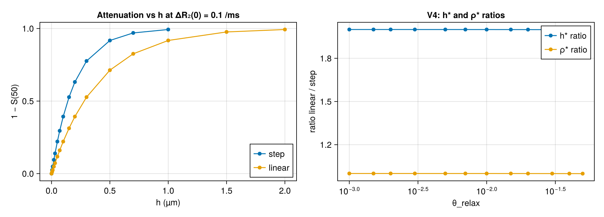

## P2.6.4: profile dependence of the timestep error (step vs linear)

Toy scans with `SHAPE=linear` ([p2_6_scan.jl](phase2/p2_6_scan.jl); the toy's linear `:exact` rule calls MCMR's `side_exponent`, the step path is unchanged), same settings as P2.6.1–P2.6.3 (100000 spins × 10 seeds, T = 10 ms, reference τ = 1e-5 for h = 0.1/ΔR₂(0) = 0.1 and h = 0.01/ΔR₂(0) = 10, 1e-4 otherwise). ΔR₂(0) is the profile's own surface rate, (ρ/h)·g(0), so ρ = ΔR₂(0)·h/2 for linear. Comparison: [p2_6_4_profile.jl](phase2/p2_6_4_profile.jl) → [results/phase2/p2_6_4_profile/](results/phase2/p2_6_4_profile/).

**MCMR vs toy, linear** (h = 0.1, ΔR₂(0) = 1, [p2_6_1_mcmr_check.jl](phase2/p2_6_1_mcmr_check.jl) with `SCAN=L_rate1` → `p2_6_1_mcmr_check_L_rate1/`): z = −0.31, +1.31, +0.04 at τ = 0.1, 1e-2, 1e-3 → **PASS**.

| scan | shape | h (µm) | ΔR₂(0) | D | bias at τ = 0.1 ms | ΔR₂(0)·τ_conv 1 % | ΔR₂(0)·τ_conv 0.1 % | error at τ = 0.005/ΔR₂(0) ± σ |
|---|---|---|---|---|---|---|---|---|
| V1_h0.1 | step | 0.1 | 0.1 | 3 | -1.13e-03 | ≥0.01 | 0.00862 | -5.4e-04 ± 2e-04 |
| L_h0.1 | linear | 0.1 | 0.1 | 3 | -6.01e-04 | ≥0.01 | ≥0.01 | -2.5e-04 ± 2e-04 |
| E_h0.1 | exponential | 0.1 | 0.1 | 3 | -7.91e-04 | ≥0.01 | ≥0.01 | -4.3e-04 ± 2e-04 |
| V2_rate0.5 | step | 0.1 | 0.5 | 3 | -6.80e-03 | ≥0.05 | 0.00316 | -1.4e-03 ± 2e-04 |
| L_rate0.5 | linear | 0.1 | 0.5 | 3 | -4.26e-03 | ≥0.05 | 0.00478 | -1.0e-03 ± 2e-04 |
| E_rate0.5 | exponential | 0.1 | 0.5 | 3 | -4.00e-03 | ≥0.05 | 0.00704 | -7.7e-04 ± 2e-04 |
| V2_rate1 | step | 0.1 | 1 | 3 | -1.34e-02 | 0.0633 | 0.00295 | -1.4e-03 ± 2e-04 |
| L_rate1 | linear | 0.1 | 1 | 3 | -8.38e-03 | ≥0.1 | 0.00486 | -1.0e-03 ± 2e-04 |
| E_rate1 | exponential | 0.1 | 1 | 3 | -7.93e-03 | ≥0.1 | 0.00665 | -7.6e-04 ± 2e-04 |
| V2_rate2 | step | 0.1 | 2 | 3 | -2.60e-02 | 0.0506 | 0.00308 | -1.5e-03 ± 2e-04 |
| L_rate2 | linear | 0.1 | 2 | 3 | -1.63e-02 | 0.0961 | 0.00422 | -1.2e-03 ± 2e-04 |
| E_rate2 | exponential | 0.1 | 2 | 3 | -1.56e-02 | 0.109 | 0.00645 | -8.3e-04 ± 2e-04 |
| V2_h0.4_rate1 | step | 0.4 | 1 | 3 | -1.44e-02 | 0.0616 | 0.00491 | -1.0e-03 ± 1e-04 |
| L_h0.4_rate1 | linear | 0.4 | 1 | 3 | -1.13e-02 | 0.0833 | 0.0057 | -8.7e-04 ± 2e-04 |
| E_h0.4_rate1 | exponential | 0.4 | 1 | 3 | -3.65e-03 | ≥0.1 | 0.0224 | -2.8e-04 ± 7e-05 |
| V3_D1_rate1 | step | 0.1 | 1 | 1 | -1.72e-02 | 0.0482 | 0.00283 | -1.5e-03 ± 4e-04 |
| L_D1_rate1 | linear | 0.1 | 1 | 1 | -1.08e-02 | 0.0866 | 0.00421 | -1.2e-03 ± 3e-04 |
| E_D1_rate1 | exponential | 0.1 | 1 | 1 | -9.50e-03 | ≥0.1 | 0.0065 | -7.6e-04 ± 3e-04 |
| V2_h0.01_rate10 | step | 0.01 | 10 | 3 | -3.09e-02 | 0.131 | 0.00651 | -7.5e-04 ± 2e-04 |
| L_h0.01_rate10 | linear | 0.01 | 10 | 3 | -1.77e-02 | 0.347 | 0.0127 | -3.6e-04 ± 2e-04 |
| E_h0.01_rate10 | exponential | 0.01 | 10 | 3 | -2.60e-02 | 0.196 | 0.00893 | -6.1e-04 ± 2e-04 |
| L_h0.2_rate1 | linear | 0.2 | 1 | 3 | -1.06e-02 | 0.0901 | 0.00481 | -1.0e-03 ± 2e-04 |

(≥: τ_conv is a lower bound, no τ ≤ 0.1 ms exceeded the tolerance. Error at the default is interpolated in log τ between scan points; σ combines the interpolated SEM and the reference SEM, both relative to R_ref, treated as independent. The bias at τ = 0.1 ms has σ ≈ 2–4e-4, tens of times smaller than the step-linear differences there.)

**Interpretation.**
- In every matched pair the linear profile has a smaller timestep error than the step profile at the same ΔR₂(0), resolved where the error is large: the bias at τ = 0.1 ms is 0.53–0.78× the step value (each difference ≫ 10σ), and ΔR₂(0)·τ_conv is 1.35–2.65× larger at 1 % and 1.16–1.96× larger at 0.1 % (pairs where both values are resolved; where the linear value is only a lower bound the ratio is larger still).
- The rate dependence is the same as for the step profile: the bias grows with ΔR₂(0) (−6.0e-4, −4.3e-3, −8.4e-3, −1.6e-2 for ΔR₂(0) = 0.1, 0.5, 1, 2 at h = 0.1). At ΔR₂(0) = 1 the linear threshold varies little with h (ΔR₂(0)·τ_conv at 0.1 % = 0.0049, 0.0048, 0.0057 for h = 0.1, 0.2, 0.4) or D (0.0042 at D = 1).
- **Constraint.** With ΔR₂(0) = (ρ/h)·g(0) (= 2ρ/h for linear, as `max_layer_rate` computes), the default c = 0.005 gives an error of at most 1.2e-3 ± 3e-4 for the linear profile (D = 1 and ΔR₂(0) = 2) and at most 1.5e-3 ± 4e-4 for the step profile (D = 1; ΔR₂(0) = 2: 1.5e-3 ± 2e-4). At the default point itself the step–linear differences per pair (1–4e-4) are within about 1–2σ, so the ordering there is not resolved; it is resolved at larger τ (bias at 0.1 ms above). Either way both are ≈ 0.1 %, far below the 1 % level c was set against, so the same c serves both (tracker risk "shape-dependent c_h": no change needed for linear).
- **Exponential** (added 2026-10-08, plan `2026-10-07-exponential-profile.md`; truncated at w = 2 µm, renormalised; `E_*` scans, reference τ = 1e-4 for all, see the caveat below). MCMR vs toy (h = 0.1, ΔR₂(0) = 1, `p2_6_1_mcmr_check_E_rate1/`): z = −0.51, +0.78, +0.06 at τ = 0.1, 1e-2, 1e-3 → **PASS**.
  - At the same ΔR₂(0) the exponential's bias at τ = 0.1 ms is below the step's in every group (0.25–0.84×; smallest at h = 0.4, where truncation at w makes the profile flatter) and close to the linear's (0.32–1.47×; larger than linear only at h = 0.01/ΔR₂(0) = 10 and h = 0.1/ΔR₂(0) = 0.1).
  - At the default c = 0.005 the exponential error is at most 8.3e-4 ± 2e-4 (ΔR₂(0) = 2), below step (1.54e-3 ± 2e-4) and linear (1.15e-3 ± 2e-4). The step profile remains the most demanding of the three; the same c serves all three.
  - Caveat: the exponential toy is ≈ 8× slower per point than the step toy (exp/expm1 per piece), so E_h0.1 and E_h0.01_rate10 use a τ = 1e-4 reference instead of 1e-5 (ledger ruling). For the step profile at ΔR₂(0) = 10 the same choice moved the 0.1 % threshold by ≈ 15 % (0.0056 → 0.0065), so the E_h0.01_rate10 0.1 % value (0.0089) carries an uncertainty of that order.
- Polynomial profiles are not implemented yet.

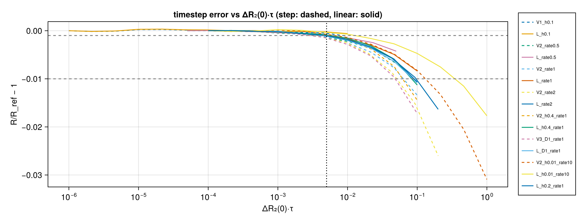

## P2.4.5: exponential profile — single-spin trace

Script [p2_2_9_layer_trace.jl](phase2/p2_2_9_layer_trace.jl) with `SHAPE=exponential` → [results/phase2/p2_2_9_layer_trace_exponential/](results/phase2/p2_2_9_layer_trace_exponential/). Same configuration as P2.2.9 (h = 0.5 µm, ΔR₂(0) = 0.1 ms⁻¹, R₂_bulk = 1/80, τ = 0.01 ms, 100 spins × 500 steps). Exponential truncated at the cutoff = w = 2 µm and renormalised, so ρ = ΔR₂(0)·h·(1 − e^(−w/h)); each face's layer reaches the opposite wall, so the two faces overlap everywhere. The prediction samples g(d/h) along every piece, independently of the `Layers` code.

| Max relative error per step | Steps with a reflection inside the layer | Outcome |
|---|---|---|
| 7.1e-13 | 4848 | **PASS** |

## P2.4.5: mean-exponent identity (all profiles)

Script [p2_4_5_mean_exponent.jl](phase2/p2_4_5_mean_exponent.jl) → [results/phase2/p2_4_5_mean_exponent/](results/phase2/p2_4_5_mean_exponent/). Seeds 1–10, 100000 spins per seed, ΔR₂(0) = 0.1 ms⁻¹, R₂_bulk = 0, t = 50 ms.

**Identity.** Between reflecting walls the uniform density is stationary under MCMR's step-and-mirror walk, and every point along a straight piece (x₀ + s·Δx, folded) is uniform too. Each spin's layer exponent is ∫ΔR₂ dt along its pieces, so its expectation is t·⟨ΔR₂⟩_volume = t·2·(1/w)∫(ρ/h)g(d/h) dd = 2ρt/w whenever each layer's support lies inside the gap — for any profile, h and τ. So E[−ln M⊥(t)] = 2ρt/w exactly. It tests normalisation, truncation, the overlap sum and the image loop end to end. It does not constrain the signal S = ⟨M⊥⟩, which depends on the higher moments of the exponent — where profiles can differ.

| profile | h (µm) | τ (ms) | ρ (µm/ms) | 2ρt/w | mean −ln M ± SEM | z | Outcome |
|---|---|---|---|---|---|---|---|
| step | 0.2 | 0.01 | 0.020000 | 1.000000 | 1.000040 ± 4.3e-05 | +0.93 | **PASS** |
| step | 0.2 | 0.04 | 0.020000 | 1.000000 | 1.000056 ± 6.5e-05 | +0.86 | **PASS** |
| linear | 0.2 | 0.01 | 0.010000 | 0.500000 | 0.500023 ± 2.2e-05 | +1.09 | **PASS** |
| linear | 0.2 | 0.04 | 0.010000 | 0.500000 | 0.500018 ± 3.6e-05 | +0.51 | **PASS** |
| linear | 1.5 | 0.01 | 0.075000 | 3.750000 | 3.750011 ± 1.3e-05 | +0.81 | **PASS** |
| linear | 1.5 | 0.04 | 0.075000 | 3.750000 | 3.750009 ± 2.0e-05 | +0.45 | **PASS** |
| exponential | 0.2 | 0.01 | 0.019999 | 0.999955 | 0.999980 ± 2.7e-05 | +0.92 | **PASS** |
| exponential | 0.2 | 0.04 | 0.019999 | 0.999955 | 0.999973 ± 4.3e-05 | +0.42 | **PASS** |
| exponential | 0.5 | 0.01 | 0.049084 | 2.454211 | 2.454232 ± 2.6e-05 | +0.80 | **PASS** |
| exponential | 0.5 | 0.04 | 0.049084 | 2.454211 | 2.454222 ± 3.8e-05 | +0.29 | **PASS** |

All ten |z| ≤ 1.1. All ten z are positive: the runs share seeds 1–10 (same initial positions and, per τ, the same random streams), so their deviations are correlated and do not count as ten independent draws.

## P2.4.5: exponential profile — h sweep, monotonicity, decay shape

Script [p2_3_4_h_sweep.jl](phase2/p2_3_4_h_sweep.jl) with `SHAPE=exponential` → [results/phase2/p2_3_4_h_sweep_exponential/](results/phase2/p2_3_4_h_sweep_exponential/). Exponential profile truncated at the cutoff = w = 2 µm and renormalised, both faces, ΔR₂(0) = 0.1 ms⁻¹, so ρ = ΔR₂(0)·h·(1 − e^(−w/h)); h ∈ H_GRID_LINEAR, τ = 1e-2 ms, 100000 spins × 10 seeds. No V4 fit follows (user decision).

| h (µm) | ρ (µm/ms) | S(25) | S(50) ± SEM | 1 − S(50) | curvature c ± SEM (ms⁻²) |
|---|---|---|---|---|---|
| 0 | 0.00000 | 1.00000 | 1.00000 ± 0.0e+00 | 0.00000 | -0.0e+00 ± 0.0e+00 |
| 0.005 | 0.00050 | 0.98758 | 0.97531 ± 1.9e-06 | 0.02469 | 1.7e-09 ± 1.5e-09 |
| 0.01 | 0.00100 | 0.97531 | 0.95123 ± 3.3e-06 | 0.04877 | 3.1e-09 ± 2.9e-09 |
| 0.02 | 0.00200 | 0.95124 | 0.90486 ± 5.3e-06 | 0.09514 | 5.4e-09 ± 5.5e-09 |
| 0.03 | 0.00300 | 0.92776 | 0.86075 ± 6.7e-06 | 0.13925 | 7.5e-09 ± 8.0e-09 |
| 0.05 | 0.00500 | 0.88255 | 0.77890 ± 8.8e-06 | 0.22110 | 1.1e-08 ± 1.3e-08 |
| 0.07 | 0.00700 | 0.83954 | 0.70484 ± 1.0e-05 | 0.29516 | 1.4e-08 ± 1.7e-08 |
| 0.1 | 0.01000 | 0.77894 | 0.60676 ± 1.1e-05 | 0.39324 | 1.8e-08 ± 2.3e-08 |
| 0.15 | 0.01500 | 0.68750 | 0.47267 ± 1.1e-05 | 0.52733 | 2.3e-08 ± 3.0e-08 |
| 0.2 | 0.02000 | 0.60679 | 0.36820 ± 9.9e-06 | 0.63180 | 2.5e-08 ± 3.4e-08 |
| 0.3 | 0.02996 | 0.47304 | 0.22377 ± 6.5e-06 | 0.77623 | 2.6e-08 ± 3.7e-08 |
| 0.5 | 0.04908 | 0.29325 | 0.08600 ± 2.2e-06 | 0.91400 | 2.2e-08 ± 3.2e-08 |
| 0.7 | 0.06598 | 0.19219 | 0.03694 ± 7.7e-07 | 0.96306 | 1.8e-08 ± 2.6e-08 |
| 1 | 0.08647 | 0.11515 | 0.01326 ± 1.9e-07 | 0.98674 | 1.2e-08 ± 1.8e-08 |
| 1.5 | 0.11046 | 0.06320 | 0.00399 ± 3.5e-08 | 0.99601 | 7.2e-09 ± 1.1e-08 |
| 2 | 0.12642 | 0.04240 | 0.00180 ± 1.0e-08 | 0.99820 | 4.7e-09 ± 7.0e-09 |

**Interpretation.**
- Attenuation rises with h at every step: 15 of 15 by more than 2 SEM → **monotonicity PASS**.
- Curvature of ln S is zero within noise at every h (max |c|/SEM = 1.1).
- 1 − S(50) spans 0.0247 (h = 0.005) to 0.9982 (h = 2.0).
- Comparison with the step profile at the same h and ΔR₂(0) (both from their sweeps; seeds shared, so z is conservative):

| h (µm) | S(50) exponential | S(50) step | ratio − 1 | z |
|---|---|---|---|---|
| 0.005 | 0.97531 | 0.97531 | -6.3e-07 | -0.2 |
| 0.01 | 0.95123 | 0.95123 | -2.7e-07 | -0.1 |
| 0.02 | 0.90486 | 0.90486 | -2.9e-06 | -0.3 |
| 0.03 | 0.86075 | 0.86076 | -1.1e-05 | -1.0 |
| 0.05 | 0.77890 | 0.77893 | -3.7e-05 | -2.2 |
| 0.07 | 0.70484 | 0.70489 | -7.1e-05 | -3.2 |
| 0.1 | 0.60676 | 0.60686 | -1.7e-04 | -5.3 |
| 0.15 | 0.47267 | 0.47286 | -4.1e-04 | -10.3 |
| 0.2 | 0.36820 | 0.36847 | -7.4e-04 | -14.8 |
| 0.3 | 0.22377 | 0.22374 | +1.5e-04 | +2.4 |
| 0.5 | 0.08600 | 0.08240 | +4.4e-02 | +665.2 |
| 0.7 | 0.03694 | 0.03028 | +2.2e-01 | +3756.7 |
| 1 | 0.01326 | 0.00674 | +9.7e-01 | +33582.4 |

  For h ≤ 0.2 µm the two profiles have essentially the same ρ (relative difference e^(−w/h) ≤ 4.5e-5), so by the mean-exponent identity the same mean of −ln M. S(50) still differs, beyond noise for h = 0.05–0.2: the exponential attenuates more, by up to 7.4e-4 relative at h = 0.2 (z = −14.8, conservative). That is a profile-shape effect at (almost) fixed ρ, of order 10⁻³ here. At h = 0.3 the ρ difference (−1.3e-3 relative: 0.02996 vs 0.03) already outweighs it (it alone raises S(50) by ≈ +1.9e-3), hence the sign change there (+1.5e-4, z = +2.4). For h ≥ 0.5 the truncation lowers the exponential's ρ (0.0491 vs 0.05 at h = 0.5; 0.0865 vs 0.1 at h = 1.0), and the differences above mainly reflect that.

## P2.5.0: conventional model at the same ρ — θ = ρ√(π/D)

Script [p2_5_1_theta_mapping.jl](phase2/p2_5_1_theta_mapping.jl) → [results/phase2/p2_5_1_theta_mapping/](results/phase2/p2_5_1_theta_mapping/). w = 2 µm, ρ = 0.01 µm/ms, t = 50 ms, seeds 1–10, 100000 spins per seed.

**Mapping.** MCMR's conventional surface relaxation multiplies M⊥ by e^(−θ√τ) at every wall collision. With Gaussian steps of variance 2Dτ per axis, walkers at density n hit a wall n·√(D/(πτ)) times per unit area and time, so the loss per unit area and time is n·θ·√(D/π): the conventional model's surface relaxivity is **ρ = θ·√(D/π)**. For a uniform start this gives the baseline its own mean-exponent identity, E[−ln M_base(t)] = 2θ√(D/π)·t/w, which equals the layer's 2ρt/w (P2.4.5) when θ = ρ√(π/D). It also explains the V4 result ρ*/θ ≈ 0.977 = √(3/π).

| D (µm²/ms) | τ (ms) | θ | 2ρt/w | baseline mean −ln M ± SEM | z | paired base − exponential layer (h = 0.2) ± SEM (z) | identical paths | Outcome |
|---|---|---|---|---|---|---|---|---|
| 1 | 0.01 | 0.01772 | 0.500000 | 0.500047 ± 6.4e-05 | +0.74 | +2.4e-05 ± 4e-05 (+0.6) | true | **PASS** |
| 1 | 0.04 | 0.01772 | 0.500000 | 0.499972 ± 6.7e-05 | -0.42 | -3.6e-05 ± 4e-05 (-0.9) | true | **PASS** |
| 3 | 0.01 | 0.01023 | 0.500000 | 0.500006 ± 3.1e-05 | +0.20 | -6.4e-06 ± 2e-05 (-0.3) | true | **PASS** |
| 3 | 0.04 | 0.01023 | 0.500000 | 0.499970 ± 3.3e-05 | -0.90 | -3.9e-05 ± 2e-05 (-1.9) | true | **PASS** |
| 6 | 0.01 | 0.00724 | 0.500000 | 0.499994 ± 2.5e-05 | -0.24 | -1.4e-05 ± 1e-05 (-1.0) | true | **PASS** |
| 6 | 0.04 | 0.00724 | 0.500000 | 0.499995 ± 3.1e-05 | -0.16 | -1.3e-05 ± 2e-05 (-0.8) | true | **PASS** |

From here on, **fixed ρ** means the baseline uses θ = ρ√(π/D). Both models then have the same mean log-attenuation by construction, so any difference in the signal S = ⟨M⊥⟩ comes from how the relaxation is distributed (the higher moments of the exponent). The layer and the baseline follow **identical trajectories** for the same seed (neither draws random numbers), so their per-seed difference is a paired measurement.

## P2.5: sensitivity to the spatial distribution at fixed ρ (walls, free decay)

Plan [2026-10-08-sensitivity-walls.md](../docs/superpowers/plans/2026-10-08-sensitivity-walls.md). Runner [p2_5_sensitivity.jl](phase2/p2_5_sensitivity.jl) (`SWEEP` = h, w, D, rho) → `results/phase2/p2_5_sensitivity_*/`; summary [p2_5_summary.jl](phase2/p2_5_summary.jl) → [results/phase2/p2_5_summary/](results/phase2/p2_5_summary/).

**Method.**
- **Fixed ρ.** The layer (step, linear or exponential; ρ, h; both faces) is compared with the conventional surface-relaxation model at the same integrated relaxivity, θ = ρ√(π/D) (P2.5.0). Both therefore have the same mean log-attenuation.
- **Pairing.** Same walls, D, τ, seeds 1–10, 50000 spins per seed, readouts 0:10:200 ms, R₂_bulk = 0. Both models follow identical trajectories (verified in the pilot and in P2.5.0), so ΔS(t) = S_layer − S_base is a paired per-seed difference. The pilot's paired SEM at the peak was 2.6e-5.
- **Timestep.** τ = min(1e-2, 0.005/ΔR₂(0)), the adopted layer constraint, used for both models.
- **Exclusions.** The step profile is excluded for h > w/2.
- **Grid.** Reference point: w = 2 µm, D = 3 µm²/ms, ρ = 0.01 µm/ms, h = 0.2 µm. Sweeps: h ∈ {0.05, 0.1, 0.2, 0.5, 1, 2}, w ∈ {1, 2, 5, 10}, D ∈ {1, 3, 6}, ρ ∈ {0.003, 0.01, 0.03, 0.1}. 50 configurations.
- **Levels.**
  - "SNR 100": |ΔS| ≥ 0.02.
  - "SNR 200": |ΔS| ≥ 0.01 (2σ of a single measurement with relative noise 1/SNR).
  - "MC only": resolved by the simulation (≥ 3 paired SEM) but below both MRI thresholds.
  - "not resolved": < 3 SEM.
- **Secondary.** The best mono-exponential residual of the layer curve: what a fitted conventional model could not absorb, given that the baseline is itself mono-exponential (|curvature| ≤ 3.6e-08 ms⁻² in every configuration).

**Sweep h** (others at the reference point):

| shape | h (µm) | τ (ms) | centroid (µm) | ΔS at peak ± SEM | t peak (ms) | level | mono-exp residual | baseline curvature (ms⁻²) |
|---|---|---|---|---|---|---|---|---|
| step | 0.05 | 0.01 | 0.0250 | +1.26e-04 ± 1e-05 | 80 | MC only | 3.8e-05 | 1.3e-09 |
| linear | 0.05 | 0.01 | 0.0167 | +1.64e-04 ± 1e-05 | 80 | MC only | 4.7e-05 | 1.3e-09 |
| exponential | 0.05 | 0.01 | 0.0500 | +1.87e-05 ± 7e-06 | 160 | not resolved | 4.0e-05 | 1.3e-09 |
| step | 0.1 | 0.01 | 0.0500 | +2.81e-05 ± 1e-05 | 70 | not resolved | 4.1e-05 | 1.3e-09 |
| linear | 0.1 | 0.01 | 0.0333 | +7.71e-05 ± 1e-05 | 80 | MC only | 4.3e-05 | 1.3e-09 |
| exponential | 0.1 | 0.01 | 0.1000 | -1.06e-04 ± 1e-05 | 90 | MC only | 3.2e-05 | 1.3e-09 |
| step | 0.2 | 0.01 | 0.1000 | -9.89e-05 ± 2e-05 | 90 | MC only | 3.3e-05 | 1.3e-09 |
| linear | 0.2 | 0.01 | 0.0667 | -3.78e-05 ± 1e-05 | 90 | not resolved | 3.8e-05 | 1.3e-09 |
| exponential | 0.2 | 0.01 | 0.1999 | -2.43e-04 ± 2e-05 | 90 | MC only | 2.0e-05 | 1.3e-09 |
| step | 0.5 | 0.01 | 0.2500 | -2.83e-04 ± 2e-05 | 90 | MC only | 9.8e-06 | 1.3e-09 |
| linear | 0.5 | 0.01 | 0.1667 | -2.04e-04 ± 2e-05 | 90 | MC only | 2.1e-05 | 1.3e-09 |
| exponential | 0.5 | 0.01 | 0.4627 | -3.78e-04 ± 2e-05 | 90 | MC only | 6.5e-06 | 1.3e-09 |
| step | 1 | 0.01 | 0.5000 | -4.05e-04 ± 2e-05 | 100 | MC only | 7.0e-13 | 1.3e-09 |
| linear | 1 | 0.01 | 0.3333 | -3.56e-04 ± 2e-05 | 90 | MC only | 7.8e-06 | 1.3e-09 |
| exponential | 1 | 0.01 | 0.6870 | -4.01e-04 ± 2e-05 | 90 | MC only | 2.0e-06 | 1.3e-09 |
| linear | 2 | 0.01 | 0.6667 | -4.05e-04 ± 2e-05 | 100 | MC only | 7.0e-13 | 1.3e-09 |
| exponential | 2 | 0.01 | 0.8360 | -4.04e-04 ± 2e-05 | 100 | MC only | 5.3e-07 | 1.3e-09 |

**Sweep w** (others at the reference point):

| shape | w (µm) | τ (ms) | centroid (µm) | ΔS at peak ± SEM | t peak (ms) | level | mono-exp residual | baseline curvature (ms⁻²) |
|---|---|---|---|---|---|---|---|---|
| step | 1 | 0.01 | 0.1000 | -1.08e-04 ± 1e-05 | 30 | MC only | 2.0e-05 | 1.5e-10 |
| linear | 1 | 0.01 | 0.0667 | -6.03e-05 ± 1e-05 | 30 | MC only | 2.1e-05 | 1.5e-10 |
| exponential | 1 | 0.01 | 0.1932 | -1.79e-04 ± 2e-05 | 30 | MC only | 9.1e-06 | 1.5e-10 |
| step | 2 | 0.01 | 0.1000 | -9.89e-05 ± 2e-05 | 90 | MC only | 3.3e-05 | 1.3e-09 |
| linear | 2 | 0.01 | 0.0667 | -3.78e-05 ± 1e-05 | 90 | not resolved | 3.8e-05 | 1.3e-09 |
| exponential | 2 | 0.01 | 0.1999 | -2.43e-04 ± 2e-05 | 90 | MC only | 2.0e-05 | 1.3e-09 |
| step | 5 | 0.01 | 0.1000 | -6.34e-05 ± 2e-05 | 200 | MC only | 5.9e-05 | -1.5e-09 |
| linear | 5 | 0.01 | 0.0667 | -1.48e-05 ± 1e-05 | 30 | not resolved | 6.3e-05 | -1.5e-09 |
| exponential | 5 | 0.01 | 0.2000 | -2.60e-04 ± 2e-05 | 200 | MC only | 5.3e-05 | -1.5e-09 |
| step | 10 | 0.01 | 0.1000 | -4.68e-05 ± 2e-05 | 190 | not resolved | 3.6e-05 | -2.0e-09 |
| linear | 10 | 0.01 | 0.0667 | -1.02e-05 ± 7e-06 | 40 | not resolved | 3.7e-05 | -2.0e-09 |
| exponential | 10 | 0.01 | 0.2000 | -2.10e-04 ± 2e-05 | 200 | MC only | 3.5e-05 | -2.0e-09 |

**Sweep D** (others at the reference point):

| shape | D (µm²/ms) | τ (ms) | centroid (µm) | ΔS at peak ± SEM | t peak (ms) | level | mono-exp residual | baseline curvature (ms⁻²) |
|---|---|---|---|---|---|---|---|---|
| step | 1 | 0.01 | 0.1000 | -3.47e-04 ± 3e-05 | 100 | MC only | 5.2e-05 | 2.0e-09 |
| linear | 1 | 0.01 | 0.0667 | -2.19e-04 ± 2e-05 | 100 | MC only | 6.1e-05 | 2.0e-09 |
| exponential | 1 | 0.01 | 0.1999 | -7.57e-04 ± 3e-05 | 100 | MC only | 3.6e-05 | 2.0e-09 |
| step | 3 | 0.01 | 0.1000 | -9.89e-05 ± 2e-05 | 90 | MC only | 3.3e-05 | 1.3e-09 |
| linear | 3 | 0.01 | 0.0667 | -3.78e-05 ± 1e-05 | 90 | not resolved | 3.8e-05 | 1.3e-09 |
| exponential | 3 | 0.01 | 0.1999 | -2.43e-04 ± 2e-05 | 90 | MC only | 2.0e-05 | 1.3e-09 |
| step | 6 | 0.01 | 0.1000 | -4.56e-05 ± 1e-05 | 30 | MC only | 3.1e-05 | 6.2e-10 |
| linear | 6 | 0.01 | 0.0667 | +2.00e-05 ± 9e-06 | 160 | not resolved | 2.4e-05 | 6.2e-10 |
| exponential | 6 | 0.01 | 0.1999 | -1.20e-04 ± 1e-05 | 90 | MC only | 2.1e-05 | 6.2e-10 |

**Sweep rho** (others at the reference point):

| shape | ρ (µm/ms) | τ (ms) | centroid (µm) | ΔS at peak ± SEM | t peak (ms) | level | mono-exp residual | baseline curvature (ms⁻²) |
|---|---|---|---|---|---|---|---|---|
| step | 0.003 | 0.01 | 0.1000 | -1.97e-05 ± 1e-05 | 90 | not resolved | 1.2e-05 | 4.2e-10 |
| linear | 0.003 | 0.01 | 0.0667 | -8.71e-06 ± 7e-06 | 90 | not resolved | 1.3e-05 | 4.2e-10 |
| exponential | 0.003 | 0.01 | 0.1999 | -6.05e-05 ± 1e-05 | 200 | MC only | 7.8e-06 | 4.2e-10 |
| step | 0.01 | 0.01 | 0.1000 | -9.89e-05 ± 2e-05 | 90 | MC only | 3.3e-05 | 1.3e-09 |
| linear | 0.01 | 0.01 | 0.0667 | -3.78e-05 ± 1e-05 | 90 | not resolved | 3.8e-05 | 1.3e-09 |
| exponential | 0.01 | 0.01 | 0.1999 | -2.43e-04 ± 2e-05 | 90 | MC only | 2.0e-05 | 1.3e-09 |
| step | 0.03 | 0.01 | 0.1000 | -2.93e-04 ± 4e-05 | 30 | MC only | 6.8e-05 | 3.5e-09 |
| linear | 0.03 | 0.01 | 0.0667 | -1.17e-04 ± 3e-05 | 30 | MC only | 7.8e-05 | 3.5e-09 |
| exponential | 0.03 | 0.01 | 0.1999 | -7.22e-04 ± 4e-05 | 30 | MC only | 4.1e-05 | 3.5e-09 |
| step | 0.1 | 0.01 | 0.1000 | -9.06e-04 ± 4e-05 | 10 | MC only | 6.4e-05 | 4.5e-09 |
| linear | 0.1 | 0.005 | 0.0667 | -6.05e-04 ± 4e-05 | 10 | MC only | 1.4e-04 | -3.6e-08 |
| exponential | 0.1 | 0.00999955 | 0.1999 | -2.37e-03 ± 4e-05 | 10 | MC only | 3.6e-05 | -1.2e-09 |

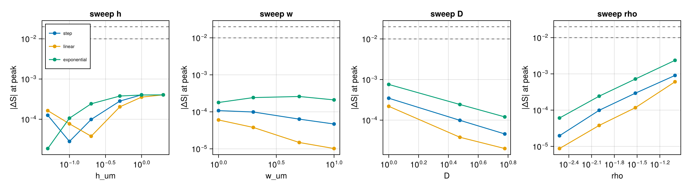

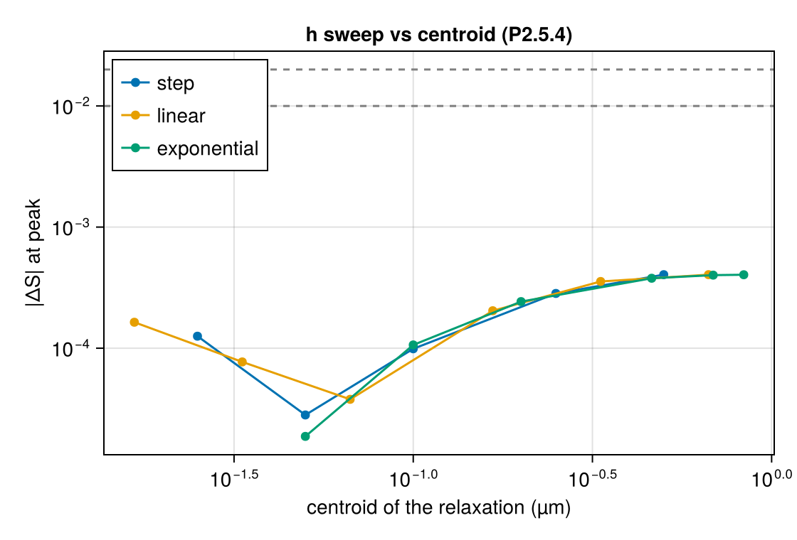

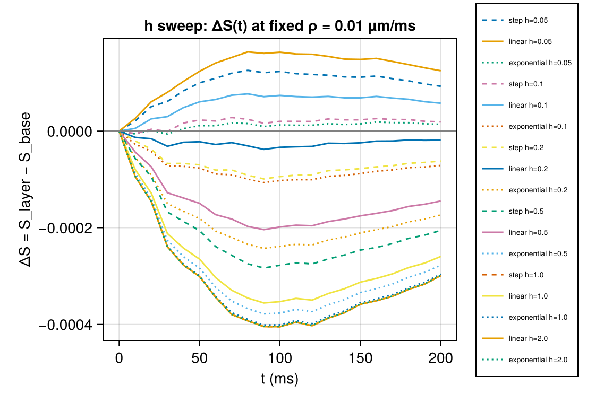

**Profile vs profile at fixed ρ** (`profile_pairs.csv`; paired over seeds where both runs share τ, which is every pair except those with the linear profile at ρ = 0.1, which use combined SEM). Of 40 distinct pairs (shape pair × configuration), 39 separate beyond 3σ in the Monte Carlo (|z| = 3.1–75). The exception is linear − exponential at h = 2, where both are near-uniform (−7e-7, z = −2.3). Peak pair differences at ρ = 0.01: step − linear −4e-5 to −1.3e-4, step − exponential +8e-5 to +4.1e-4, linear − exponential +1.2e-4 to +5.4e-4 (largest at D = 1). The largest overall is linear − exponential +1.66e-3 ± 7e-5 at ρ = 0.1. Every pair difference is below the SNR-200 threshold (0.01).

> **Superseded in part (Review C1):** magnitudes for h ≤ 0.2, the thin-layer sign and the sign change come from timestep-biased Monte Carlo; see "Review C1 follow-up" for the corrected values.

**Summary (P2.5.5), numbers only.**
- **Counts.** 50 rows in four sweeps; the reference point appears in every sweep, so there are **41 distinct configurations**. None of them reaches either MRI threshold: 0 at SNR 100, 0 at SNR 200, 32 MC-resolved only, 9 not resolved. The two borderline MC rows (step w = 5: 3.2 SEM; step D = 6: 3.1 SEM) come from the peak of 21 readouts, which slightly favours the threshold.
- **Largest layer vs conventional difference.** −2.37e-3 ± 4e-5 (exponential, ρ = 0.1, first readout 10 ms; S ≈ 0.37 there, so 0.6 % of the signal). That is 0.47σ of single-measurement noise at SNR 200, against the 2σ threshold. |ΔS| still falls from 10 to 50 ms, so the true peak lies before 10 ms and is somewhat larger than measured.
- **Profiles separate from each other in MC, not at MRI noise.** Step, linear and exponential at the same (ρ, h, w, D) differ beyond 3σ in 39 of 40 pairs (see above), by at most 1.66e-3.
- **h.** Signed ΔS goes from positive for thin layers (up to +1.6e-4, linear h = 0.05) to −4.0e-4 in the uniform limit (step h = w/2, linear h = w, exponential h = w). |ΔS| is therefore not monotone in h: it passes near zero around h = 0.1–0.2.
- **Centroid (P2.5.4).** Plotted against the profile centroid (step h/2, linear h/3, exponential truncated at w), the three shapes fall on one curve within noise (largest offset from an interpolated neighbour ≈ 3.6e-5 ≈ 1.3 combined SEM). Points with h ≥ 1 sit in the uniform limit, where agreement is trivial. Among MC-resolved points the sign change lies between centroids 0.033 µm (linear h = 0.1, positive) and 0.1 µm (step h = 0.2 and exponential h = 0.1, negative). The pairwise differences above are real (resolved) but small compared with the change along the centroid axis.
- **w.** At h = 0.2, the step and linear differences fall with w (step 1.1e-4 → 4.7e-5, linear 6.0e-5 → 1.0e-5 for w = 1 → 10). The exponential stays at 1.8–2.6e-4: its cutoff = w makes its tail and centroid grow with w.
- **D.** For step and exponential the difference falls roughly as 1/D (exponential −7.6e-4, −2.4e-4, −1.2e-4; step −3.5e-4, −9.9e-5, −4.6e-5 for D = 1, 3, 6). Linear does not follow this: −2.2e-4, −3.8e-5, then +2.0e-5 (sign change, unresolved) at D = 6.
- **ρ.** Roughly linear between ρ = 0.01 and 0.1: ×9.8 (exponential) and ×9.2 (step) per decade. The ρ = 0.003 points are noisy (exponential 6 SEM, step not resolved), and the peaks fall at different times (90, 30, 10 ms), the ρ = 0.1 one at the first readout.
- **Shape of the decay.** Every layer curve stays mono-exponential within ≤ 1.4e-4 (largest residual of the best mono-exponential fit; the baseline's |curvature| ≤ 3.6e-8 ms⁻²). For a single condition, a conventional model with a fitted θ would therefore absorb these differences: the distribution of the relaxation is not separable from its strength by the curve shape. A joint fit across several D or w was not tested.
- **Extrapolation (not simulated).** Assuming linear growth in ρ and the measured ×3 from D = 3 to 1, |ΔS| would reach the SNR-200 threshold (0.01) near ρ ≈ 0.4 µm/ms at D = 3, or ≈ 0.14 µm/ms at D = 1 (exponential, h = 0.2, w = 2). At those ρ the mean rate 2ρ/w is 0.4 ms⁻¹ (resp. 0.14), so the peak would fall well before 10 ms and need a finer readout grid. Because the measured peak at ρ = 0.1 is an underestimate, these ρ are upper bounds on what is needed. This is a candidate region for Phase 3 (curved geometry, smaller compartments, stronger relaxation), not a result.
- **Grid note.** P2.5.2 asked for h/w 0.01–0.5; the run covered 0.025–1 (h = 0.05–2 at w = 2), adding the overlapping, uniform-limit range for the linear and exponential profiles.

## P2.5.6 prerequisite: spin echo = free decay (walls, no off-resonance)

Script [p2_5_t2_spin_echo_check.jl](phase2/p2_5_t2_spin_echo_check.jl) → [results/phase2/p2_5_t2_spin_echo_check/](results/phase2/p2_5_t2_spin_echo_check/). MRIBuilder `SpinEcho(TE = 50, TR = 1000, scanner = Siemens_Prisma, excitation = (phase = 90,))` with instantaneous pulses, as in Rep2, vs free decay; w = 2, h = 0.2, D = 3, ρ = 1/70, R₂_bulk = 1/2000; seeds 1–10, 50000 spins.

| model | S_SE(50) | S_free(50) | combined SEM | z | Outcome |
|---|---|---|---|---|---|
| conventional | 0.477950 | 0.477950 | 4.3e-05 | -0.00 | **PASS** |
| exponential | 0.477652 | 0.477652 | 1.5e-05 | +0.00 | **PASS** |

The two signals agree to all printed digits: with no off-resonance the refocusing pulse leaves |M⊥| unchanged, and the sequence adds no diffusion weighting here. Free decay therefore stands in for the paper's idealised spin echo in P2.5.6/P2.5.7. S(50) ≈ 0.478 gives T₂_app ≈ 67.7 ms, close to 1/(1/2000 + 2ρ/w) = 67.6 ms.

## P2.5.7: apparent T₂ vs echo time (Fig. 8A analogue)

Plan [2026-10-12-apparent-t2.md](../docs/superpowers/plans/2026-10-12-apparent-t2.md). Paper: Cottaar, Zheng, Miller et al., *Imaging Neuroscience* 4 (2026), Fig. 8A (T₂ from an idealised spin echo vs TE per compartment, without / with surface relaxation; the off-resonance part is not modelled here). Runner [p2_5_t2_apparent.jl](phase2/p2_5_t2_apparent.jl) (`SWEEP=te`, `MATCH=h` / `centroid`) → `results/phase2/p2_5_t2_te[_centroid]/`; summary [p2_5_t2_summary.jl](phase2/p2_5_t2_summary.jl) → [results/phase2/p2_5_t2_summary/](results/phase2/p2_5_t2_summary/).

**Method.**
- T₂_app(TE) = −TE/ln(S(TE)/S(0)) per seed, at TE = 5:5:200 ms. Free decay stands in for the spin echo (equal to 6 digits, P2.5.6 prerequisite).
- R₂_bulk = 1/2000 ms⁻¹ (intrinsic T₂ = 2 s, as in the paper). ρ = 1/70 µm/ms, so 2ρ/w = 1/70 at w = 2: the paper's tissue T₂ of ≈ 70 ms. D = 3. Conventional θ = ρ√(π/D).
- Walls w = 1, 2, 5 µm stand in for compartments with different S/V (2, 1, 0.4 µm⁻¹).
- Profiles at the **same ρ and the same h** (h = 0.2, plus 0.05 and 0.5 at w = 2), and in a sub-test at the **same ρ and the same centroid** c̄ (0.1, plus 0.025 and 0.25 at w = 2).
- Paired per seed on identical trajectories; seeds 1–10, 50000 spins. Without surface relaxation, T₂ = 2000 ms exactly.

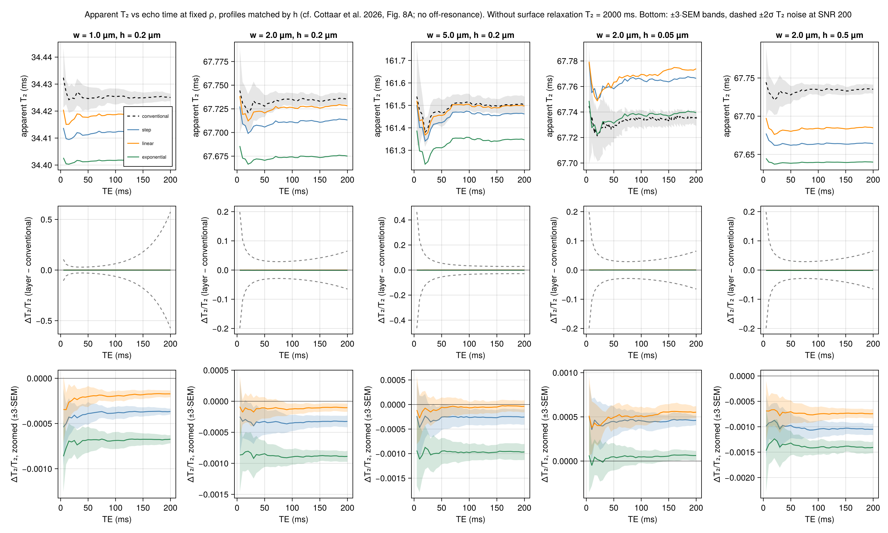

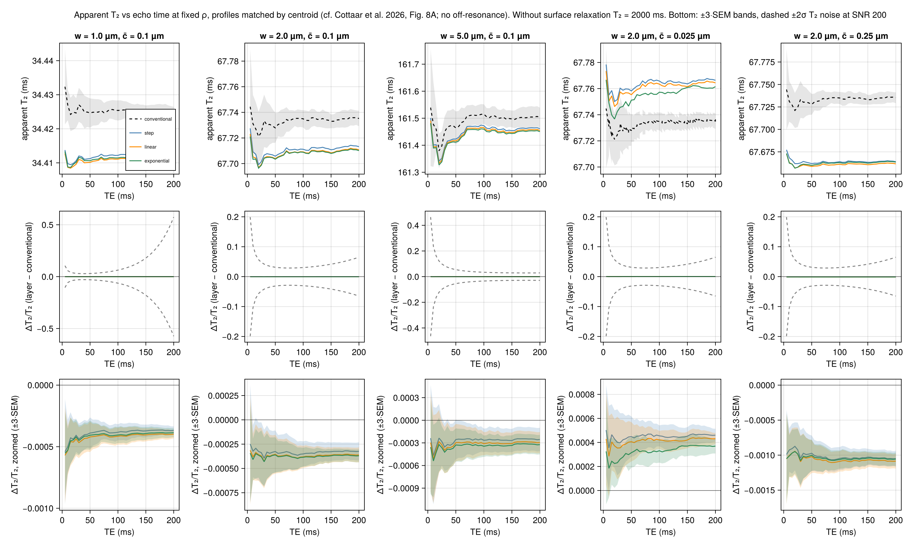

**Same h** (selected TE; full curves in the figure).

| w (µm) | h (µm) | TE (ms) | T₂ conventional (ms) | ΔT₂/T₂ step | ΔT₂/T₂ linear | ΔT₂/T₂ exponential | 2σ_T₂/T₂ at SNR 200 |
|---|---|---|---|---|---|---|---|
| 1 | 0.2 | 5 | 34.43 | -5.4e-04 ± 1e-04 | -3.4e-04 ± 1e-04 | -8.6e-04 ± 1e-04 | 0.105 |
| 1 | 0.2 | 20 | 34.42 | -4.4e-04 ± 5e-05 | -2.5e-04 ± 5e-05 | -7.0e-04 ± 6e-05 | 0.035 |
| 1 | 0.2 | 50 | 34.42 | -3.9e-04 ± 4e-05 | -2.0e-04 ± 4e-05 | -6.8e-04 ± 5e-05 | 0.030 |
| 1 | 0.2 | 100 | 34.43 | -3.8e-04 ± 2e-05 | -1.9e-04 ± 2e-05 | -6.9e-04 ± 3e-05 | 0.063 |
| 1 | 0.2 | 200 | 34.43 | -3.7e-04 ± 1e-05 | -1.7e-04 ± 1e-05 | -6.7e-04 ± 1e-05 | 0.574 |
| 2 | 0.05 | 5 | 67.74 | +5.0e-04 ± 1e-04 | +5.1e-04 ± 2e-04 | +6.4e-05 ± 1e-04 | 0.199 |
| 2 | 0.05 | 20 | 67.72 | +4.3e-04 ± 8e-05 | +4.0e-04 ± 8e-05 | +1.8e-05 ± 6e-05 | 0.057 |
| 2 | 0.05 | 50 | 67.73 | +4.5e-04 ± 6e-05 | +4.9e-04 ± 5e-05 | +4.9e-05 ± 5e-05 | 0.031 |
| 2 | 0.05 | 100 | 67.73 | +4.5e-04 ± 3e-05 | +5.1e-04 ± 3e-05 | +4.6e-05 ± 2e-05 | 0.030 |
| 2 | 0.05 | 200 | 67.74 | +4.6e-04 ± 2e-05 | +5.5e-04 ± 2e-05 | +6.3e-05 ± 2e-05 | 0.065 |
| 2 | 0.2 | 5 | 67.74 | -2.5e-04 ± 2e-04 | -8.8e-05 ± 2e-04 | -8.7e-04 ± 2e-04 | 0.199 |
| 2 | 0.2 | 20 | 67.72 | -3.2e-04 ± 1e-04 | -1.3e-04 ± 7e-05 | -8.1e-04 ± 1e-04 | 0.057 |
| 2 | 0.2 | 50 | 67.73 | -3.3e-04 ± 7e-05 | -1.1e-04 ± 6e-05 | -8.5e-04 ± 7e-05 | 0.031 |
| 2 | 0.2 | 100 | 67.73 | -3.5e-04 ± 4e-05 | -1.2e-04 ± 3e-05 | -9.0e-04 ± 4e-05 | 0.030 |
| 2 | 0.2 | 200 | 67.74 | -3.2e-04 ± 3e-05 | -1.0e-04 ± 2e-05 | -8.9e-04 ± 3e-05 | 0.065 |
| 2 | 0.5 | 5 | 67.74 | -9.9e-04 ± 2e-04 | -6.9e-04 ± 2e-04 | -1.5e-03 ± 3e-04 | 0.199 |
| 2 | 0.5 | 20 | 67.72 | -8.7e-04 ± 1e-04 | -6.6e-04 ± 1e-04 | -1.2e-03 ± 1e-04 | 0.057 |
| 2 | 0.5 | 50 | 67.73 | -9.7e-04 ± 8e-05 | -7.0e-04 ± 8e-05 | -1.3e-03 ± 8e-05 | 0.031 |
| 2 | 0.5 | 100 | 67.73 | -1.0e-03 ± 5e-05 | -7.5e-04 ± 5e-05 | -1.4e-03 ± 5e-05 | 0.030 |
| 2 | 0.5 | 200 | 67.74 | -1.1e-03 ± 4e-05 | -7.4e-04 ± 3e-05 | -1.4e-03 ± 4e-05 | 0.065 |
| 5 | 0.2 | 5 | 161.54 | -2.4e-04 ± 2e-04 | -1.1e-04 ± 2e-04 | -9.4e-04 ± 2e-04 | 0.464 |
| 5 | 0.2 | 20 | 161.38 | -2.4e-04 ± 2e-04 | -7.5e-05 ± 1e-04 | -8.7e-04 ± 1e-04 | 0.122 |
| 5 | 0.2 | 50 | 161.46 | -2.6e-04 ± 9e-05 | -5.6e-05 ± 7e-05 | -9.5e-04 ± 9e-05 | 0.055 |
| 5 | 0.2 | 100 | 161.52 | -2.7e-04 ± 5e-05 | -6.7e-05 ± 4e-05 | -9.8e-04 ± 6e-05 | 0.034 |
| 5 | 0.2 | 200 | 161.50 | -2.5e-04 ± 5e-05 | -3.7e-05 ± 4e-05 | -9.7e-04 ± 5e-05 | 0.029 |

**Same centroid** (selected TE; full curves in the figure).

| w (µm) | c̄ (µm) | TE (ms) | T₂ conventional (ms) | ΔT₂/T₂ step | ΔT₂/T₂ linear | ΔT₂/T₂ exponential | 2σ_T₂/T₂ at SNR 200 |
|---|---|---|---|---|---|---|---|
| 1 | 0.1 | 5 | 34.43 | -5.4e-04 ± 1e-04 | -5.7e-04 ± 1e-04 | -5.5e-04 ± 1e-04 | 0.105 |
| 1 | 0.1 | 20 | 34.42 | -4.4e-04 ± 5e-05 | -4.6e-04 ± 5e-05 | -4.5e-04 ± 5e-05 | 0.035 |
| 1 | 0.1 | 50 | 34.42 | -3.9e-04 ± 4e-05 | -4.2e-04 ± 4e-05 | -4.1e-04 ± 4e-05 | 0.030 |
| 1 | 0.1 | 100 | 34.43 | -3.8e-04 ± 2e-05 | -4.2e-04 ± 2e-05 | -4.1e-04 ± 2e-05 | 0.063 |
| 1 | 0.1 | 200 | 34.43 | -3.7e-04 ± 1e-05 | -4.0e-04 ± 1e-05 | -3.9e-04 ± 1e-05 | 0.574 |
| 2 | 0.025 | 5 | 67.74 | +5.0e-04 ± 1e-04 | +4.3e-04 ± 1e-04 | +3.3e-04 ± 1e-04 | 0.199 |
| 2 | 0.025 | 20 | 67.72 | +4.3e-04 ± 8e-05 | +3.7e-04 ± 7e-05 | +2.3e-04 ± 7e-05 | 0.057 |
| 2 | 0.025 | 50 | 67.73 | +4.5e-04 ± 6e-05 | +4.1e-04 ± 5e-05 | +3.1e-04 ± 4e-05 | 0.031 |
| 2 | 0.025 | 100 | 67.73 | +4.5e-04 ± 3e-05 | +4.2e-04 ± 2e-05 | +3.3e-04 ± 3e-05 | 0.030 |
| 2 | 0.025 | 200 | 67.74 | +4.6e-04 ± 2e-05 | +4.3e-04 ± 2e-05 | +3.7e-04 ± 2e-05 | 0.065 |
| 2 | 0.1 | 5 | 67.74 | -2.5e-04 ± 2e-04 | -3.1e-04 ± 2e-04 | -3.4e-04 ± 2e-04 | 0.199 |
| 2 | 0.1 | 20 | 67.72 | -3.2e-04 ± 1e-04 | -3.6e-04 ± 9e-05 | -3.6e-04 ± 8e-05 | 0.057 |
| 2 | 0.1 | 50 | 67.73 | -3.3e-04 ± 7e-05 | -3.5e-04 ± 7e-05 | -3.6e-04 ± 6e-05 | 0.031 |
| 2 | 0.1 | 100 | 67.73 | -3.5e-04 ± 4e-05 | -3.8e-04 ± 4e-05 | -3.8e-04 ± 3e-05 | 0.030 |
| 2 | 0.1 | 200 | 67.74 | -3.2e-04 ± 3e-05 | -3.6e-04 ± 3e-05 | -3.7e-04 ± 2e-05 | 0.065 |
| 2 | 0.25 | 5 | 67.74 | -9.9e-04 ± 2e-04 | -1.1e-03 ± 2e-04 | -1.0e-03 ± 2e-04 | 0.199 |
| 2 | 0.25 | 20 | 67.72 | -8.7e-04 ± 1e-04 | -9.4e-04 ± 1e-04 | -9.5e-04 ± 1e-04 | 0.057 |
| 2 | 0.25 | 50 | 67.73 | -9.7e-04 ± 8e-05 | -1.0e-03 ± 8e-05 | -1.0e-03 ± 7e-05 | 0.031 |
| 2 | 0.25 | 100 | 67.73 | -1.0e-03 ± 5e-05 | -1.1e-03 ± 5e-05 | -1.1e-03 ± 4e-05 | 0.030 |
| 2 | 0.25 | 200 | 67.74 | -1.1e-03 ± 4e-05 | -1.1e-03 ± 4e-05 | -1.1e-03 ± 3e-05 | 0.065 |
| 5 | 0.1 | 5 | 161.54 | -2.4e-04 ± 2e-04 | -3.0e-04 ± 2e-04 | -3.6e-04 ± 2e-04 | 0.464 |
| 5 | 0.1 | 20 | 161.38 | -2.4e-04 ± 2e-04 | -2.8e-04 ± 1e-04 | -3.2e-04 ± 1e-04 | 0.122 |
| 5 | 0.1 | 50 | 161.46 | -2.6e-04 ± 9e-05 | -3.0e-04 ± 8e-05 | -3.3e-04 ± 7e-05 | 0.055 |
| 5 | 0.1 | 100 | 161.52 | -2.7e-04 ± 5e-05 | -3.1e-04 ± 5e-05 | -3.4e-04 ± 5e-05 | 0.034 |
| 5 | 0.1 | 200 | 161.50 | -2.5e-04 ± 5e-05 | -3.0e-04 ± 5e-05 | -3.2e-04 ± 4e-05 | 0.029 |

> **Superseded in part (Review C1):** the thin-layer "longer T₂" and the sizes of ΔT₂/T₂ for h ≤ 0.2 come from timestep-biased Monte Carlo; see "Review C1 follow-up" for the corrected values.

**Interpretation (numbers only).**
- **T₂_app vs TE.** For every model and configuration T₂_app is nearly flat in TE: it varies by ≤ 0.16 ms over 5–200 ms and ≤ 0.082 ms beyond 30 ms (most of the change between 5 and 30 ms, where the two-point estimate is noisiest), on top of T₂ ≈ 34.4, 67.7 and 161.5 ms for w = 1, 2, 5. The conventional model and all three profiles show the same TE trend.
- **Profile effect vs TE.** ΔT₂/T₂ is constant in TE within its ±3·SEM band beyond ≈ 30 ms. Same h: from +5e-4 (h = 0.05, step and linear; the exponential ≈ 0 there) to −1.3e-3 (h = 0.5, exponential, TE = 50; ≈ −1.4e-3 at long TE). Same centroid: the three profiles lie within each other's bands, ≲ 2e-4 apart (largest: step − exponential 2.2e-4 at w = 2, c̄ = 0.025, ≈ 2σ).
- **Against noise.** All differences are ≥ 20× below the two-point T₂ noise at SNR 200 (2σ_T₂/T₂ ≥ 0.03 at TE ≈ 50–100 ms, and much larger at short and long TE).

## P2.5.6: apparent T₂ vs microstructure (Fig. 9 analogue)

Paper Fig. 9: T₂ (spin echo, TE = 50 ms) vs (A) axon radius, (B) axonal volume fraction, (C) myelin loss, (D) angle to B₀. Walls have an analogue only for A: the wall spacing w, which sets S/V = 2/w. Added for this model: the layer thickness h (or the centroid c̄), D and ρ. B, C and D are not done (they need two compartments, myelin or off-resonance). Same runner and summary (`SWEEP` = w, h | c, D, rho), TE = 20, 50, 100; the reference point and settings as above.

Observability: the two-point T₂ noise σ_T₂/T₂ = √(1 + r²)/(SNR·r·|ln r|), with r = S(TE)/S(0). "Observable at SNR X" means |ΔT₂/T₂| ≥ 2σ_T₂/T₂; "MC only" means ≥ 3 paired SEM but below both thresholds.

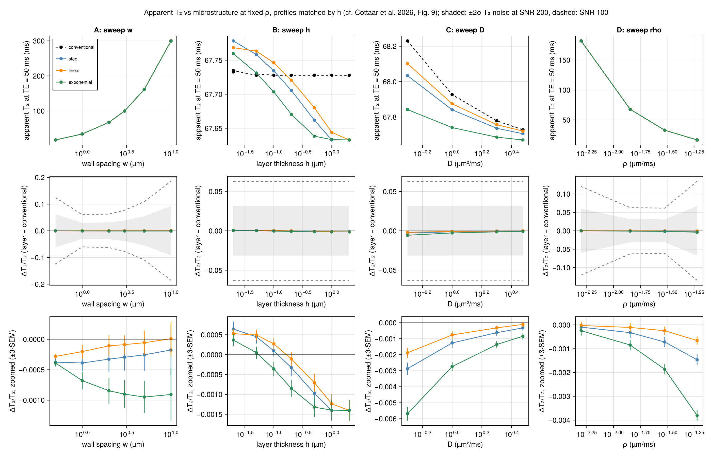

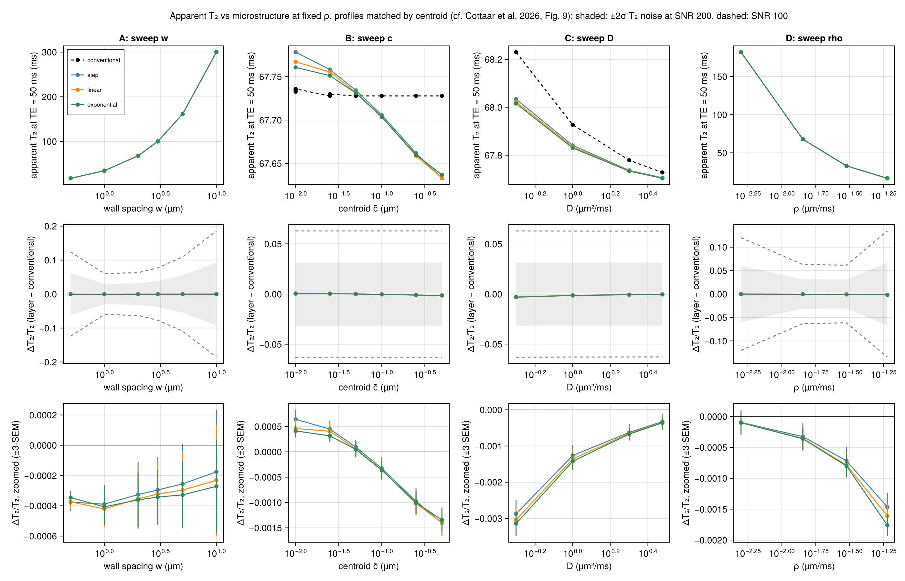

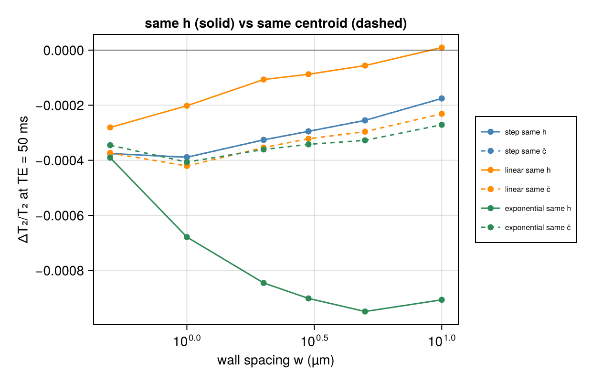

**Same h, TE = 50 ms.**

*Sweep w.*

| w (µm) | T₂ conventional (ms) | ΔT₂/T₂ step | ΔT₂/T₂ linear | ΔT₂/T₂ exponential | 2σ_T₂/T₂ at SNR 200 | levels |
|---|---|---|---|---|---|---|
| 0.5 | 17.36 | -3.8e-04 ± 2e-05 | -2.8e-04 ± 1e-05 | -3.9e-04 ± 2e-05 | 0.062 | MC only |
| 1 | 34.42 | -3.9e-04 ± 4e-05 | -2.0e-04 ± 4e-05 | -6.8e-04 ± 5e-05 | 0.030 | MC only |
| 2 | 67.73 | -3.3e-04 ± 7e-05 | -1.1e-04 ± 6e-05 | -8.5e-04 ± 7e-05 | 0.031 | MC only, not resolved |
| 3 | 99.97 | -2.9e-04 ± 7e-05 | -8.8e-05 ± 5e-05 | -9.0e-04 ± 8e-05 | 0.039 | MC only, not resolved |
| 5 | 161.46 | -2.6e-04 ± 9e-05 | -5.6e-05 ± 7e-05 | -9.5e-04 ± 9e-05 | 0.055 | MC only, not resolved |
| 10 | 299.85 | -1.8e-04 ± 1e-04 | +9.2e-06 ± 9e-05 | -9.1e-04 ± 1e-04 | 0.093 | MC only, not resolved |

*Sweep h.*

| h (µm) | T₂ conventional (ms) | ΔT₂/T₂ step | ΔT₂/T₂ linear | ΔT₂/T₂ exponential | 2σ_T₂/T₂ at SNR 200 | levels |
|---|---|---|---|---|---|---|
| 0.02 | 67.73 | +6.4e-04 ± 6e-05 | +5.3e-04 ± 4e-05 | +3.7e-04 ± 5e-05 | 0.031 | MC only |
| 0.05 | 67.73 | +4.5e-04 ± 6e-05 | +4.9e-04 ± 5e-05 | +4.9e-05 ± 5e-05 | 0.031 | MC only, not resolved |
| 0.1 | 67.73 | +9.5e-05 ± 5e-05 | +2.7e-04 ± 5e-05 | -3.6e-04 ± 6e-05 | 0.031 | MC only, not resolved |
| 0.2 | 67.73 | -3.3e-04 ± 7e-05 | -1.1e-04 ± 6e-05 | -8.5e-04 ± 7e-05 | 0.031 | MC only, not resolved |
| 0.5 | 67.73 | -9.7e-04 ± 8e-05 | -7.0e-04 ± 8e-05 | -1.3e-03 ± 8e-05 | 0.031 | MC only |
| 1 | 67.73 | -1.4e-03 ± 9e-05 | -1.2e-03 ± 8e-05 | -1.4e-03 ± 8e-05 | 0.031 | MC only |
| 2 | 67.73 | — | -1.4e-03 ± 9e-05 | -1.4e-03 ± 9e-05 | 0.031 | MC only |

*Sweep D.*

| D (µm²/ms) | T₂ conventional (ms) | ΔT₂/T₂ step | ΔT₂/T₂ linear | ΔT₂/T₂ exponential | 2σ_T₂/T₂ at SNR 200 | levels |
|---|---|---|---|---|---|---|
| 0.5 | 68.23 | -2.9e-03 ± 1e-04 | -1.9e-03 ± 1e-04 | -5.7e-03 ± 1e-04 | 0.032 | MC only |
| 1 | 67.93 | -1.3e-03 ± 1e-04 | -7.6e-04 ± 8e-05 | -2.7e-03 ± 1e-04 | 0.031 | MC only |
| 2 | 67.78 | -6.2e-04 ± 7e-05 | -3.2e-04 ± 4e-05 | -1.4e-03 ± 8e-05 | 0.031 | MC only |
| 3 | 67.73 | -3.3e-04 ± 7e-05 | -1.1e-04 ± 6e-05 | -8.5e-04 ± 7e-05 | 0.031 | MC only, not resolved |

*Sweep rho.*

| ρ (µm/ms) | T₂ conventional (ms) | ΔT₂/T₂ step | ΔT₂/T₂ linear | ΔT₂/T₂ exponential | 2σ_T₂/T₂ at SNR 200 | levels |
|---|---|---|---|---|---|---|
| 0.005 | 181.89 | -9.5e-05 ± 7e-05 | -2.6e-05 ± 5e-05 | -2.5e-04 ± 7e-05 | 0.060 | MC only, not resolved |
| 0.0142857 | 67.73 | -3.3e-04 ± 7e-05 | -1.1e-04 ± 6e-05 | -8.5e-04 ± 7e-05 | 0.031 | MC only, not resolved |
| 0.03 | 32.89 | -7.2e-04 ± 7e-05 | -2.5e-04 ± 6e-05 | -1.9e-03 ± 7e-05 | 0.031 | MC only |
| 0.06 | 16.63 | -1.5e-03 ± 7e-05 | -6.6e-04 ± 6e-05 | -3.8e-03 ± 7e-05 | 0.067 | MC only |

**Same centroid, TE = 50 ms.**

*Sweep w.*

| w (µm) | T₂ conventional (ms) | ΔT₂/T₂ step | ΔT₂/T₂ linear | ΔT₂/T₂ exponential | 2σ_T₂/T₂ at SNR 200 | levels |
|---|---|---|---|---|---|---|
| 0.5 | 17.36 | -3.8e-04 ± 2e-05 | -3.7e-04 ± 2e-05 | -3.5e-04 ± 2e-05 | 0.062 | MC only |
| 1 | 34.42 | -3.9e-04 ± 4e-05 | -4.2e-04 ± 4e-05 | -4.1e-04 ± 4e-05 | 0.030 | MC only |
| 2 | 67.73 | -3.3e-04 ± 7e-05 | -3.5e-04 ± 7e-05 | -3.6e-04 ± 6e-05 | 0.031 | MC only |
| 3 | 99.97 | -2.9e-04 ± 7e-05 | -3.2e-04 ± 7e-05 | -3.4e-04 ± 6e-05 | 0.039 | MC only |
| 5 | 161.46 | -2.6e-04 ± 9e-05 | -3.0e-04 ± 8e-05 | -3.3e-04 ± 7e-05 | 0.055 | MC only, not resolved |
| 10 | 299.85 | -1.8e-04 ± 1e-04 | -2.3e-04 ± 1e-04 | -2.7e-04 ± 1e-04 | 0.093 | not resolved |

*Sweep c.*

| c̄ (µm) | T₂ conventional (ms) | ΔT₂/T₂ step | ΔT₂/T₂ linear | ΔT₂/T₂ exponential | 2σ_T₂/T₂ at SNR 200 | levels |
|---|---|---|---|---|---|---|
| 0.01 | 67.73 | +6.4e-04 ± 6e-05 | +4.6e-04 ± 6e-05 | +4.1e-04 ± 4e-05 | 0.031 | MC only |
| 0.025 | 67.73 | +4.5e-04 ± 6e-05 | +4.1e-04 ± 5e-05 | +3.1e-04 ± 4e-05 | 0.031 | MC only |
| 0.05 | 67.73 | +9.5e-05 ± 5e-05 | +5.7e-05 ± 5e-05 | +4.9e-05 ± 5e-05 | 0.031 | not resolved |
| 0.1 | 67.73 | -3.3e-04 ± 7e-05 | -3.5e-04 ± 7e-05 | -3.6e-04 ± 6e-05 | 0.031 | MC only |
| 0.25 | 67.73 | -9.7e-04 ± 8e-05 | -1.0e-03 ± 8e-05 | -1.0e-03 ± 7e-05 | 0.031 | MC only |
| 0.5 | 67.73 | -1.4e-03 ± 9e-05 | -1.4e-03 ± 8e-05 | -1.3e-03 ± 8e-05 | 0.031 | MC only |

*Sweep D.*

| D (µm²/ms) | T₂ conventional (ms) | ΔT₂/T₂ step | ΔT₂/T₂ linear | ΔT₂/T₂ exponential | 2σ_T₂/T₂ at SNR 200 | levels |
|---|---|---|---|---|---|---|
| 0.5 | 68.23 | -2.9e-03 ± 1e-04 | -3.0e-03 ± 1e-04 | -3.1e-03 ± 1e-04 | 0.032 | MC only |
| 1 | 67.93 | -1.3e-03 ± 1e-04 | -1.4e-03 ± 9e-05 | -1.4e-03 ± 8e-05 | 0.031 | MC only |
| 2 | 67.78 | -6.2e-04 ± 7e-05 | -6.5e-04 ± 6e-05 | -6.7e-04 ± 5e-05 | 0.031 | MC only |
| 3 | 67.73 | -3.3e-04 ± 7e-05 | -3.5e-04 ± 7e-05 | -3.6e-04 ± 6e-05 | 0.031 | MC only |

*Sweep rho.*

| ρ (µm/ms) | T₂ conventional (ms) | ΔT₂/T₂ step | ΔT₂/T₂ linear | ΔT₂/T₂ exponential | 2σ_T₂/T₂ at SNR 200 | levels |
|---|---|---|---|---|---|---|
| 0.005 | 181.89 | -9.5e-05 ± 7e-05 | -1.0e-04 ± 6e-05 | -1.0e-04 ± 6e-05 | 0.060 | not resolved |
| 0.0142857 | 67.73 | -3.3e-04 ± 7e-05 | -3.5e-04 ± 7e-05 | -3.6e-04 ± 6e-05 | 0.031 | MC only |
| 0.03 | 32.89 | -7.2e-04 ± 7e-05 | -7.9e-04 ± 7e-05 | -8.0e-04 ± 6e-05 | 0.031 | MC only |
| 0.06 | 16.63 | -1.5e-03 ± 7e-05 | -1.6e-03 ± 7e-05 | -1.8e-03 ± 6e-05 | 0.067 | MC only |

> **Superseded in part (Review C1):** magnitudes for h ≤ 0.2, the thin-layer sign and the sign change come from timestep-biased Monte Carlo; see "Review C1 follow-up" for the corrected values.

**Interpretation (numbers only).**
- **Conventional model (Fig. 9A analogue).** T₂_app rises with the compartment size, as in the paper (T₂ ↑ with axon diameter through S/V): 17.36, 34.42, 67.73, 99.97, 161.46 and 299.85 ms for w = 0.5, 1, 2, 3, 5, 10 µm. It falls with ρ (181.89, 67.73, 32.89, 16.63 ms for ρ = 0.005, 1/70, 0.03, 0.06) and decreases slightly with D (68.23 → 67.73 ms for D = 0.5 → 3). All values are close to 1/(1/2000 + 2ρ/w).
- **Profiles at the same h.** At TE = 50, ΔT₂/T₂ (layer − conventional) ranges from +6.4e-4 (step, h = 0.02) to −5.7e-3 (exponential, D = 0.5). The profiles separate clearly, mostly in the order exponential most negative, linear least (exceptions: at h = 0.02 step +6.4e-4 is above linear +5.3e-4; in the uniform limit, h ≥ 1 or w = 0.5, step and exponential tie). Of 52 distinct profile pairs, 34 differ beyond 3 combined SEM; the largest pair difference is 3.8e-3 (exponential − linear, D = 0.5, z = 21).
- **Profiles at the same centroid.** The three profiles nearly coincide. Of 51 distinct pairs, 2 differ beyond 3 combined SEM, with the largest pair difference 2.9e-4 (step − exponential, ρ = 0.06, z = 3.1). The combined SEM is unpaired: the profile runs share seeds, so their errors are positively correlated and a paired test (per-seed T₂, not stored) could resolve more of these small residuals. The difference from the conventional model remains and follows the centroid: positive at c̄ = 0.01–0.025 µm (up to +6.4e-4), unresolved at c̄ = 0.05 (≤ 1.9σ), negative from c̄ = 0.1 µm (≈ −3.5e-4), down to −1.4e-3 at c̄ = 0.5 and −3.1e-3 at D = 0.5; the resolved sign change lies between c̄ = 0.025 and 0.1 µm. Matching the centroid removes most of the profile spread (largest pair difference 3.8e-3 → 2.9e-4; comparison figure). A residual remains, largest in relative terms at small c̄: at c̄ = 0.01 step +6.4e-4 vs exponential +4.1e-4 (z = 3.1), about a third of the effect.
- **Observability.** No configuration reaches the T₂ noise at SNR 100 or 200 under either matching (same h: 53 distinct configurations at TE = 50, 43 MC-only, 10 not resolved; same centroid: 51 distinct, 41 MC-only, 10 not resolved). The largest |ΔT₂/T₂| is -5.7e-03 (exponential, D = 0.5, same h), against 2σ_T₂/T₂ ≈ 0.03 at SNR 200.
- **Trends.** |ΔT₂/T₂| grows with ρ and as D falls, as in P2.5, and depends little on w at fixed centroid (−1.8e-4 to −4.2e-4 for w = 0.5–10).

## Review check (C1): timestep bias of the fixed-ρ profile effect

Independent whole-project review (2026-10-12): an exact 1D continuum solution of the same model on walls gives ΔS = S_layer − S_conv **negative for every h > 0** (→ 0 as h → 0), while P2.5 found positive ΔS for thin layers. The continuum solver (finite-volume eigen-solution of 1D diffusion with ΔR₂(x) for the layer, and a surface sink ρ in the wall cells for the conventional model; reviewer's script, kept in the session scratchpad and to be added as a tested benchmark) is converged: from N = 3000 to 12000 cells ΔS changes by ≤ 1 %.

Script [p2_5_tau_check.jl](phase2/p2_5_tau_check.jl) → [results/phase2/p2_5_tau_check/](results/phase2/p2_5_tau_check/). Same paired comparison as P2.5 at τ = 1e-2, 2.5e-3, 6.25e-4 ms (w = 2, D = 3, ρ = 0.01, R₂_bulk = 0, seeds 1–10, 50000 spins). ΔS at t = 90 ms:

| profile | h (µm) | τ = 1e-2 | τ = 2.5e-3 | τ = 6.25e-4 | continuum (reviewer's script, N = 3000; the committed solver gives values within 1 %) | (MC at 6.25e-4 − continuum)/SEM |
|---|---|---|---|---|---|---|
| step | 0.05 | +1.21e-04 ± 1e-05 | +3.57e-05 ± 1e-05 | -2.14e-05 ± 8e-06 | -3.95e-05 | +2.4 |
| linear | 0.05 | +1.61e-04 ± 1e-05 | +6.54e-05 ± 1e-05 | -9.03e-06 ± 7e-06 | -2.78e-05 | +2.6 |
| step | 0.2 | -9.89e-05 ± 2e-05 | -1.07e-04 ± 1e-05 | -1.42e-04 ± 1e-05 | -1.46e-04 | +0.4 |
| linear | 0.2 | -3.78e-05 ± 1e-05 | -6.23e-05 ± 1e-05 | -9.60e-05 ± 8e-06 | -1.06e-04 | +1.2 |
| exponential | 0.2 | -2.43e-04 ± 2e-05 | -2.44e-04 ± 2e-05 | -2.79e-04 ± 1e-05 | -2.68e-04 | -0.8 |

**Finding: confirmed.** ΔS moves monotonically from the P2.5 value (τ = 1e-2, the value the adopted constraint gives here) toward the continuum value as τ is reduced, and at τ = 6.25e-4 ms it lies within about 1–3 SEM of it. The thin-layer positive ΔS at τ = 1e-2 (+1.2e-4 step, +1.6e-4 linear at h = 0.05) is a **timestep artefact**: the true difference is small and negative. At h = 0.2 the τ = 1e-2 values underestimate |ΔS| by ≈ 30 % (step), ≈ 65 % (linear) and ≈ 10 % (exponential).

**Cause.** The timestep constraint c = 0.005 (P2.6.5) keeps the error in the decay rate R near 0.1 %, which it does. But the profile effect at fixed ρ is itself only ≈ 0.03–0.15 % of R, the same size as that error, and the error depends on the profile. For comparisons of profiles at fixed ρ the timestep must be set by the error in ΔS, not in R.

**Affected claims (corrected in "Review C1 follow-up" below):** P2.5 and P2.5.6/P2.5.7 statements on the thin-layer sign (positive ΔS / longer T₂), the sign change near centroid 0.05 µm, "linear does not follow 1/D", the ρ-scaling per decade, the extrapolated ρ for SNR 200, and the size of |ΔS| and ΔT₂/T₂ for h ≤ 0.2. Not affected: the absence of any configuration reaching the SNR-100/200 thresholds (continuum maximum |ΔS| ≈ 2.7e-3), the mapping θ = ρ√(π/D), and the step, linear and exponential verifications.

## Review C1 follow-up: P2.5 and P2.5.6/7 recomputed with the exact continuum benchmark

**Why.** Review check C1 showed the Monte Carlo fixed-ρ profile effect at the adopted τ is timestep-biased (thin-layer sign flipped, |ΔS| underestimated). The decision (user, 2026-10-13) was to recompute with an exact benchmark rather than rerun at small τ.

**Benchmark.** [continuum.jl](phase2/continuum.jl): the same models on walls solved without Monte Carlo or timestep, as 1D diffusion on [0, w] with reflecting walls and a uniform start. The layer enters as ΔR₂(x) = (ρ/h)[g(x/h) + g((w − x)/h)], both faces, exponential truncated at w and renormalised. The conventional model enters as a surface sink ρ on both walls, ρ = θ√(D/π) (P2.5.0). It uses N = 3000 finite-volume cells (Neumann Laplacian, ΔR₂ cell-averaged by sub-sampling, the sink as ρ/dx in the wall cells) and an eigen-decomposition. The profile code is written independently of the package. Unit tests ([test_continuum.jl](phase2/test/test_continuum.jl)):
- free diffusion and bulk-only are exact;
- step h = w/2 and linear h = w give the exact uniform rate (≤ 2.3e-8 absolute);
- the initial slope is −2ρ/w for every model;
- the lowest conventional rate equals D·k² with k·tan(kw/2) = ρ/D (rtol 1e-3);
- grid convergence: 3000 vs 6000 cells within 2 %; the map's N = 1500 agrees with N = 6000 within 4 % at its extremes.

Script [p2_5_continuum.jl](phase2/p2_5_continuum.jl) and figures [p2_5_continuum_figs.jl](phase2/p2_5_continuum_figs.jl) → [results/phase2/p2_5_continuum/](results/phase2/p2_5_continuum/).

**Validation against Monte Carlo** (converged small-τ runs of C1, and the P2.5 rows with h ≥ 0.5, where τ = 1e-2 is adequate):

| source | profile | h (µm) | Monte Carlo ± SEM | continuum | z |
|---|---|---|---|---|---|
| tau_check τ=6.25e-4 | step | 0.05 | -2.14e-05 ± 8e-06 | -3.92e-05 | +2.3 |
| tau_check τ=6.25e-4 | linear | 0.05 | -9.03e-06 ± 7e-06 | -2.75e-05 | +2.6 |
| tau_check τ=6.25e-4 | step | 0.2 | -1.42e-04 ± 1e-05 | -1.46e-04 | +0.4 |
| tau_check τ=6.25e-4 | linear | 0.2 | -9.60e-05 ± 8e-06 | -1.05e-04 | +1.2 |
| tau_check τ=6.25e-4 | exponential | 0.2 | -2.79e-04 ± 1e-05 | -2.68e-04 | -0.8 |
| P2.5 h sweep τ=1e-2 | step | 0.5 | -2.83e-04 ± 2e-05 | -3.04e-04 | +0.9 |
| P2.5 h sweep τ=1e-2 | linear | 0.5 | -2.04e-04 ± 2e-05 | -2.33e-04 | +1.5 |
| P2.5 h sweep τ=1e-2 | exponential | 0.5 | -3.78e-04 ± 2e-05 | -3.85e-04 | +0.3 |
| P2.5 h sweep τ=1e-2 | step | 1 | -4.05e-04 ± 2e-05 | -4.08e-04 | +0.2 |
| P2.5 h sweep τ=1e-2 | linear | 1 | -3.56e-04 ± 2e-05 | -3.65e-04 | +0.5 |
| P2.5 h sweep τ=1e-2 | exponential | 1 | -4.01e-04 ± 2e-05 | -4.04e-04 | +0.1 |
| P2.5 h sweep τ=1e-2 | linear | 2 | -4.05e-04 ± 2e-05 | -4.08e-04 | +0.2 |
| P2.5 h sweep τ=1e-2 | exponential | 2 | -4.04e-04 ± 2e-05 | -4.08e-04 | +0.2 |

All points agree within 2.6 SEM. Two caveats:
- The two thin-layer points (h = 0.05) both sit on the same side (z = +2.3, +2.6), and their τ trend has not clearly levelled off (step h = 0.05: −8.5e-5 then −5.7e-5 per factor-4 step; a first-order extrapolation lands on the continuum value, a √τ extrapolation overshoots it). The negative sign is established; the thin-layer magnitudes are consistent with, but not independently confirmed by, Monte Carlo.
- Step h = 1 and linear h = 2 are the same uniform model with identical Monte Carlo data, so they count as one comparison.

The continuum is independently checked against an exact non-uniform case (step layer, h < w/2: lowest rate from the matching equation κ·tanh(κh) = k·tan(k(w/2 − h)), agreement to 1.7e-8 relative; review of this follow-up). It therefore stands in for the Monte Carlo values below; the Monte Carlo at τ = 1e-2 stays recorded above as the biased first pass.

**P2.5 corrected (fixed ρ, layer − conventional, readouts 0:10:200).**
- All 41 distinct configurations give **negative ΔS**: at the same ρ the layer always attenuates slightly more than the conventional model, and ΔS → 0 as h → 0. The largest is −2.68e-3 (exponential, h = 0.2, ρ = 0.1). None reaches the SNR-100/200 thresholds (0.02 / 0.01).
- ΔS scales **linearly in ρ** (×9.9–10.0 per decade from 0.01 to 0.1, all profiles) and **as 1/D** for all three profiles (e.g. step −4.39e-4, −1.47e-4, −7.33e-5 for D = 1, 3, 6; linear −3.17e-4, −1.06e-4, −5.29e-5). The earlier "linear does not follow 1/D" was a timestep artefact.
- There is no sign change with h or centroid: |ΔS| rises monotonically from ≈ 0 (thin layers) to the uniform-limit value.

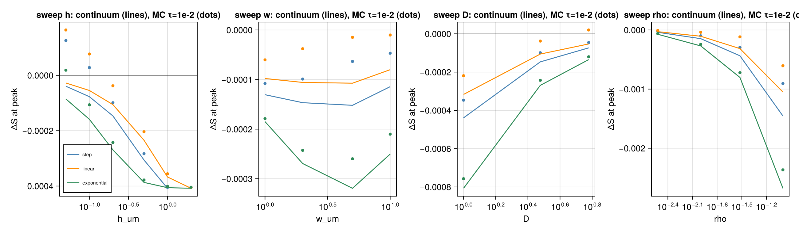

**P2.5.6/7 corrected (apparent T₂, TE = 50; R₂_bulk = 1/2000).**
- Every ΔT₂/T₂ is negative, in both matchings and at every TE. The largest is −6.0e-3 (same h) and −3.5e-3 (same centroid), both exponential at D = 0.5. None reaches the two-point T₂ noise at SNR 200.
- **Centroid matching** (`p2_5_continuum_figs.jl`, distinct configurations, |a − b|/max(|a|, |b|) per profile pair at TE = 50). At the same h the three profiles differ by up to 69 % of the effect (median 46 %, 52 pairs; largest difference 3.65e-3). At the same centroid they agree within 11 % (median 4 %, 51 pairs; largest difference 2.75e-4). The centroid-collapse conclusion holds, now without the timestep bias; the residual is ≈ 10 %.
- **TE.** ΔT₂/T₂ is constant in TE from 30 to 200 ms to within 2e-6. There is no thin-layer "longer T₂".

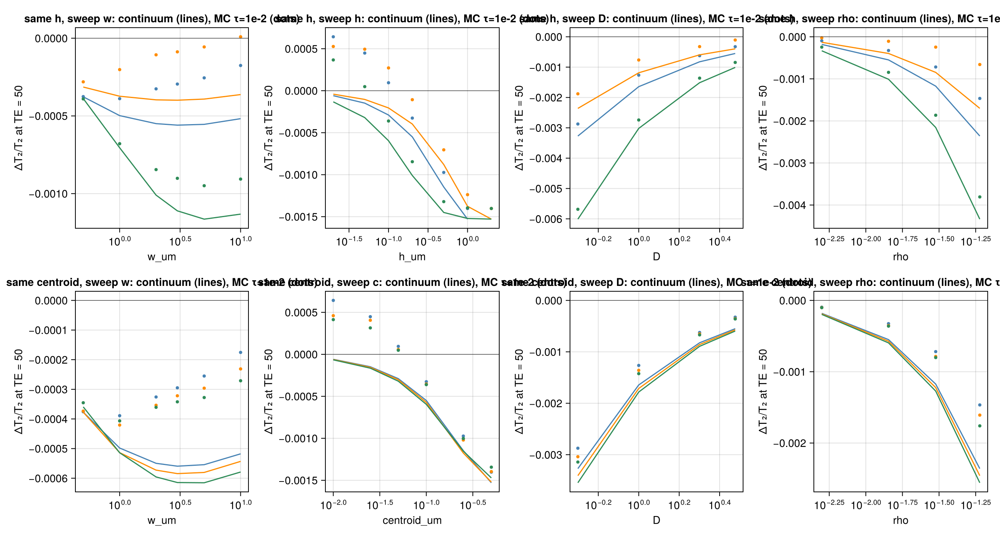

**Wider map (w = 2, D = 3, ρw/D = 0.003–30, h/w = 0.01–0.5; no bulk R₂; 41 readouts from 0 until the conventional signal reaches ≈ 1 %).** Two quantities, each against the single-measurement threshold (0.01 = 2σ at SNR 200):
- max |ΔS| at **fixed ρ** (ρ known);
- the minimax residual after fitting the **conventional model's ρ freely** to the layer curve, which is the realistic test for a single condition. The fit is a coarse scan of ρ_fit over e^−4…e^8 × ρ, then golden-section refinement. (Review of this follow-up: the first version searched only ±1.5 decades and stopped at its edge in 18 rows.)

| profile | h/w | fixed ρ: first ρw/D with max\|ΔS\| ≥ 0.01 | best-fit conventional: first ρw/D with residual ≥ 0.01 |
|---|---|---|---|
| step | 0.01 | 30 | > 30 |
| step | 0.05 | 3 | > 30 |
| step | 0.1 | 0.95 | 30 |
| step | 0.25 | 0.3 | 3 |
| step | 0.5 | 0.3 | 3 |
| linear | 0.01 | > 30 | > 30 |
| linear | 0.05 | 3 | > 30 |
| linear | 0.1 | 0.95 | 30 |
| linear | 0.25 | 0.3 | 9.5 |
| linear | 0.5 | 0.3 | 3 |
| exponential | 0.01 | 3 | > 30 |
| exponential | 0.05 | 0.95 | 9.5 |
| exponential | 0.1 | 0.3 | 3 |
| exponential | 0.25 | 0.3 | 3 |
| exponential | 0.5 | 0.3 | 3 |

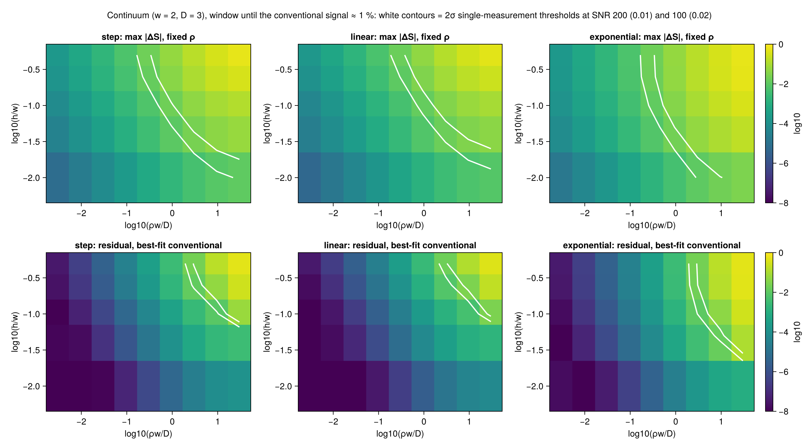

- At fixed ρ the profile effect becomes visible at SNR 200 once ρw/D is about 0.3–1 for layers with h/w ≥ 0.1 (exponential from h/w = 0.05), and later for thinner ones.
- With the conventional model's ρ free, a single free-decay curve separates from it at SNR 200 only for ρw/D ≈ 3–30 with a thick enough layer: from ρw/D ≈ 3 for step and linear at h/w = 0.5, step at 0.25, and exponential at h/w ≥ 0.1; later for thinner layers; not at all within ρw/D ≤ 30 for h/w ≤ 0.05 (step, linear) or 0.01 (all).
- **Why the fit fails there.** In 15 rows (ρw/D ≥ 9.5) the best conventional fit runs to ρ_fit → ∞, i.e. perfectly absorbing walls. A wall sink cannot decay the signal faster than D·π²/w² = 7.40 ms⁻¹ (w = 2, D = 3), whereas a strong layer relaxes spins inside the volume; for example, step h/w = 0.25 at ρw/D = 9.5 decays at 9.36 ms⁻¹. The residual there has converged to its limit: pushing ρ_fit from e^8 to e^16 × ρ changes it by ≤ 0.2 %. Beyond this ceiling no conventional θ can reproduce the layer curve.
- **Caveats.** These are single conditions (one w, D) of free decay on walls, with no bulk R₂. The residual is a maximum over 41 correlated readouts compared with a single-point 2σ threshold, so it indicates rather than calibrates detectability. A joint fit across several w, D or TE at a shared ρ is the stronger test and has not been done.
- All earlier P2.5 runs had ρw/D ≤ 0.07, well inside the region where neither test separates the models.

**Superseded statements.** In the P2.5 and P2.5.6/7 sections above, these statements come from the timestep-biased Monte Carlo and are replaced by this section:
- positive ΔS / longer T₂ for thin layers;
- the sign change near centroid 0.05 µm;
- "linear does not follow 1/D";
- the ρ-scaling per decade and the extrapolated ρ for SNR 200;
- the magnitudes of |ΔS| and ΔT₂/T₂ for h ≤ 0.2.

These are unchanged: no configuration in those sweeps is observable at SNR 100/200, the θ ↔ ρ mapping, and all verifications of the layer code.

## P2.5.9: overlapping layers (linear, exponential) vs the conventional model

Plan [2026-10-22-overlapping-layers.md](../docs/superpowers/plans/2026-10-22-overlapping-layers.md). Scripts [overlap.jl](phase2/overlap.jl), [p2_5_overlap_profiles.jl](phase2/p2_5_overlap_profiles.jl), [p2_5_overlap.jl](phase2/p2_5_overlap.jl), [p2_5_overlap_mc_check.jl](phase2/p2_5_overlap_mc_check.jl), [p2_5_overlap_figs.jl](phase2/p2_5_overlap_figs.jl) → [results/phase2/p2_5_overlap/](results/phase2/p2_5_overlap/), [results/phase2/p2_5_overlap_mc_check/](results/phase2/p2_5_overlap_mc_check/). Walls w = 2 µm, D = 3 unless stated; layers on both faces; exponential truncated at w and renormalised.

**1. Is the overlapping profile realistic?** The summed rate across the gap, ΔR₂(x) = (ρ/h)[g(x/h) + g((w − x)/h)], was evaluated from the simulator itself (layer exponent of a stationary spin, all wall images) and in closed form. The two agree to 1e-10 at every interior point (`test_overlap.jl`).
- **Linear**, w/2 < h ≤ w: a flat plateau (ρ/h)(4 − 2w/h) on the overlap region [w − h, h], never above the wall value 2ρ/h. At h = w it is uniform, 2ρ/w.
- **Exponential**: 2(ρ/h)·e^(−w/2h)·cosh((x − w/2)/h)/(1 − e^(−w/h)), lowest exactly mid-gap. Because the tail is cut at w, it always overlaps; the overlap is graded by the mid/wall ratio.
- **Realism test** (ΔR₂ non-increasing from wall to middle): passes for every linear (h/w = 0.25–1.0) and exponential (0.05–1.0) configuration. The step counter-example at h/w = 0.75 fails (mid/wall = 2), which shows the test detects the unrealistic case.
- Ruling: at exactly x = 0, x = w, or where two step supports touch (h = w/2, x = w/2), a point can be counted from both sides. These are measure-zero boundary points, so the checks sample inside the gap (±1e-9 µm).

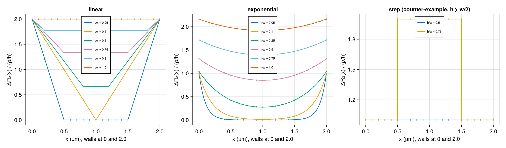

| profile | h/w | overlap width (µm) | mid/wall | share of one face beyond mid-gap | realistic |
|---|---|---|---|---|---|
| linear | 0.25 | 0.00 | 0 | 0 | yes |
| linear | 0.5 | 0.00 | 1e-12 | 0 | yes |
| linear | 0.6 | 0.40 | 0.333 | 0.0278 | yes |
| linear | 0.75 | 1.00 | 0.667 | 0.111 | yes |
| linear | 0.9 | 1.60 | 0.889 | 0.198 | yes |
| linear | 1 | 2.00 | 1 | 0.25 | yes |
| exponential | 0.05 | 2.00 | 9.08e-05 | 4.54e-05 | yes |
| exponential | 0.1 | 2.00 | 0.0135 | 0.00669 | yes |
| exponential | 0.25 | 2.00 | 0.266 | 0.119 | yes |
| exponential | 0.5 | 2.00 | 0.648 | 0.269 | yes |
| exponential | 0.75 | 2.00 | 0.813 | 0.339 | yes |
| exponential | 1 | 2.00 | 0.887 | 0.378 | yes |
| step | 0.5 | 0.00 | 1 | 0 | yes |
| step | 0.75 | 1.00 | 2 | 0.333 | **no** |

**2. Monte Carlo spot check** (τ from the summed maximum rate, a quarter of the layer constraint; seeds 1–10, 50000 spins; readouts until the conventional signal ≈ 0.05):

| ρ | profile | h/w | τ (ms) | max \|z\| | max \|MC − continuum\| | Outcome |
|---|---|---|---|---|---|---|
| 0.1 | linear | 0.75 | 9.4e-03 | 1.90 | 1.1e-05 | **PASS** |
| 0.1 | linear | 1 | 1.0e-02 | 1.16 | 1.2e-09 | **PASS** |
| 0.1 | exponential | 0.5 | 9.5e-03 | 2.19 | 1.2e-05 | **PASS** |
| 0.1 | exponential | 1 | 1.0e-02 | 1.66 | 2.6e-06 | **PASS** |
| 1 | linear | 0.75 | 9.4e-04 | 1.99 | 4.2e-05 | **PASS** |
| 1 | linear | 1 | 1.3e-03 | 0.04 | 4.2e-11 | **PASS** |
| 1 | exponential | 0.5 | 9.5e-04 | 2.04 | 4.0e-05 | **PASS** |
| 1 | exponential | 1 | 1.2e-03 | 1.90 | 9.7e-06 | **PASS** |

The fully overlapping linear layer (uniform) matches its exact decay to ≤ 1.2e-9.

**3. Comparison with the conventional model at the same ρ** (continuum benchmark). For each configuration:
- max |ΔS| over a window running until the conventional signal ≈ 1 %;
- ΔT₂/T₂ at TE* = the conventional model's own T₂ (S_conv(TE*) = e^(−1), bulk T₂ = 2 s). Ruling: a fixed TE = 50 ms is unmeasurable at ρw/D ≥ 0.3, where T₂ ≤ 10 ms;
- the best-fit-conventional residual (ρ_c free, single curve);
- the mono-exponential residual of the layer curve.

*Linear:*

| h/w | mid/wall | ρw/D | max\|ΔS\| | ΔT₂/T₂ at TE* | TE* (ms) | 2σ_T₂/T₂ (SNR 200) | best-fit residual | layer mono-exp residual |
|---|---|---|---|---|---|---|---|---|
| 0.25 | 0 | 0.0067 | 2.35e-04 | -6.10e-04 | 94.9 | 0.029 | 6.4e-08 | 1.3e-07 |
| 0.25 | 0 | 0.1 | 3.48e-03 | -9.38e-03 | 6.75 | 0.029 | 1.3e-05 | 2.9e-05 |
| 0.25 | 0 | 0.3 | 1.02e-02 | -2.73e-02 | 2.33 | 0.029 | 1.2e-04 | 2.6e-04 |
| 0.25 | 0 | 1 | 3.15e-02 | -8.22e-02 | 0.777 | 0.029 | 1.2e-03 | 2.5e-03 |
| 0.25 | 0 | 3 | 7.77e-02 | -1.91e-01 | 0.332 | 0.029 | 6.9e-03 | 1.6e-02 |
| 0.5 | 1e-12 | 0.0067 | 3.69e-04 | -9.55e-04 | 94.9 | 0.029 | 1.4e-07 | 3.2e-08 |
| 0.5 | 1e-12 | 0.1 | 5.46e-03 | -1.47e-02 | 6.75 | 0.029 | 3.0e-05 | 7.2e-06 |
| 0.5 | 1e-12 | 0.3 | 1.61e-02 | -4.28e-02 | 2.33 | 0.029 | 2.7e-04 | 6.5e-05 |
| 0.5 | 1e-12 | 1 | 5.05e-02 | -1.29e-01 | 0.777 | 0.029 | 2.8e-03 | 6.6e-04 |
| 0.5 | 1e-12 | 3 | 1.29e-01 | -3.00e-01 | 0.332 | 0.029 | 1.8e-02 | 4.4e-03 |
| 0.6 | 0.33 | 0.0067 | 3.94e-04 | -1.02e-03 | 94.9 | 0.029 | 1.5e-07 | 1.3e-08 |
| 0.6 | 0.33 | 0.1 | 5.83e-03 | -1.57e-02 | 6.75 | 0.029 | 3.3e-05 | 2.9e-06 |
| 0.6 | 0.33 | 0.3 | 1.72e-02 | -4.57e-02 | 2.33 | 0.029 | 3.0e-04 | 2.6e-05 |
| 0.6 | 0.33 | 1 | 5.41e-02 | -1.37e-01 | 0.777 | 0.029 | 3.1e-03 | 2.6e-04 |
| 0.6 | 0.33 | 3 | 1.39e-01 | -3.20e-01 | 0.332 | 0.029 | 2.0e-02 | 1.7e-03 |
| 0.75 | 0.67 | 0.0067 | 4.08e-04 | -1.06e-03 | 94.9 | 0.029 | 1.6e-07 | 1.6e-09 |
| 0.75 | 0.67 | 0.1 | 6.04e-03 | -1.62e-02 | 6.75 | 0.029 | 3.5e-05 | 3.6e-07 |
| 0.75 | 0.67 | 0.3 | 1.78e-02 | -4.73e-02 | 2.33 | 0.029 | 3.1e-04 | 3.2e-06 |
| 0.75 | 0.67 | 1 | 5.61e-02 | -1.42e-01 | 0.777 | 0.029 | 3.3e-03 | 3.3e-05 |
| 0.75 | 0.67 | 3 | 1.44e-01 | -3.30e-01 | 0.332 | 0.029 | 2.1e-02 | 2.2e-04 |
| 0.9 | 0.89 | 0.0067 | 4.10e-04 | -1.06e-03 | 94.9 | 0.029 | 1.6e-07 | 3.0e-11 |
| 0.9 | 0.89 | 0.1 | 6.07e-03 | -1.63e-02 | 6.75 | 0.029 | 3.5e-05 | 6.6e-09 |
| 0.9 | 0.89 | 0.3 | 1.79e-02 | -4.75e-02 | 2.33 | 0.029 | 3.2e-04 | 6.0e-08 |
| 0.9 | 0.89 | 1 | 5.64e-02 | -1.43e-01 | 0.777 | 0.029 | 3.3e-03 | 6.1e-07 |
| 0.9 | 0.89 | 3 | 1.45e-01 | -3.32e-01 | 0.332 | 0.029 | 2.1e-02 | 4.1e-06 |
| 1 | 1 | 0.0067 | 4.10e-04 | -1.06e-03 | 94.9 | 0.029 | 1.6e-07 | 1.6e-15 |
| 1 | 1 | 0.1 | 6.07e-03 | -1.63e-02 | 6.75 | 0.029 | 3.5e-05 | 6.7e-16 |
| 1 | 1 | 0.3 | 1.79e-02 | -4.75e-02 | 2.33 | 0.029 | 3.2e-04 | 4.0e-15 |
| 1 | 1 | 1 | 5.64e-02 | -1.43e-01 | 0.777 | 0.029 | 3.3e-03 | 1.8e-15 |
| 1 | 1 | 3 | 1.45e-01 | -3.32e-01 | 0.332 | 0.029 | 2.1e-02 | 1.8e-15 |

*Exponential:*

| h/w | mid/wall | ρw/D | max\|ΔS\| | ΔT₂/T₂ at TE* | TE* (ms) | 2σ_T₂/T₂ (SNR 200) | best-fit residual | layer mono-exp residual |
|---|---|---|---|---|---|---|---|---|
| 0.05 | 9.1e-05 | 0.0067 | 1.60e-04 | -4.13e-04 | 94.9 | 0.029 | 3.7e-08 | 1.7e-07 |
| 0.05 | 9.1e-05 | 0.1 | 2.35e-03 | -6.36e-03 | 6.75 | 0.029 | 7.0e-06 | 3.8e-05 |
| 0.05 | 9.1e-05 | 0.3 | 6.89e-03 | -1.86e-02 | 2.33 | 0.029 | 6.1e-05 | 3.3e-04 |
| 0.05 | 9.1e-05 | 1 | 2.12e-02 | -5.60e-02 | 0.777 | 0.029 | 5.9e-04 | 3.1e-03 |
| 0.05 | 9.1e-05 | 3 | 5.18e-02 | -1.31e-01 | 0.332 | 0.029 | 3.5e-03 | 1.8e-02 |
| 0.1 | 0.013 | 0.0067 | 2.71e-04 | -7.01e-04 | 94.9 | 0.029 | 8.3e-08 | 1.0e-07 |
| 0.1 | 0.013 | 0.1 | 4.00e-03 | -1.08e-02 | 6.75 | 0.029 | 1.8e-05 | 2.3e-05 |
| 0.1 | 0.013 | 0.3 | 1.18e-02 | -3.15e-02 | 2.33 | 0.029 | 1.6e-04 | 2.0e-04 |
| 0.1 | 0.013 | 1 | 3.67e-02 | -9.50e-02 | 0.777 | 0.029 | 1.6e-03 | 2.0e-03 |
| 0.1 | 0.013 | 3 | 9.25e-02 | -2.24e-01 | 0.332 | 0.029 | 1.0e-02 | 1.2e-02 |
| 0.25 | 0.27 | 0.0067 | 3.89e-04 | -1.01e-03 | 94.9 | 0.029 | 1.5e-07 | 1.7e-08 |
| 0.25 | 0.27 | 0.1 | 5.75e-03 | -1.55e-02 | 6.75 | 0.029 | 3.2e-05 | 3.7e-06 |
| 0.25 | 0.27 | 0.3 | 1.70e-02 | -4.51e-02 | 2.33 | 0.029 | 2.9e-04 | 3.3e-05 |
| 0.25 | 0.27 | 1 | 5.34e-02 | -1.35e-01 | 0.777 | 0.029 | 3.0e-03 | 3.3e-04 |
| 0.25 | 0.27 | 3 | 1.37e-01 | -3.16e-01 | 0.332 | 0.029 | 1.9e-02 | 2.2e-03 |
| 0.5 | 0.65 | 0.0067 | 4.08e-04 | -1.06e-03 | 94.9 | 0.029 | 1.6e-07 | 1.7e-09 |
| 0.5 | 0.65 | 0.1 | 6.04e-03 | -1.62e-02 | 6.75 | 0.029 | 3.5e-05 | 3.7e-07 |
| 0.5 | 0.65 | 0.3 | 1.78e-02 | -4.73e-02 | 2.33 | 0.029 | 3.1e-04 | 3.3e-06 |
| 0.5 | 0.65 | 1 | 5.61e-02 | -1.42e-01 | 0.777 | 0.029 | 3.3e-03 | 3.4e-05 |
| 0.5 | 0.65 | 3 | 1.44e-01 | -3.30e-01 | 0.332 | 0.029 | 2.1e-02 | 2.3e-04 |
| 0.75 | 0.81 | 0.0067 | 4.09e-04 | -1.06e-03 | 94.9 | 0.029 | 1.6e-07 | 3.7e-10 |
| 0.75 | 0.81 | 0.1 | 6.06e-03 | -1.63e-02 | 6.75 | 0.029 | 3.5e-05 | 8.2e-08 |
| 0.75 | 0.81 | 0.3 | 1.79e-02 | -4.75e-02 | 2.33 | 0.029 | 3.2e-04 | 7.3e-07 |
| 0.75 | 0.81 | 1 | 5.63e-02 | -1.42e-01 | 0.777 | 0.029 | 3.3e-03 | 7.5e-06 |
| 0.75 | 0.81 | 3 | 1.45e-01 | -3.31e-01 | 0.332 | 0.029 | 2.1e-02 | 5.0e-05 |
| 1 | 0.89 | 0.0067 | 4.10e-04 | -1.06e-03 | 94.9 | 0.029 | 1.6e-07 | 1.2e-10 |
| 1 | 0.89 | 0.1 | 6.07e-03 | -1.63e-02 | 6.75 | 0.029 | 3.5e-05 | 2.7e-08 |
| 1 | 0.89 | 0.3 | 1.79e-02 | -4.75e-02 | 2.33 | 0.029 | 3.2e-04 | 2.4e-07 |
| 1 | 0.89 | 1 | 5.64e-02 | -1.42e-01 | 0.777 | 0.029 | 3.3e-03 | 2.5e-06 |
| 1 | 0.89 | 3 | 1.45e-01 | -3.32e-01 | 0.332 | 0.029 | 2.1e-02 | 1.6e-05 |

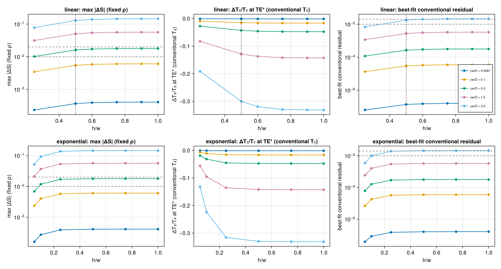

**4. D dependence of the apparent T₂** (one TE per ρ, the conventional T₂ at D = 3, used for every D; same ρ for both models at every D):

| ρ (µm/ms) | TE (ms) | model | h/w | T₂(D=0.5) | T₂(D=1) | T₂(D=2) | T₂(D=3) | T₂(0.5)/T₂(3) − 1 |
|---|---|---|---|---|---|---|---|---|
| 0.1 | 10.1 | conventional | — | 10.609 | 10.280 | 10.115 | 10.060 | +5.45e-02 |
| 0.1 | 10.1 | linear | 0.25 | 10.230 | 10.090 | 10.020 | 9.997 | +2.33e-02 |
| 0.1 | 10.1 | linear | 0.5 | 10.015 | 9.983 | 9.967 | 9.961 | +5.43e-03 |
| 0.1 | 10.1 | linear | 0.6 | 9.976 | 9.963 | 9.957 | 9.955 | +2.14e-03 |
| 0.1 | 10.1 | linear | 0.75 | 9.954 | 9.952 | 9.951 | 9.951 | +2.83e-04 |
| 0.1 | 10.1 | linear | 0.9 | 9.950 | 9.950 | 9.950 | 9.950 | +6.12e-06 |
| 0.1 | 10.1 | linear | 1 | 9.950 | 9.950 | 9.950 | 9.950 | -5.19e-09 |
| 0.1 | 10.1 | exponential | 0.05 | 10.351 | 10.151 | 10.051 | 10.017 | +3.33e-02 |
| 0.1 | 10.1 | exponential | 0.1 | 10.172 | 10.062 | 10.006 | 9.988 | +1.85e-02 |
| 0.1 | 10.1 | exponential | 0.25 | 9.984 | 9.967 | 9.959 | 9.956 | +2.81e-03 |
| 0.1 | 10.1 | exponential | 0.5 | 9.954 | 9.952 | 9.951 | 9.951 | +2.83e-04 |
| 0.1 | 10.1 | exponential | 0.75 | 9.951 | 9.951 | 9.950 | 9.950 | +6.21e-05 |
| 0.1 | 10.1 | exponential | 1 | 9.950 | 9.950 | 9.950 | 9.950 | +2.04e-05 |
| 1 | 1.11 | conventional | — | 1.629 | 1.327 | 1.165 | 1.110 | +4.67e-01 |
| 1 | 1.11 | linear | 0.25 | 1.260 | 1.137 | 1.070 | 1.046 | +2.04e-01 |
| 1 | 1.11 | linear | 0.5 | 1.057 | 1.031 | 1.016 | 1.010 | +4.58e-02 |
| 1 | 1.11 | linear | 0.6 | 1.021 | 1.012 | 1.006 | 1.004 | +1.75e-02 |
| 1 | 1.11 | linear | 0.75 | 1.002 | 1.001 | 1.000 | 1.000 | +2.30e-03 |
| 1 | 1.11 | linear | 0.9 | 1.000 | 1.000 | 1.000 | 1.000 | +5.16e-05 |
| 1 | 1.11 | linear | 1 | 1.000 | 1.000 | 1.000 | 1.000 | +1.58e-11 |
| 1 | 1.11 | exponential | 0.05 | 1.372 | 1.197 | 1.100 | 1.067 | +2.86e-01 |
| 1 | 1.11 | exponential | 0.1 | 1.198 | 1.107 | 1.055 | 1.037 | +1.55e-01 |
| 1 | 1.11 | exponential | 0.25 | 1.028 | 1.015 | 1.008 | 1.005 | +2.27e-02 |
| 1 | 1.11 | exponential | 0.5 | 1.002 | 1.001 | 1.000 | 1.000 | +2.29e-03 |
| 1 | 1.11 | exponential | 0.75 | 1.000 | 1.000 | 1.000 | 1.000 | +5.03e-04 |
| 1 | 1.11 | exponential | 1 | 1.000 | 1.000 | 1.000 | 1.000 | +1.66e-04 |

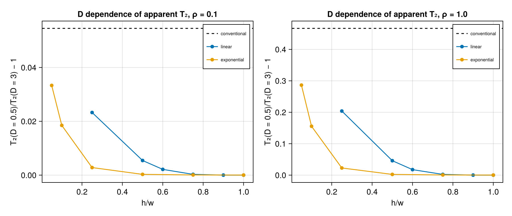

**Conclusions (numbers only).**
- **Profiles are realistic.** Overlapping linear and exponential layers never relax more mid-gap than at the walls, in the simulator and in closed form. Only the step profile with h > w/2 does, which is why it stays excluded.
- **At fixed ρ, overlap adds little beyond the thick-layer value.** The difference from the conventional model rises with h/w and saturates once the layers overlap: from h/w ≈ 0.5 for linear and ≈ 0.25 for exponential, it is within ≈ 10 % of the fully uniform value. At ρw/D = 0.0067 (the P2.5 reference) it is ≤ 4.1e-4 in S and ≤ 1.1e-3 in T₂. At ρw/D = 0.3 it reaches ΔT₂/T₂ ≈ −4.8 %, above the 2σ two-point noise at SNR 200 (2.9 %), but only if ρ is known. At ρw/D = 1 and 3 it is −14 % and −33 %.
- **A fitted conventional model still mimics a single curve.** The best-fit residual for overlapping layers is 3.5e-5 (ρw/D = 0.1), 3.2e-4 (0.3), 3.3e-3 (1) and 0.021 (3). It crosses the single-measurement threshold 0.01 only at ρw/D = 3, as in the C1 map.
- **The D dependence is the distinguishing feature of overlap.** With the layers overlapping (h/w ≥ 0.5), the apparent T₂ barely changes with D: T₂(D = 0.5)/T₂(D = 3) − 1 ≤ 5.4e-3 (ρ = 0.1) and ≤ 4.6e-2 (ρ = 1), and exactly 0 at full linear overlap (uniform relaxation). The conventional model changes by +5.5 % (ρ = 0.1) and +47 % (ρ = 1). Thin (non-overlapping) layers sit in between: exponential h/w = 0.05 +3.3 % / +29 %, linear h/w = 0.25 +2.3 % / +20 %. Comparing two single two-point T₂ measurements at SNR 200 (σ of the ratio ≈ 2 %, so 2σ ≈ 4 %), the conventional +5.5 % at ρ = 0.1 is marginal and +47 % at ρ = 1 is clear, while an overlapping layer shows ≈ 0.
- **Limitations.**
  - Walls only, free decay.
  - Overlap needs h ≳ w/2, so it is relevant mainly for small compartments.
  - The D comparison assumes ρ does not change with D (a temperature change might change both).
  - At ρ = 1 the T₂ is ≈ 1 ms, far shorter than typical tissue values; at ρ = 0.1 it is ≈ 10 ms.
  - Thresholds are for single measurements.
