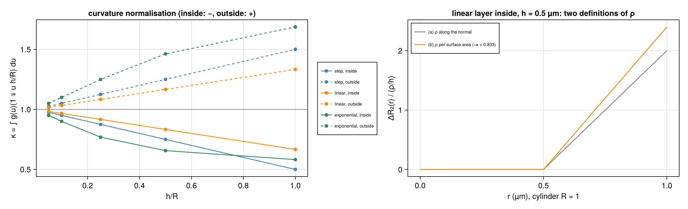
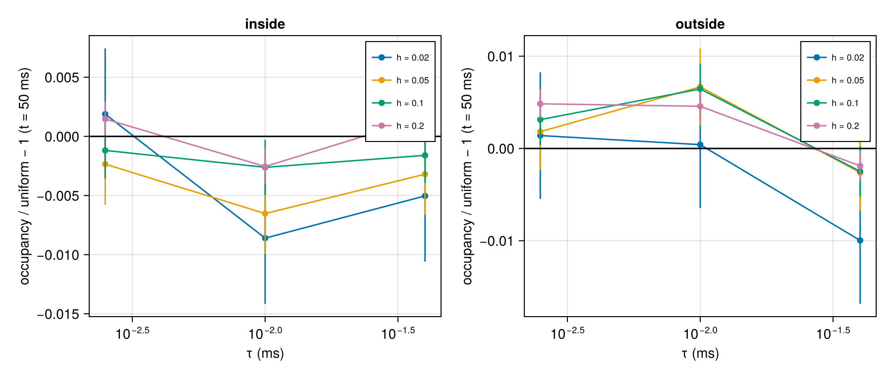
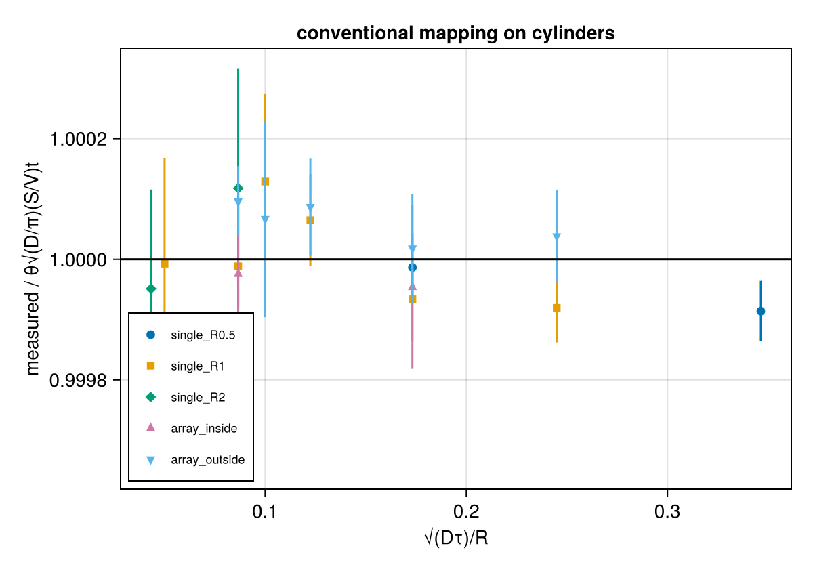

# Phase 3 · Record (R₂(d) on cylinders, no RF)

Settings, methods and results of Phase 3 (tracker: `research/project-progress-tracker.md`, Phase 3). The model is the user's own:

  R₂,total(x) = R₂,bulk + ΔR₂(d(x)),  ΔR₂(d) = (ρ/h)·g(d/h)/κ,

where d is the distance from a cylinder surface, measured into the compartment. The conventional surface-relaxation model of MCMR (per-collision loss θ√τ) is a reference, not the truth. No fast-diffusion assumption is used anywhere.

Each section follows the same pattern: **design** (what was chosen, the alternatives, why), **method** (the equations computed, the definition of every quantity, how uncertainty is estimated), **result**, and **conclusion** (numbers tied back to the formulas).

## Summary

| ID | Item | Criterion | Outcome |
|---|---|---|---|
| D3.1–D3.6 | Design decisions for cylinders | user decision | **Decided** (2026-10-24), see below |
| D3.1 check | Curvature normalisation κ = 1 ∓ c̄/R | quadrature = closed form | **PASS**: max deviation 1.6e-9 |
| P3.2.1–P3.2.4, P3.2.6 | Step layer on cylinders: exact shell fraction, images, overlap sum, fields, validation, timestep bound | package tests | **PASS**: 100 tests; full suite 3497/3497 |
| P3.1.1, P3.1.2 | C-B1 null, C-B2 bulk (single, array inside/outside) | exact / ≤ 1e-10 per spin, ≤ roundoff bound | **PASS** (3/3): per spin 5.4e-14; τ_default = 0.01 ms |
| P3.1.3 | C-B3 density and occupancy within h | \|z_χ\| ≤ 3; occupancy \|z\| ≤ 2 | χ² **PASS** (z +0.33 / +0.78); occupancy **FAIL** by criterion (outside h = 0.1/0.2: z +2.36/+2.89, nested shells); follow-up vs τ: no trend; identity P3.4.3 confirms uniform density to 1e-4 |
| P3.4.5 | Positions with the layer on = no layer | identical | **PASS** |
| P3.1.4 | C-B4 conventional θ reference curves (5 configurations × 3 θ) | τ_a vs τ_a/4 within 2 SEM; bulk factorisation | 14/15 (+ 1 confirmed at τ_a/16, z +0.83); bulk 5.9e-14 → **reference set** |
| P3.1.5 | C-B5 runtime | cost table | layer ×1.25–1.67 per spin-step |
| P3.1.6 | Conventional mapping θ√(D/π)(S/V) on curved surfaces | \|z\| ≤ 3 | **PASS** (18/18, max \|z\| 2.17); ratio 0.99976–1.00013 for √(Dτ)/R ≤ 0.35 |
| P3.4.1 | Single-spin trace, square array, overlapping outer layers | every step ≤ 1e-6 | **PASS**: max 1.0e-7; 9808 reflections in a shell, 2978 overlap steps |
| P3.2.5, P3.4.2, P3.4.4, P3.4.7 | V0b, uniform h = R, additivity, side-specific (full size) | exact / ≤ 1e-10 / leak ≤ 1e-9 | **PASS** (8/8) |
| P3.4.3 | Mean-exponent identity E[−ln M] = ρ(S/V)t, step (single, square, overlap, rectangular) | \|z\| ≤ 3 | **PASS** (12/12, \|z\| ≤ 1.25; ≤ 6e-5 relative) |

---

## Design decisions (D3.1–D3.6)

Decided by the user on 2026-10-24, following the recommendations below. Notation:
- cylinder radius R; axis along z;
- r = distance of a point from the axis;
- inside, d = R − r ∈ [0, R]; outside, d = r − R ≥ 0;
- layer thickness h; profile g(u) with ∫g(u) du = 1 over its support;
- profile centroid c̄ = h∫u g(u) du (step h/2, linear h/3, exponential truncated at support c·h: h(1 − (c + 1)e^(−c))/(1 − e^(−c))).

### D3.1 — ρ is defined per unit surface area

**Problem.** On a wall the volume element at distance d is the same as at the surface, so the integral along the normal,

  ρ_n = ∫ ΔR₂(d) dd,

is also the relaxation per unit surface area. On a cylinder the shell at distance d has circumference 2π(R ∓ d), so per unit cylinder length

  ∫ ΔR₂ dA = 2πR ∫ ΔR₂(d) (1 ∓ d/R) dd,

with − inside and + outside. The two notions of "ρ" differ by the curvature factor.

**Options.**
- (a) ρ along the normal: ΔR₂(d) = (ρ/h) g(d/h), the same formula as on walls.
- (b) ρ per unit surface area: ρ = ∫ ΔR₂(d)(1 ∓ d/R) dd.

**Decision: (b).** Inserting ΔR₂ = (ρ/h) g(d/h)/κ gives the normalisation

  κ = ∫ g(u) (1 ∓ u·h/R) du = 1 ∓ c̄/R.

**Why.**
1. With (b), the volume mean of ΔR₂ over a compartment of volume V and surface A is exactly ρ·A/V. That is the same expression as for the conventional model with relaxivity ρ (rate ρ·S/V). So "same ρ" keeps meaning "same total relaxation per unit surface", which every comparison in Phase 3 relies on.
2. The mean-exponent identity used for verification keeps its simple form, E[−ln M] = ρ·(A/V)·t, because the uniform density is stationary.
3. On walls (R → ∞), κ → 1 and (b) reduces to the Phase 2 definition.

**Cost.**
- The surface rate becomes ΔR₂(0) = (ρ/h) g(0)/κ, which depends on curvature.
- Inside a cylinder κ < 1, so the profile is scaled up; outside, κ > 1 scales it down (figure, right panel).
- Results quoted per ρ are not directly comparable with option (a). When ΔR₂(0) is the quantity held fixed, both conventions are given.

**Check.** κ computed by midpoint quadrature (2·10⁵ points) agrees with 1 ∓ c̄/R to 1.6e-9 for step, linear and exponential, inside and outside, h/R = 0.05–1 (script [p3_0_design.jl](phase3/p3_0_design.jl), table `results/phase3/p3_0_design/kappa.csv`). Examples at h/R = 0.5: step inside 0.750 / outside 1.250; linear 0.833 / 1.167; exponential (inside support R, outside 2 µm) 0.657 / 1.463.

### D3.2 — Profiles: step first, then linear and exponential

**Decision.** The step profile is implemented and verified first. Linear and exponential follow once the integration path of D3.3 exists.

**Why.** For the step profile the exponent over a straight piece is ΔR₂(0)·dt·(fraction of the piece inside the shell). The fraction follows from exact line–circle intersections (D3.3). So the step profile on cylinders keeps an exact closed form and can be verified to roundoff, as on walls, before any numerical integration is introduced.

### D3.3 — Integration along a straight piece: quadrature for all profiles, linear closed form as its test

**Problem.** A straight piece from p₀ to p₁, with transverse displacement Δ⊥, has squared distance from the axis

  r(s)² = |p₀⊥ − c + s Δ⊥|² = a s² + b s + q,  s ∈ [0, 1],

where a = |Δ⊥|², b = 2(p₀⊥ − c)·Δ⊥ and q = |p₀⊥ − c|². So d(s) = R − √(as² + bs + q) (inside) is not linear in s. The exponent of the piece, of duration dt, is

  E = dt ∫₀¹ ΔR₂(d(s)) ds.

**Method.**
- The roots of r(s) = R − h and r(s) = R (or R and R + h outside) split [0, 1] into sub-intervals that lie entirely inside or entirely outside the shell. These are exact quadratic roots, with tangent and chord-only cases handled explicitly.
- **Step:** E = ΔR₂(0)·dt·(total length of the inside sub-intervals), exactly.
- **Linear and exponential:** an adaptive quadrature on each inside sub-interval, with tolerance ε_R₂ on E, fixed in P3.6.3.
- **Independent check:** the linear profile also has a closed form, because ∫√(as² + bs + q) ds is elementary (a logarithm/asinh form). The quadrature is tested against it (P3.3.2) and against the Phase 2 wall closed forms (P3.3.3).

**Why.** A single integration path for all profiles keeps the code small, and the closed forms make it testable. This activates the Phase 2 items deferred for walls: P2.4.6 (quadrature path), P2.6.6 (V12 tolerance), P2.6.7 and P2.6.9 (cost).

### D3.4 — Both sides, side-specific parameters

**Decision.** Each cylinder surface has an inner (inside) and an outer (outside) layer, each with its own (ρ, h, g). Both sides are symmetric by default. This is the walls' positive/negative pair transferred to cylinders.

**Why.** The intra- and extra-cylinder compartments can have different surface chemistry (the user's model, as in Phase 2). Setting one side to zero recovers a one-sided layer.

### D3.5 — Exponential support

**Decision.**
- **Inside:** support d ≤ R, so it reaches the axis, with the inside κ above.
- **Outside:** support d ≤ L, where L is the `layer_cutoff` and defaults to the smallest surface-to-surface gap between neighbouring cylinders, L = s_min − 2R, with s_min the smallest centre spacing. A single, non-repeating cylinder must set L explicitly.

**Why.** On walls the exponential is cut at the distance to the opposite surface (cutoff = wall spacing), so it reaches exactly the neighbouring surface. The cylinder analogue is the surface gap s − 2R.

**Clarification (2026-10-24).** The decision table first said "half the smallest centre spacing". That was a slip, corrected here to the gap, which matches the wall convention. Renormalising g over its support keeps ∫g = 1, so ρ stays the relaxation per unit area (D3.1).

### D3.6 — Arrays: square and rectangular

**Decision.** Square arrays (centre spacing s in x and y) and rectangular arrays (s_x ≠ s_y), as MCMR `Cylinders(repeats = [s_x, s_y])`. Random packings are an optional extension in 3.7.

**Why.** These give the three overlap classes of the proposal (Milestone 5) by construction. With the surface gaps G_x = s_x − 2R and G_y = s_y − 2R:
- **separated:** G_x > 2h and G_y > 2h;
- **one-direction overlap:** G_x ≤ 2h < G_y;
- **two-direction overlap:** G_x ≤ 2h and G_y ≤ 2h.

At overlap the contributions of all cylinders within reach are summed (Eq. 10 of the proposal), as on walls.

---

## Implementation of the step layer on cylinders (P3.2.1–P3.2.4, P3.2.6)

Plan [2026-10-24-cylinders-step.md](../docs/superpowers/plans/2026-10-24-cylinders-step.md). Code:
- [layers.jl](../src/geometries/internal/layers.jl): `CylinderLayer`, `kappa`, `cylinder_surface_rate`, `disk_length`, `shell_fraction`, `cylinder_exponent`, `image_centres`, `layer_exponent`, `max_layer_rate`;
- [fix.jl](../src/geometries/user/fix.jl): `cylinder_layers`, `check_outer_reach`, `obstruction_shifts`.

Tests: [test_layer_cylinders.jl](../test/test_layer_cylinders.jl), 100 tests. The full suite without plots passes, 3497/3497.

**Design.**
- **Exact shell time in closed form.** Along a straight piece p(s) = p₀ + sΔ, s ∈ [0, 1], the squared distance from the axis (in the transverse plane of the cylinder) is

  r(s)² = a s² + b s + q,  a = |Δ⊥|²,  b = 2(p₀⊥ − c)·Δ⊥,  q = |p₀⊥ − c|².

  It is convex in s, so {s : r(s)² ≤ X} is one interval of length L(X), bounded by the roots. The fraction of the piece in the shell r_lo ≤ r ≤ r_hi is

  f = L(r_hi²) − L(r_lo²),

  with no side bookkeeping: the inner shell is [R − h_in, R] and the outer shell is [R, R + h_out]. The roots use the cancellation-free form t = −(b + sign(b)√disc)/2, s = t/a and (q − X)/t. A piece with a = 0 (purely axial motion) is a stationary point.
- **Exponent of a piece.** For the step profile, E = ΔR₂(0)·dt·f exactly. With D3.1,

  ΔR₂(0) = (ρ/h)/κ,  κ = 1 − h/(2R) inside,  κ = 1 + h/(2R) outside.

- **Arrays.** Every image of every cylinder within reach R + h_out of the piece's bounding box is summed (proposal Eq. 10), so overlapping outer layers add. Rotated axes come from the group's rotation: motion along the axis does not change r.
- **Alternatives rejected.**
  - Sampling the piece: not exact, and slow.
  - Tracking which side a piece is on: unnecessary, because the two shells are disjoint radial ranges.
- **Validation.**
  - h_inner ≤ R.
  - h_outer ≤ the smallest surface gap |c_i − c_j| − R_i − R_j to any other cylinder or image (centres wrapped into the cell, images within ±1 cell). This is the wall rule h ≤ spacing, so an outer layer never relaxes spins inside another cylinder.
  - Only the step profile is accepted on cylinders so far (D3.2).
  - Fields: `layer_rho`, `layer_h`, `layer_shape`, each with `_inner` and `_outer` versions; JSON and CLI supported.
- **Timestep (P3.2.6).** τ ≤ c/ΔR₂,max with c = 0.005. Here ΔR₂,max is the larger of:
  - the inner surface rate;
  - the outer surface rate plus the outer rates of every cylinder or image whose outer shell intersects this one's (|c_i − c_j| < R_i + h_i + R_j + h_j).

  This equals the largest rate when shells do not overlap and is an upper bound otherwise. Example: a square array s = 2.5, R = 1, h = 0.3 has 5 overlapping outer rates at the 4 nearest neighbours.

**Verification (package tests).**
- Shell fraction against brute-force sampling (10⁵ points, 3000 pieces): max error < 3e-5, the sampling bound. Exact cases:
  - radial;
  - a chord;
  - tangent to the outer circle (fraction 0) and to the inner circle;
  - h = R;
  - stationary points.
- Review Focus cases:
  - nearly axial motion (|Δ⊥| = 1e-15);
  - a piece starting on r = R.
- Layer exponent against an independent brute-force sum of rates (2·10⁴ samples, 200 pieces, max error < 1e-4):
  - two and four overlapping cylinders;
  - a square array with images;
  - two cylinders per cell in a rectangular array;
  - a cylinder along x (r measured in the (y, z) plane).
- A hand-computed radial step with a reflection, inside and outside, to 1e-12.
- ρ = 0 bit-identical to no layer; h_inner = R uniform (every inside spin at e^(−0.1t)); bulk factorisation.
- Side-specific layers; a permeable cylinder; finite RF rejected.
- Mutation check: scaling the surface rate by 1.01 is caught by 22 tests.

**Roundoff at the surface (ruling).** A reflection point can lie a roundoff distance across r = R, inside the other side's shell (its boundary has measure zero). An outer-only layer then leaves inside spins at 1 − M⊥ ≈ 1e-15 per reflection rather than exactly 1, accumulating over 50 ms to at most 1.2e-11 at full size (10⁶ spins). The tests bound this leak at 1e-12 (package test, 2000 spins, 50 ms; max seen 1.3e-15) and 1e-9 (full size), eight orders below the layer's own effect (1 − S ≈ 0.87).

## C-B1, C-B2: null run and bulk R₂ on cylinders (P3.1.1, P3.1.2)

Script [p3_1_1_null_bulk.jl](phase3/p3_1_1_null_bulk.jl) → [results/phase3/p3_1_1_null_bulk/](results/phase3/p3_1_1_null_bulk/).

**Design.** These are the exact baselines of the old code on the geometries used in Phase 3:
- a single cylinder R = 1 µm (inside);
- a square array s = 2.5 µm, R = 1 (inside and outside; surface gap 0.5 µm).

Default timestep, seeds 1–10, 10⁵ spins per seed, readouts 0:5:50 ms. Spins for the single cylinder start uniformly in the box [−R, R]³; the region is set by the distance from the nearest axis at t = 0.

**Method.**
- **C-B1:** every spin keeps M⊥ = 1 exactly.
- **C-B2 (R₂ = 1/80 ms⁻¹, same seeds):**
  - positions identical to C-B1;
  - per spin, |M⊥/e^(−t/80) − 1| ≤ 1e-10;
  - ensemble within B = (t/τ + N)·ε = 2.3e-11.

**Result.**

| configuration | τ_default (ms) | spins in region (mean per seed) | C-B1 | C-B2 per spin | C-B2 ensemble | outcome |
|---|---|---|---|---|---|---|
| single, inside | 0.01 | 78 501 | exact | 5.4e-14 | 4.4e-14 | **PASS** |
| array, inside | 0.01 | 50 247 | exact | 5.4e-14 | 4.4e-14 | **PASS** |
| array, outside | 0.01 | 49 753 | exact | 5.4e-14 | 4.4e-14 | **PASS** |

**Conclusion.** τ_default = 0.03·R²/D = 0.01 ms, set by the tortuosity constraint with size scale R. The bulk factor is exact to roundoff on cylinders.

## C-B3: density and shell occupancy (P3.1.3), and with the layer on (P3.4.5)

Scripts [p3_1_3_density.jl](phase3/p3_1_3_density.jl) and [p3_1_3b_density_tau.jl](phase3/p3_1_3b_density_tau.jl) → [results/phase3/p3_1_3_density/](results/phase3/p3_1_3_density/), [results/phase3/p3_1_3b_density_tau/](results/phase3/p3_1_3b_density_tau/).

**Design.** By (M2) of Phase 2, the mean layer exponent is ΔR₂ times the time fraction in the shell. So the density near a curved surface must be uniform, including at finite τ, where finite steps are reflected on a curved surface. The layer must also not move spins.

**Method.** Positions at t = 50 ms, pooled over 10 seeds (785 012 spins inside, 497 526 outside).
- **Inside:** for a uniform density, r²/R² is uniform on [0, 1]. Test: 100-bin χ², z_χ = (χ² − dof)/√(2 dof).
- **Outside:** for R ≤ r ≤ s/2 whole annuli lie in the cell, so P(r_k ≤ r < r_k+1 | r ≤ s/2) = (r_k+1² − r_k²)/((s/2)² − R²). Test: 50 equal-area bins.
- **Occupancy within h:** binomial z = (n − Np)/√(Np(1 − p)), with
  - p = (R² − (R − h)²)/R² inside;
  - p = π((R + h)² − R²)/(s² − πR²) outside.
- **Criteria:** |z_χ| ≤ 3, |z| ≤ 2 per h.

**Result.**

| test | no layer | layer on (ρ = 0.02, h = 0.2) |
|---|---|---|
| inside χ²/dof (z) | 1.047 (+0.33) | 1.047 (+0.33) |
| outside χ²/dof (z) | 1.159 (+0.78) | 1.159 (+0.78) |
| occupancy z inside, h = 0.05 / 0.1 / 0.2 / 0.5 | −1.90 / −1.12 / −1.69 / −1.56 | same |
| occupancy z outside, h = 0.05 / 0.1 / 0.2 | +1.60 / **+2.36** / **+2.89** | same |
| positions identical to the no-layer run | — | **true** (P3.4.5 **PASS**) |

The criterion outcome is **FAIL** (outside h = 0.1 and 0.2), not loosened. The h = R row inside (p = 1) is an exact check: the fraction is 1.

**Follow-up: occupancy vs τ** (deviation δ = fraction/p − 1, σ = √((1 − p)/(Np)); t = 0 control, where the positions are uniform by construction):

| region, h | t = 0 (control) | τ = 4e-2 | τ = 1e-2 | τ = 2.5e-3 |
|---|---|---|---|---|
| inside, 0.05 | −0.02 % (z −0.05) | −0.32 % (−0.93) | −0.65 % (−1.90) | −0.24 % (−0.68) |
| inside, 0.2 | −0.02 % (−0.16) | +0.16 % (+1.07) | −0.26 % (−1.69) | +0.15 % (+0.98) |
| outside, 0.05 | −0.68 % (−1.64) | −0.26 % (−0.63) | +0.67 % (+1.60) | +0.18 % (+0.44) |
| outside, 0.2 | +0.26 % (+1.61) | −0.19 % (−1.19) | +0.46 % (+2.89) | +0.48 % (+3.05) |

**Conclusion.**
- There is no monotone trend with τ, and the t = 0 control fluctuates by the same amount.
- The nested shells (h = 0.05 ⊂ 0.1 ⊂ 0.2) reuse the same spins, so one fluctuation appears in several z values. The χ² over disjoint bins passes in both regions.
- The decisive check is the mean-exponent identity (P3.4.3 below). A real +0.46 % excess within 0.2 µm of the outer surface would shift E[−ln M⊥] by ≈ +0.5 %, about 20σ. The measured value agrees to +5e-6 relative.
- The C-B3 deviations are therefore fluctuations: the density is uniform near curved surfaces at this precision. The layer moves no spin.

## C-B4: conventional θ reference curves on cylinders (P3.1.4)

Scripts [p3_1_4_theta_reference.jl](phase3/p3_1_4_theta_reference.jl) and [p3_1_4b_tau16.jl](phase3/p3_1_4b_tau16.jl) → [results/phase3/p3_1_4_theta_reference/](results/phase3/p3_1_4_theta_reference/) (`reference_curves.csv` is the reference set).

**Design.** These curves are the conventional model's reference on cylinders (a reference, not the truth). Configurations:
- single cylinder inside, R = 0.5, 1, 2;
- square array s = 2.5, R = 1, inside and outside.

θ = 0.003, 0.01, 0.03; D = 3; seeds 1–10, 2·10⁴ spins per seed.

**Method.**
- **Convergence:** τ_a = min(1e-2, 0.03R²/D) against τ_a/4, z = (S_a(50) − S_b(50))/√(SEM_a² + SEM_b²), one test per curve; the 11 readouts are correlated. Pass if |z| ≤ 2.
- **Bulk factorisation:** same seeds with R₂ = 1/80; the per-spin ratio must be e^(−t/80).

**Result.** 14 of 15 curves have |z| ≤ 2 (range −0.98 … +1.19). The exception is array outside θ = 0.03, z = +2.06. Rerun at τ_a/16 = 6.25e-4 ms, it agrees with τ_a/4: 0.05194 against 0.05192 ± 2.2e-5, z = +0.83. τ_a/4 is the reference for that curve (ruling). Bulk factorisation: max per-spin deviation 5.9e-14.

| configuration | S(50), θ = 0.003 / 0.01 / 0.03 (τ_a/4) |
|---|---|
| single R = 0.5 | 0.55643 / 0.14178 / 0.00286 |
| single R = 1 | 0.74596 / 0.37666 / 0.05368 |
| single R = 2 | 0.86372 / 0.61398 / 0.23254 |
| array inside | 0.74596 / 0.37666 / 0.05369 |
| array outside | 0.74359 / 0.37265 / 0.05194 |

**Conclusion.** The conventional reference is τ-converged at these settings. A single cylinder and the array give the same inside curve (the compartments are identical), which is a consistency check.

## Conventional mapping on curved surfaces (P3.1.6)

Script [p3_1_6_mapping.jl](phase3/p3_1_6_mapping.jl) → [results/phase3/p3_1_6_mapping/](results/phase3/p3_1_6_mapping/).

**Design.** MCMR's conventional model multiplies M⊥ by e^(−θ√τ) at each collision, so for every path −ln M⊥ = θ√τ·(number of collisions). On walls the collision rate per unit area is n√(D/(πτ)), which gives the relaxivity ρ = θ√(D/π) (Phase 2, P2.5.0). On a curved surface, finite steps √(2Dτ) could change the collision rate by O(√(Dτ)/R). The fixed-ρ comparisons of 3.7 need the mapping to hold, or a measured correction.

**Method.**

  E[−ln M⊥(t)] = θ√(D/π)·(S/V)·t,  S/V = 2/R inside,  2πR/(s² − πR²) outside.

- Measured at t = 50 ms for 5 configurations, D = 1, 3, 6 (D scan on single R = 1 and array outside), τ = 1e-2 and 2.5e-3, θ = 0.01; seeds 1–10, 2·10⁴ spins.
- z = (mean − expected)/SEM. Pass if |z| ≤ 3; otherwise the measured ratio becomes the mapping.

**Result.** 18 of 18 have |z| ≤ 3 (max |z| = 2.17). The ratio measured/expected lies in 0.99976–1.00013 over √(Dτ)/R = 0.04–0.35.

**Conclusion.** The conventional relaxivity ρ = θ√(D/π) holds on these curved surfaces to ≈ 1e-4, with no resolved trend in √(Dτ)/R up to 0.35. Phase 3 comparisons at fixed ρ use θ = ρ√(π/D) unchanged.

## C-B5: runtime on cylinders (P3.1.5)

Script [p3_1_5_runtime.jl](phase3/p3_1_5_runtime.jl) → [results/phase3/p3_1_5_runtime/](results/phase3/p3_1_5_runtime/). Single runs of 10⁴ spins × 1000 steps, 8 threads; ratios carry a load uncertainty of 10–20 %.

| τ (ms) | single, no layer (µs/spin-step) | single, layer | ratio | array, no layer | array, layer | ratio |
|---|---|---|---|---|---|---|
| 0.1 | 0.0738 | 0.0924 | 1.25 | 0.0824 | 0.1312 | 1.59 |
| 1e-2 | 0.0442 | 0.0666 | 1.51 | 0.0495 | 0.0806 | 1.63 |
| 1e-3 | 0.0370 | 0.0557 | 1.50 | 0.0393 | 0.0657 | 1.67 |
| 1e-4 | 0.0350 | 0.0538 | 1.54 | 0.0380 | 0.0603 | 1.59 |

**Conclusion.** The step layer costs ×1.25–1.67 per spin-step on cylinders, against ×1.2–1.4 on walls. The extra cost in arrays comes from the image loop over neighbouring cylinders, whose cost grows with the number of cylinders within reach. A reference run (10⁵ spins × 50 ms × 10 seeds at τ = 0.01) takes ≈ 5–7 min.

## Verification of the step layer on cylinders (P3.4.1, P3.4.3)

### P3.4.1: single-spin trace

Script [p3_4_1_trace.jl](phase3/p3_4_1_trace.jl) → [results/phase3/p3_4_1_trace/](results/phase3/p3_4_1_trace/).

**Design.** The configuration is the hardest one for the bookkeeping: a square array s = 2.5, R = 1 with h = 0.3 on both sides, so the outer shells overlap (gap 0.5 < 2h). It also has reflections inside shells and image cylinders.

**Method.** Each step's prediction uses the simulator's reflected path and an independent brute-force summed rate (5 × 5 images, written from D3.1 in the harness):

  M⊥,pred = M⊥,prev · exp(−R₂,bulk·τ − Σ_j dt_j · (1/K)Σ_k ΔR₂(p_j(s_k))),  dt_j = τ·ℓ_j/Σℓ,  K = 10⁴.

Parameters: ρ = 0.03, so ΔR₂ = 0.1176 (inside) and 0.0870 (outside); R₂,bulk = 1/80; τ = 0.01; 100 spins × 500 steps. Midpoint sampling error per boundary crossing ≤ ΔR₂·τ/(2K) ≈ 6e-8.

**Result.** Max |M⊥,sim/M⊥,pred − 1| = 1.0e-7 (tolerance 1e-6). 9808 steps had a reflection inside a shell and 2978 steps passed through an overlap → **PASS**.

**Conclusion.** The error is at the sampling resolution (≈ 2 boundary crossings × 6e-8). The exact shell fractions, κ, the image loop and the overlap sum agree with brute force on real reflected paths.

### P3.2.5, P3.4.2, P3.4.4, P3.4.7: exact cases at full size

Script [p3_4_exact.jl](phase3/p3_4_exact.jl) → [results/phase3/p3_4_exact/](results/phase3/p3_4_exact/). Seeds 1–10, 10⁵ spins per seed, readouts 0:5:50, τ = 1e-2 (V0b: default τ).

**Design.** These cases are exact in any diffusion regime, so a failure means the code is wrong, not that there is noise.
- **V0b:** ρ = 0 must leave the run bit-identical to no layer.
- **Uniform inner layer:** step, h = R, so κ = 1 − 1/2 = 1/2. Then ΔR₂ = (ρ/R)/κ = 2ρ/R everywhere inside: with ρ = 0.05 and R = 1, every inside spin decays as M⊥ = e^(−(0.1 + R₂,bulk)t) whatever its path. This is the cylinder analogue of the wall cases h = w/2 (step) and h = w (linear), and it checks κ directly.
- **Additivity:** the bulk factor multiplies every step, so the per-spin ratio is e^(−t/80).
- **Side-specific:** an inner-only layer must not touch outside spins, and an outer-only layer must not touch inside spins.

**Method.**
- Per spin: ≤ 1e-10.
- Ensemble: ≤ B = (t/τ + N)·ε = 2.3e-11.
- Side leak: max(1 − M⊥) ≤ 1e-9 (roundoff ruling above).

**Result.**

| check | configuration | result | outcome |
|---|---|---|---|
| V0b inside / outside | square array, ρ = 0, h = 0.3 vs no layer, R₂ = 1/80 | positions and every M⊥ identical | **PASS** / **PASS** |
| uniform, bulk off | single R = 1, inner h = 1, ρ = 0.05 | per spin 9.7e-14, ensemble 6.6e-14 | **PASS** |
| uniform, bulk on (1/80) | same | per spin 1.3e-13, ensemble 1.1e-13 | **PASS** |
| additivity inside / outside | square array ρ = 0.02, h = 0.2 | positions identical; per spin 6.6e-14 / 6.7e-14 | **PASS** / **PASS** |
| inner-only layer | square array | outside spins: max leak 2.4e-12; inside S(50) = 0.1356 | **PASS** |
| outer-only layer | square array | inside spins: max leak 1.2e-11; outside S(50) = 0.1327 | **PASS** |

**Conclusion.** The κ normalisation gives the exact uniform rate 2ρ/R, so ρ is per unit surface area, as D3.1 requires. ρ = 0 runs the unmodified code. Bulk and layer factorise exactly. Each side acts only in its own compartment, up to roundoff at reflection points.

### P3.4.3: mean-exponent identity on cylinders

Script [p3_4_3_identity.jl](phase3/p3_4_3_identity.jl) → [results/phase3/p3_4_3_identity/](results/phase3/p3_4_3_identity/).

**Design.** With ρ defined per unit surface area (D3.1) and a uniform stationary density, every compartment satisfies

  E[−ln M⊥(t)] = t·⟨ΔR₂⟩_compartment = ρ·(S/V)·t

for any h and τ. Each shell integrates to exactly ρ per unit area of its surface:

  ∫ shell ΔR₂ dA = (ρ/(hκ))·π((R ± h)² − R²) = (ρ/(hκ))·2πRh(1 ± h/2R) = 2πRρ.

Overlapping outer layers add their integrals, and validation keeps them out of other cylinders. The identity therefore tests κ, the shell fractions, the image loop, the overlap sum and the density end to end. It does not constrain S = ⟨M⊥⟩, which is where profiles and the conventional model differ.

**Method.** ρ = 0.02, step, t = 50 ms, τ = 1e-2 and 4e-2, seeds 1–10, 10⁵ spins per seed. z = (mean − ρ(S/V)t)/SEM; pass if |z| ≤ 3.

**Result.**

| configuration | τ (ms) | ρ(S/V)t | E[−ln M⊥] ± SEM | z |
|---|---|---|---|---|
| single R = 1, h = 0.2 | 1e-2 | 2.000000 | 2.000019 ± 9.2e-5 | +0.21 |
| | 4e-2 | | 1.999988 ± 8.1e-5 | −0.15 |
| single R = 0.5, h = 0.2 | 1e-2 | 4.000000 | 3.999918 ± 8.3e-5 | −1.00 |
| | 4e-2 | | 4.000063 ± 1.1e-4 | +0.55 |
| square inside, h = 0.2 | 1e-2 | 2.000000 | 2.000105 ± 1.5e-4 | +0.68 |
| | 4e-2 | | 2.000003 ± 1.2e-4 | +0.03 |
| square outside, separated (h = 0.2) | 1e-2 | 2.021352 | 2.021362 ± 6.5e-5 | +0.16 |
| | 4e-2 | | 2.021373 ± 9.4e-5 | +0.23 |
| square outside, overlap (h_out = 0.4 > gap/2) | 1e-2 | 2.021352 | 2.021363 ± 4.8e-5 | +0.23 |
| | 4e-2 | | 2.021311 ± 5.4e-5 | −0.76 |
| rectangular 2.4 × 3.0 outside, overlap in x only (h_out = 0.3) | 1e-2 | 1.548190 | 1.548257 ± 9.6e-5 | +0.70 |
| | 4e-2 | | 1.548305 ± 9.2e-5 | +1.25 |

**Conclusion.**
- 12 of 12 pass with |z| ≤ 1.25. The runs share seeds, so the z values are correlated.
- The agreement is ≤ 6e-5 relative, inside and outside, with and without overlap, for both τ. It holds even at R = 0.5, where κ = 0.8 differs most from 1.
- This confirms the D3.1 normalisation and the overlap sum. It also confirms that the density near the surfaces is uniform at the 1e-4 level (see C-B3).
