# Phase 3 · Record (R₂(d) on cylinders, no RF)

Settings, methods and results of Phase 3 (tracker: `research/project-progress-tracker.md`, Phase 3). The model is the user's own:

  R₂,total(x) = R₂,bulk + ΔR₂(d(x)),  ΔR₂(d) = (ρ/h)·g(d/h)/κ,

where d is the distance from a cylinder surface, measured into the compartment. The conventional surface-relaxation model of MCMR (per-collision loss θ√τ) is a reference, not the truth. No fast-diffusion assumption is used anywhere.

Each section follows the same pattern: **design** (what was chosen, the alternatives, why), **method** (the equations computed, the definition of every quantity, how uncertainty is estimated), **result**, and **conclusion** (numbers tied back to the formulas).

## Summary

| ID | Item | Criterion | Outcome |
|---|---|---|---|
| D3.1–D3.6 | Design decisions for cylinders | user decision | **Decided** (2026-10-24), see below |
| D3.1 check | Curvature normalisation κ = 1 ∓ c̄/R | quadrature = closed form | **PASS**: max deviation 1.6e-9 |
| P3.2.1–P3.2.4, P3.2.6 | Step layer on cylinders: exact shell fraction, images, overlap sum, fields, validation, timestep bound | package tests | **PASS**: 100 tests; full suite 3497/3497 |
| P3.1.1, P3.1.2 | C-B1 null, C-B2 bulk (single, array inside/outside) | exact / ≤ 1e-10 per spin, ≤ roundoff bound | **PASS** (3/3): per spin 5.4e-14; τ_default = 0.01 ms |
| P3.1.3 | C-B3 density and occupancy within h | \|z_χ\| ≤ 3; occupancy \|z\| ≤ 2 | χ² **PASS** (z +0.33 / +0.78); occupancy **FAIL** by criterion (outside h = 0.1/0.2: z +2.36/+2.89, nested shells); follow-up vs τ: no trend; identity P3.4.3 confirms uniform density to 1e-4 |
| P3.4.5 | Positions with the layer on = no layer | identical | **PASS** |
| P3.1.4 | C-B4 conventional θ reference curves (5 configurations × 3 θ) | τ_a vs τ_a/4 within 2 SEM; bulk factorisation | 14/15 (+ 1 confirmed at τ_a/16, z +0.83); bulk 5.9e-14 → **reference set** |
| P3.1.5 | C-B5 runtime | cost table | layer ×1.25–1.67 per spin-step (1 cylinder per cell); ×6.7 at 400 per cell (cost ∝ cylinders per cell) |
| P3.1.6 | Conventional mapping θ√(D/π)(S/V) on curved surfaces | \|z\| ≤ 3 | **PASS** (18/18, max \|z\| 2.17); ratio 0.99976–1.00013 for √(Dτ)/R ≤ 0.35 |
| P3.4.1 | Single-spin trace, square array, overlapping outer layers | every step ≤ 1e-6 | **PASS**: max 1.0e-7; 9808 reflected steps with a layer exponent, 2978 overlap steps |
| P3.2.5, P3.4.2, P3.4.4, P3.4.7 | V0b, uniform h = R, additivity, side-specific (full size) | exact / ≤ 1e-10 / leak ≤ 1e-9 | **PASS** (8/8) |
| P3.4.3 | Mean-exponent identity E[−ln M] = ρ(S/V)t, step (single, square, overlap, rectangular) | \|z\| ≤ 3 | **PASS** (12/12, \|z\| ≤ 1.25; ≤ 6e-5 relative) |
| P3.4.6 | Radial continuum benchmark (single cylinder, inside): solver vs exact Bessel eigenvalues; MC vs continuum at converged τ | solver tests pass; MC within 3 SEM | solver **PASS** (25 tests); MC 5/6 **PASS**; h = 0.05 paired ΔS **FAIL** (z 4.1 at τ = 6.25e-4, converging: Richardson −4.6e-5 vs −5.75e-5); C1 timestep bias on cylinders: thin-layer ΔS sign flips at τ = 1e-2 |
| P3.4.8 | Attenuation vs h at fixed ρ (step): inside continuum (R = 0.5, 1, 2), outside paired MC (s = 2.5, 3.0) | monotonicity, sign recorded; curvature of ln S | S decreases with h: inside 27/27 steps resolved; outside 10/13 steps beyond 3σ (all layer steps from h = 0.1 on), conventional → 0.05 not resolved (z −2.4, −1.8; residual τ bias); J ≈ f(h/R) inside (0.3 %); effects ≤ 0.33 % of S at ρ = 0.02 |
| P3.3.1–P3.3.3 | Linear and exponential on cylinders: quadrature between exact roots vs linear closed form, wall formulas, brute force; supports (D3.5), validation, simulation | package tests | **PASS**; step results bit-identical to before |
| P3.3.4, P3.6.3 | Quadrature tolerance and cost | error vs tolerance; runtime | linear vs closed form ≤ 9e-11; exponential 3.2e-11 at the default 1e-10 (kept); cost ×1.2 (linear), ×2.5 (exponential) vs step; no allocation |
| P3.4.1, P3.4.3 (linear, exponential) | Single-spin trace; mean-exponent identity | trace ≤ 1e-6; \|z\| ≤ 3 | **PASS**: trace 6.7e-12 (linear), 2.4e-8 (exponential); identity 12/12 each (\|z\| ≤ 1.27) |
| P3.4.6 (linear, exponential) | MC vs radial continuum inside (continuum now with exact ring averages for all profiles) | max \|z\| ≤ 3 at τ_b for S and paired ΔS | **PASS** (5/5; ΔS \|z\| ≤ 2.09); \|ΔS\| low by 4–38 % at τ = 1e-2 and still 2.5–12 % low (same sign, not resolved) at τ = 2.5e-3 (C1) |
| P3.4.8 (all profiles) | Attenuation vs h and same-centroid comparison: inside (continuum, R = 0.5, 1, 2), outside (paired MC, s = 3.0, thin end at τ = 6.25e-4) | monotonicity, sign recorded; centroid spread | S decreases with h: inside 84/84 steps (all profiles); outside every step resolved for linear and exponential (thin end at τ_c), step thin end unresolved; centroid collapse: 3–9 % inside, 1–22 % outside at the same c̄ (outside not pinned down: 3–6 % or 13–15 % at c̄ = 0.15–0.2 depending on τ) vs 34–66 % and 7–72 % at the same h |
| P3.6.1 | Timestep scans inside cylinders vs the radial continuum (thin, profiles, radius, rate) | errors vs ΔR₂(0)τ, √(2Dτ)/h, √(Dτ)/R recorded | rate error ∝ ΔR₂(0)τ (p ≈ 1; 0.1 % at c ≈ 0.005); difference error controlled by √(2Dτ)/h (p ≈ 1.5 for thin step layers at \|e\| ≳ 40 %); profiles collapse in √(2Dτ)/c̄, crossing 10 % at ≈ 0.9–1.3 (measured at c̄ = 0.1; rule √(2Dτ) ≤ 0.9 c̄ confirmed at c̄ = 0.05: 4.3 ± 3.8 %); no curvature effect resolved |
| P3.6.2 | Timestep rule for comparison studies | constraint documented | **Decided (user, 2026-11-08): option (b)** — comparison studies use τ ≤ 0.135 c̄_min² (√(2Dτ) ≤ 0.9 c̄; error ≲ 10 %, measured at c̄ = 0.1 and 0.05); default c = 0.005 unchanged for single-model runs; no package option |
| P3.6.4 | Runtime summary | table | cylinders ≈ 2.6–3× walls; layer ×1.5–1.6; linear ×1.2, exponential ×2.5 vs step; cell list open |
| P3.7.1, P3.7.3, P3.7.4 (inside, P3.7a) | Comparison with the conventional model inside single cylinders: apparent T₂ vs R and parameters, map over ρR/D × h/R with best fit, D signature | ΔT₂/T₂ and \|ΔS\| vs 2σ at SNR 100/200 | physiological ρ: \|ΔT₂/T₂\| ≤ 0.044 % (≥ 70× below noise); fixed-ρ threshold ρR/D ≈ 0.1–0.75; free conventional ρ separates from ρR/D ≈ 1–3 or beyond the ceiling D·j₀₁²/R²; D signature detectable at ρ = 1 |
| P3.7.1, P3.7.2 (arrays, P3.7b) | Fig. 9B analogue: intra, extra, summed T₂ vs packing f = 0.20–0.59 | as above | \|ΔT₂/T₂\| ≤ 0.028 % in every compartment (≈ 100× below noise); MC vs radial continuum \|z\| ≤ 0.82 |
| P3.7.3, P3.7.4 (outside, P3.7b) | Annulus support model, outside map (s = 2.5, 4), outside D signature; walls/inside/outside on one threshold convention | pre-registered annulus rule; thresholds by `threshold_status` | annulus valid only at s = 4, ρR/D ≤ 0.1 (renormalised; user decisions); fixed-ρ visibility at about the same physical ρ in all geometries; D signature detectable at ρ = 1 everywhere |
| P3.5.1–P3.5.4 | Overlapping layers: configurations, realism (ray test), exact summation, signal and D dependence vs overlap | realism criterion; ≤ 1e-10 vs brute force | linear realistic; step doubles; truncated exponential jumps by e^(−gap/h) inside the fluid (D3.5 open); package exact (suite 3579/3579); \|ΔS\| keeps rising through overlap; D dependence not removed (≥ 0.13 q_conv) |
| P3.8.1–P3.8.3 | Record, user documentation, tag | complete; docs build; tag exists | this record; `docs/src/near_surface_layer.md` (docs build OK); tag `rd-cylinders-v1` |

---

## Design decisions (D3.1–D3.6)

Decided by the user on 2026-10-24, following the recommendations below. Notation:
- cylinder radius R; axis along z;
- r = distance of a point from the axis;
- inside, d = R − r ∈ [0, R]; outside, d = r − R ≥ 0;
- layer thickness h; profile g(u) with ∫g(u) du = 1 over its support;
- profile centroid c̄ = h∫u g(u) du (step h/2, linear h/3, exponential truncated at support c·h: h(1 − (c + 1)e^(−c))/(1 − e^(−c))).

### D3.1 — ρ is defined per unit surface area

**Problem.** On a wall the volume element at distance d is the same as at the surface, so the integral along the normal,

  ρ_n = ∫ ΔR₂(d) dd,

is also the relaxation per unit surface area. On a cylinder the shell at distance d has circumference 2π(R ∓ d), so per unit cylinder length

  ∫ ΔR₂ dA = 2πR ∫ ΔR₂(d) (1 ∓ d/R) dd,

with − inside and + outside. The two notions of "ρ" differ by the curvature factor.

**Options.**
- (a) ρ along the normal: ΔR₂(d) = (ρ/h) g(d/h), the same formula as on walls.
- (b) ρ per unit surface area: ρ = ∫ ΔR₂(d)(1 ∓ d/R) dd.

**Decision: (b).** Inserting ΔR₂ = (ρ/h) g(d/h)/κ gives the normalisation

  κ = ∫ g(u) (1 ∓ u·h/R) du = 1 ∓ c̄/R.

**Why.**
1. With (b), the volume mean of ΔR₂ over a compartment of volume V and surface A is exactly ρ·A/V. That is the same expression as for the conventional model with relaxivity ρ (rate ρ·S/V). So "same ρ" keeps meaning "same total relaxation per unit surface", which every comparison in Phase 3 relies on.
2. The mean-exponent identity used for verification keeps its simple form, E[−ln M] = ρ·(A/V)·t, because the uniform density is stationary.
3. On walls (R → ∞), κ → 1 and (b) reduces to the Phase 2 definition.

**Cost.**
- The surface rate becomes ΔR₂(0) = (ρ/h) g(0)/κ, which depends on curvature.
- Inside a cylinder κ < 1, so the profile is scaled up; outside, κ > 1 scales it down (figure, right panel).
- Results quoted per ρ are not directly comparable with option (a). When ΔR₂(0) is the quantity held fixed, both conventions are given.

**Check.** κ computed by midpoint quadrature (2·10⁵ points) agrees with 1 ∓ c̄/R to 1.6e-9 for step, linear and exponential, inside and outside, h/R = 0.05–1 (script [p3_0_design.jl](phase3/p3_0_design.jl), table `results/phase3/p3_0_design/kappa.csv`). Examples at h/R = 0.5: step inside 0.750 / outside 1.250; linear 0.833 / 1.167; exponential (inside support R, outside 2 µm) 0.657 / 1.463.

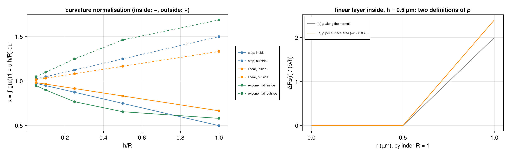

### D3.2 — Profiles: step first, then linear and exponential

**Decision.** The step profile is implemented and verified first. Linear and exponential follow once the integration path of D3.3 exists.

**Why.** For the step profile the exponent over a straight piece is ΔR₂(0)·dt·(fraction of the piece inside the shell). The fraction follows from exact line–circle intersections (D3.3). So the step profile on cylinders keeps an exact closed form and can be verified to roundoff, as on walls, before any numerical integration is introduced.

### D3.3 — Integration along a straight piece: quadrature for all profiles, linear closed form as its test

**Problem.** A straight piece from p₀ to p₁, with transverse displacement Δ⊥, has squared distance from the axis

  r(s)² = |p₀⊥ − c + s Δ⊥|² = a s² + b s + q,  s ∈ [0, 1],

where a = |Δ⊥|², b = 2(p₀⊥ − c)·Δ⊥ and q = |p₀⊥ − c|². So d(s) = R − √(as² + bs + q) (inside) is not linear in s. The exponent of the piece, of duration dt, is

  E = dt ∫₀¹ ΔR₂(d(s)) ds.

**Method.**
- The roots of r(s) = R − h and r(s) = R (or R and R + h outside) split [0, 1] into sub-intervals that lie entirely inside or entirely outside the shell. These are exact quadratic roots, with tangent and chord-only cases handled explicitly.
- **Step:** E = ΔR₂(0)·dt·(total length of the inside sub-intervals), exactly.
- **Linear and exponential:** an adaptive quadrature on each inside sub-interval, with tolerance ε_R₂ on E, fixed in P3.6.3.
- **Independent check:** the linear profile also has a closed form, because ∫√(as² + bs + q) ds is elementary (a logarithm/asinh form). The quadrature is tested against it (P3.3.2) and against the Phase 2 wall closed forms (P3.3.3).

**Why.** A single integration path for all profiles keeps the code small, and the closed forms make it testable. This activates the Phase 2 items deferred for walls: P2.4.6 (quadrature path), P2.6.6 (V12 tolerance), P2.6.7 and P2.6.9 (cost).

### D3.4 — Both sides, side-specific parameters

**Decision.** Each cylinder surface has an inner (inside) and an outer (outside) layer, each with its own (ρ, h, g). Both sides are symmetric by default. This is the walls' positive/negative pair transferred to cylinders.

**Why.** The intra- and extra-cylinder compartments can have different surface chemistry (the user's model, as in Phase 2). Setting one side to zero recovers a one-sided layer.

### D3.5 — Exponential support

**Decision.**
- **Inside:** support d ≤ R, so it reaches the axis, with the inside κ above.
- **Outside:** support d ≤ L, where L is the `layer_cutoff` and defaults to the smallest surface-to-surface gap between neighbouring cylinders, L = s_min − 2R, with s_min the smallest centre spacing. A single, non-repeating cylinder must set L explicitly.

**Why.** On walls the exponential is cut at the distance to the opposite surface (cutoff = wall spacing), so it reaches exactly the neighbouring surface. The cylinder analogue is the surface gap s − 2R.

**Clarification (2026-10-24).** The decision table first said "half the smallest centre spacing". That was a slip, corrected here to the gap, which matches the wall convention. Renormalising g over its support keeps ∫g = 1, so ρ stays the relaxation per unit area (D3.1).

### D3.6 — Arrays: square and rectangular

**Decision.** Square arrays (centre spacing s in x and y) and rectangular arrays (s_x ≠ s_y), as MCMR `Cylinders(repeats = [s_x, s_y])`. Random packings are an optional extension in 3.7.

**Why.** These give the three overlap classes of the proposal (Milestone 5) by construction. With the surface gaps G_x = s_x − 2R and G_y = s_y − 2R:
- **separated:** G_x > 2h and G_y > 2h;
- **one-direction overlap:** G_x ≤ 2h < G_y;
- **two-direction overlap:** G_x ≤ 2h and G_y ≤ 2h.

At overlap the contributions of all cylinders within reach are summed (Eq. 10 of the proposal), as on walls.

---

## Implementation of the step layer on cylinders (P3.2.1–P3.2.4, P3.2.6)

Plan [2026-10-24-cylinders-step.md](../docs/superpowers/plans/2026-10-24-cylinders-step.md). Code:
- [layers.jl](../src/geometries/internal/layers.jl): `CylinderLayer`, `kappa`, `cylinder_surface_rate`, `disk_length`, `shell_fraction`, `cylinder_exponent`, `image_centres`, `layer_exponent`, `max_layer_rate`;
- [fix.jl](../src/geometries/user/fix.jl): `cylinder_layers`, `check_outer_reach`, `obstruction_shifts`.

Tests: [test_layer_cylinders.jl](../test/test_layer_cylinders.jl), 100 tests. The full suite without plots passes, 3497/3497.

**Design.**
- **Exact shell time in closed form.** Along a straight piece p(s) = p₀ + sΔ, s ∈ [0, 1], the squared distance from the axis (in the transverse plane of the cylinder) is

  r(s)² = a s² + b s + q,  a = |Δ⊥|²,  b = 2(p₀⊥ − c)·Δ⊥,  q = |p₀⊥ − c|².

  It is convex in s, so {s : r(s)² ≤ X} is one interval of length L(X), bounded by the roots. The fraction of the piece in the shell r_lo ≤ r ≤ r_hi is

  f = L(r_hi²) − L(r_lo²),

  with no side bookkeeping: the inner shell is [R − h_in, R] and the outer shell is [R, R + h_out]. The roots use the cancellation-free form t = −(b + sign(b)√disc)/2, s = t/a and (q − X)/t. A piece with a = 0 (purely axial motion) is a stationary point.
- **Exponent of a piece.** For the step profile, E = ΔR₂(0)·dt·f exactly. With D3.1,

  ΔR₂(0) = (ρ/h)/κ,  κ = 1 − h/(2R) inside,  κ = 1 + h/(2R) outside.

- **Arrays.** Every image of every cylinder within reach R + h_out of the piece's bounding box is summed (proposal Eq. 10), so overlapping outer layers add. Rotated axes come from the group's rotation: motion along the axis does not change r.
- **Alternatives rejected.**
  - Sampling the piece: not exact, and slow.
  - Tracking which side a piece is on: unnecessary, because the two shells are disjoint radial ranges.
- **Validation.**
  - h_inner ≤ R.
  - h_outer ≤ the smallest surface gap |c_i − c_j| − R_i − R_j to any other cylinder or image (centres wrapped into the cell, images within ±1 cell). This is the wall rule h ≤ spacing, so an outer layer never relaxes spins inside another cylinder.
  - Only the step profile is accepted on cylinders so far (D3.2).
  - Fields: `layer_rho`, `layer_h`, `layer_shape`, each with `_inner` and `_outer` versions; JSON and CLI supported.
- **Timestep (P3.2.6).** τ ≤ c/ΔR₂,max with c = 0.005. Here ΔR₂,max is the larger of:
  - the inner surface rate;
  - the outer surface rate plus the outer rates of every cylinder or image whose outer shell intersects this one's (|c_i − c_j| < R_i + h_i + R_j + h_j).

  This equals the largest rate when shells do not overlap and is an upper bound otherwise. Example: a square array s = 2.5, R = 1, h = 0.3 has 5 overlapping outer rates at the 4 nearest neighbours.

**Verification (package tests).**
- Shell fraction against brute-force sampling (10⁵ points, 3000 pieces): max error < 3e-5, the sampling bound. Exact cases:
  - radial;
  - a chord;
  - tangent to the outer circle (fraction 0) and to the inner circle;
  - h = R;
  - stationary points.
- Review Focus cases:
  - nearly axial motion (|Δ⊥| = 1e-15);
  - a piece starting on r = R.
- Layer exponent against an independent brute-force sum of rates (2·10⁴ samples, 200 pieces, max error < 1e-4):
  - two and four overlapping cylinders;
  - a square array with images;
  - two cylinders per cell in a rectangular array;
  - a cylinder along x (r measured in the (y, z) plane).
- A hand-computed radial step with a reflection, inside and outside, to 1e-12.
- ρ = 0 bit-identical to no layer; h_inner = R uniform (every inside spin at e^(−0.1t)); bulk factorisation.
- Side-specific layers; a permeable cylinder; finite RF rejected.
- Mutation check: scaling the surface rate by 1.01 is caught by 22 tests.

**Roundoff at the surface (ruling).** A reflection point can lie a roundoff distance across r = R, inside the other side's shell (its boundary has measure zero). An outer-only layer then leaves inside spins at 1 − M⊥ ≈ 1e-15 per reflection rather than exactly 1, accumulating over 50 ms to at most 1.2e-11 at full size (10⁶ spins). The tests bound this leak at 1e-12 (package test, 2000 spins, 50 ms; max seen 1.3e-15) and 1e-9 (full size), eight orders below the layer's own effect (1 − S ≈ 0.87).

## C-B1, C-B2: null run and bulk R₂ on cylinders (P3.1.1, P3.1.2)

Script [p3_1_1_null_bulk.jl](phase3/p3_1_1_null_bulk.jl) → [results/phase3/p3_1_1_null_bulk/](results/phase3/p3_1_1_null_bulk/).

**Design.** These are the exact baselines of the old code on the geometries used in Phase 3:
- a single cylinder R = 1 µm (inside);
- a square array s = 2.5 µm, R = 1 (inside and outside; surface gap 0.5 µm).

Default timestep, seeds 1–10, 10⁵ spins per seed, readouts 0:5:50 ms. Spins for the single cylinder start uniformly in the box [−R, R]³; the region is set by the distance from the nearest axis at t = 0.

**Method.**
- **C-B1:** every spin keeps M⊥ = 1 exactly.
- **C-B2 (R₂ = 1/80 ms⁻¹, same seeds):**
  - positions identical to C-B1;
  - per spin, |M⊥/e^(−t/80) − 1| ≤ 1e-10;
  - ensemble within B = (t/τ + N)·ε = 2.3e-11.

**Result.**

| configuration | τ_default (ms) | spins in region (mean per seed) | C-B1 | C-B2 per spin | C-B2 ensemble | outcome |
|---|---|---|---|---|---|---|
| single, inside | 0.01 | 78 501 | exact | 5.4e-14 | 4.4e-14 | **PASS** |
| array, inside | 0.01 | 50 247 | exact | 5.4e-14 | 4.4e-14 | **PASS** |
| array, outside | 0.01 | 49 753 | exact | 5.4e-14 | 4.4e-14 | **PASS** |

**Conclusion.** τ_default = 0.03·R²/D = 0.01 ms, set by the tortuosity constraint with size scale R. The bulk factor is exact to roundoff on cylinders.

## C-B3: density and shell occupancy (P3.1.3), and with the layer on (P3.4.5)

Scripts [p3_1_3_density.jl](phase3/p3_1_3_density.jl) and [p3_1_3b_density_tau.jl](phase3/p3_1_3b_density_tau.jl) → [results/phase3/p3_1_3_density/](results/phase3/p3_1_3_density/), [results/phase3/p3_1_3b_density_tau/](results/phase3/p3_1_3b_density_tau/).

**Design.** By (M2) of Phase 2, the mean layer exponent is ΔR₂ times the time fraction in the shell. So the density near a curved surface must be uniform, including at finite τ, where finite steps are reflected on a curved surface. The layer must also not move spins.

**Method.** Positions at t = 50 ms, pooled over 10 seeds (785 012 spins inside, 497 526 outside).
- **Inside:** for a uniform density, r²/R² is uniform on [0, 1]. Test: 100-bin χ², z_χ = (χ² − dof)/√(2 dof).
- **Outside:** for R ≤ r ≤ s/2 whole annuli lie in the cell, so P(r_k ≤ r < r_k+1 | r ≤ s/2) = (r_k+1² − r_k²)/((s/2)² − R²). Test: 50 equal-area bins.
- **Occupancy within h:** binomial z = (n − Np)/√(Np(1 − p)), with
  - p = (R² − (R − h)²)/R² inside;
  - p = π((R + h)² − R²)/(s² − πR²) outside.
- **Criteria:** |z_χ| ≤ 3, |z| ≤ 2 per h.

**Result.**

| test | no layer | layer on (ρ = 0.02, h = 0.2) |
|---|---|---|
| inside χ²/dof (z) | 1.047 (+0.33) | 1.047 (+0.33) |
| outside χ²/dof (z) | 1.159 (+0.78) | 1.159 (+0.78) |
| occupancy z inside, h = 0.05 / 0.1 / 0.2 / 0.5 | −1.90 / −1.12 / −1.69 / −1.56 | same |
| occupancy z outside, h = 0.05 / 0.1 / 0.2 | +1.60 / **+2.36** / **+2.89** | same |
| positions identical to the no-layer run | — | **true** (P3.4.5 **PASS**) |

The criterion outcome is **FAIL** (outside h = 0.1 and 0.2), not loosened. The h = R row inside (p = 1) is an exact check: the fraction is 1.

**Follow-up: occupancy vs τ** (deviation δ = fraction/p − 1, σ = √((1 − p)/(Np)); t = 0 control, where the positions are uniform by construction):

| region, h | t = 0 (control) | τ = 4e-2 | τ = 1e-2 | τ = 2.5e-3 |
|---|---|---|---|---|
| inside, 0.05 | −0.02 % (z −0.05) | −0.32 % (−0.93) | −0.65 % (−1.90) | −0.24 % (−0.68) |
| inside, 0.2 | −0.02 % (−0.16) | +0.16 % (+1.07) | −0.26 % (−1.69) | +0.15 % (+0.98) |
| outside, 0.05 | −0.68 % (−1.64) | −0.26 % (−0.63) | +0.67 % (+1.60) | +0.18 % (+0.44) |
| outside, 0.2 | +0.26 % (+1.61) | −0.19 % (−1.19) | +0.46 % (+2.89) | +0.48 % (+3.05) |

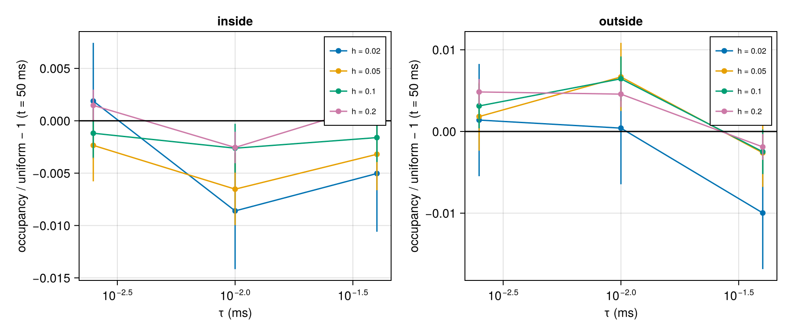

**Conclusion.**
- There is no monotone trend with τ, and the t = 0 control fluctuates by the same amount.
- The nested shells (h = 0.05 ⊂ 0.1 ⊂ 0.2) reuse the same spins, so one fluctuation appears in several z values. The χ² over disjoint bins passes in both regions.
- The decisive check is the mean-exponent identity (P3.4.3 below). A real +0.46 % excess within 0.2 µm of the outer surface would shift E[−ln M⊥] by ≈ +0.5 %, about 20σ. The measured value agrees to +5e-6 relative.
- The C-B3 deviations are therefore fluctuations: the density is uniform near curved surfaces at this precision. The layer moves no spin.

## C-B4: conventional θ reference curves on cylinders (P3.1.4)

Scripts [p3_1_4_theta_reference.jl](phase3/p3_1_4_theta_reference.jl) and [p3_1_4b_tau16.jl](phase3/p3_1_4b_tau16.jl) → [results/phase3/p3_1_4_theta_reference/](results/phase3/p3_1_4_theta_reference/) (`reference_curves.csv` is the reference set).

**Design.** These curves are the conventional model's reference on cylinders (a reference, not the truth). Configurations:
- single cylinder inside, R = 0.5, 1, 2;
- square array s = 2.5, R = 1, inside and outside.

θ = 0.003, 0.01, 0.03; D = 3; seeds 1–10, 2·10⁴ spins per seed.

**Method.**
- **Convergence:** τ_a = min(1e-2, 0.03R²/D) against τ_a/4, z = (S_a(50) − S_b(50))/√(SEM_a² + SEM_b²), one test per curve; the 11 readouts are correlated. Pass if |z| ≤ 2.
- **Bulk factorisation:** same seeds with R₂ = 1/80; the per-spin ratio must be e^(−t/80).

**Result.** 14 of 15 curves have |z| ≤ 2 (range −0.98 … +1.19). The exception is array outside θ = 0.03, z = +2.06. Rerun at τ_a/16 = 6.25e-4 ms, it agrees with τ_a/4: 0.05194 against 0.05192 ± 2.2e-5, z = +0.83. τ_a/4 is the reference for that curve (ruling). Bulk factorisation: max per-spin deviation 5.9e-14.

| configuration | S(50), θ = 0.003 / 0.01 / 0.03 (τ_a/4) |
|---|---|
| single R = 0.5 | 0.55643 / 0.14178 / 0.00286 |
| single R = 1 | 0.74596 / 0.37666 / 0.05368 |
| single R = 2 | 0.86372 / 0.61398 / 0.23254 |
| array inside | 0.74596 / 0.37666 / 0.05369 |
| array outside | 0.74359 / 0.37265 / 0.05194 |

**Conclusion.** The conventional reference is τ-converged at these settings. A single cylinder and the array give the same inside curve (the compartments are identical), which is a consistency check.

## Conventional mapping on curved surfaces (P3.1.6)

Script [p3_1_6_mapping.jl](phase3/p3_1_6_mapping.jl) → [results/phase3/p3_1_6_mapping/](results/phase3/p3_1_6_mapping/).

**Design.** MCMR's conventional model multiplies M⊥ by e^(−θ√τ) at each collision, so for every path −ln M⊥ = θ√τ·(number of collisions). On walls the collision rate per unit area is n√(D/(πτ)), which gives the relaxivity ρ = θ√(D/π) (Phase 2, P2.5.0). On a curved surface, finite steps √(2Dτ) could change the collision rate by O(√(Dτ)/R). The fixed-ρ comparisons of 3.7 need the mapping to hold, or a measured correction.

**Method.**

  E[−ln M⊥(t)] = θ√(D/π)·(S/V)·t,  S/V = 2/R inside,  2πR/(s² − πR²) outside.

- Measured at t = 50 ms for 5 configurations, D = 1, 3, 6 (D scan on single R = 1 and array outside), τ = 1e-2 and 2.5e-3, θ = 0.01; seeds 1–10, 2·10⁴ spins.
- z = (mean − expected)/SEM. Pass if |z| ≤ 3; otherwise the measured ratio becomes the mapping.

**Result.** 18 of 18 have |z| ≤ 3 (max |z| = 2.17). The ratio measured/expected lies in 0.99976–1.00013 over √(Dτ)/R = 0.04–0.35.

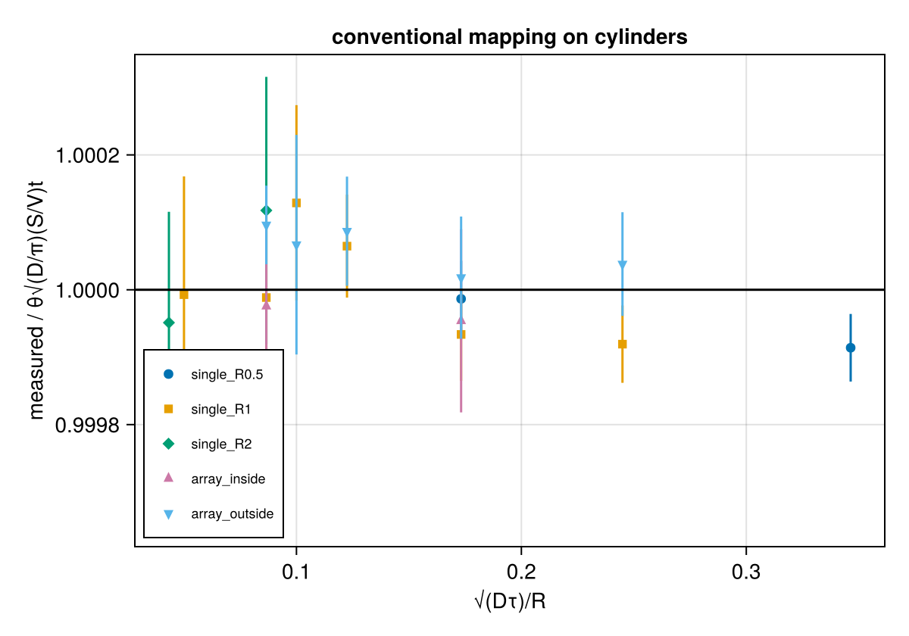

**Conclusion.** The conventional relaxivity ρ = θ√(D/π) holds on these curved surfaces to ≈ 1e-4, with no resolved trend in √(Dτ)/R up to 0.35. Phase 3 comparisons at fixed ρ use θ = ρ√(π/D) unchanged.

## C-B5: runtime on cylinders (P3.1.5)

Script [p3_1_5_runtime.jl](phase3/p3_1_5_runtime.jl) → [results/phase3/p3_1_5_runtime/](results/phase3/p3_1_5_runtime/). Single runs of 10⁴ spins × 1000 steps, 8 threads; ratios carry a load uncertainty of 10–20 %.

| τ (ms) | single, no layer (µs/spin-step) | single, layer | ratio | array, no layer | array, layer | ratio |
|---|---|---|---|---|---|---|
| 0.1 | 0.0738 | 0.0924 | 1.25 | 0.0824 | 0.1312 | 1.59 |
| 1e-2 | 0.0442 | 0.0666 | 1.51 | 0.0495 | 0.0806 | 1.63 |
| 1e-3 | 0.0370 | 0.0557 | 1.50 | 0.0393 | 0.0657 | 1.67 |
| 1e-4 | 0.0350 | 0.0538 | 1.54 | 0.0380 | 0.0603 | 1.59 |

**Many cylinders per cell** (final-review finding; script [p3_1_5b_runtime_many.jl](phase3/p3_1_5b_runtime_many.jl), `runtime_many.csv`).
- Set-up: n × n cylinders (R = 0.7, spacing 2) per cell of side 2n, the same packing density for every n; layer ρ = 0.02, h = 0.1; 2000 spins × 1000 steps.
- The layer exponent loops over every cylinder of the group on every straight piece, at ≈ 1 ns per cylinder even when none of its images is within reach. So the cost grows with the total number of cylinders per cell.

| cylinders per cell | no layer (µs/spin-step) | layer | ratio |
|---|---|---|---|
| 1 | 0.119 | 0.123 | 1.0 |
| 9 | 0.100 | 0.136 | 1.4 |
| 100 | 0.100 | 0.271 | 2.7 |
| 400 | 0.107 | 0.721 | 6.7 |

The final reviewer measured ×17 at 400 cylinders per cell in another configuration (R = 0.7, h = 0.1, a 40 × 40 cell).

**Conclusion.**
- With one cylinder per cell, the step layer costs ×1.25–1.67 per spin-step on cylinders, against ×1.2–1.4 on walls. A reference run (10⁵ spins × 50 ms × 10 seeds at τ = 0.01) takes ≈ 5–7 min.
- The cost grows with the total number of cylinders per cell (×6.7 at 400 here). Packings of hundreds of axons are therefore correct but slow.
- A cell list of layer indices (shell bounding boxes R + h_out, like MCMR's hit grid) would restore a cost proportional to the cylinders within reach. It is deferred to the plan that introduces packings (ruling; tracker P3.6.4).

## Verification of the step layer on cylinders (P3.4.1, P3.4.3)

### P3.4.1: single-spin trace

Script [p3_4_1_trace.jl](phase3/p3_4_1_trace.jl) → [results/phase3/p3_4_1_trace/](results/phase3/p3_4_1_trace/).

**Design.** The configuration is the hardest one for the bookkeeping: a square array s = 2.5, R = 1 with h = 0.3 on both sides, so the outer shells overlap (gap 0.5 < 2h). It also has reflections inside shells and image cylinders.

**Method.** Each step's prediction uses the simulator's reflected path and an independent brute-force summed rate (5 × 5 images, written from D3.1 in the harness):

  M⊥,pred = M⊥,prev · exp(−R₂,bulk·τ − Σ_j dt_j · (1/K)Σ_k ΔR₂(p_j(s_k))),  dt_j = τ·ℓ_j/Σℓ,  K = 10⁴.

Parameters: ρ = 0.03, so ΔR₂ = 0.1176 (inside) and 0.0870 (outside); R₂,bulk = 1/80; τ = 0.01; 100 spins × 500 steps. Midpoint sampling error per boundary crossing ≤ ΔR₂·τ/(2K) ≈ 6e-8.

**Result.** Max |M⊥,sim/M⊥,pred − 1| = 1.0e-7 (tolerance 1e-6) → **PASS**. 9808 steps had a reflection and a non-zero layer exponent; this counts reflected steps that touched a shell, not reflections located inside a shell. 2978 steps passed through an overlap of two outer shells, i.e. had a sample with summed rate 2·ΔR₂,out.

**Conclusion.** The error is at the sampling resolution (≈ 2 boundary crossings × 6e-8). The exact shell fractions, κ, the image loop and the overlap sum agree with brute force on real reflected paths.

### P3.2.5, P3.4.2, P3.4.4, P3.4.7: exact cases at full size

Script [p3_4_exact.jl](phase3/p3_4_exact.jl) → [results/phase3/p3_4_exact/](results/phase3/p3_4_exact/). Seeds 1–10, 10⁵ spins per seed, readouts 0:5:50, τ = 1e-2 (V0b: default τ).

**Design.** These cases are exact in any diffusion regime, so a failure means the code is wrong, not that there is noise.
- **V0b:** ρ = 0 must leave the run bit-identical to no layer.
- **Uniform inner layer:** step, h = R, so κ = 1 − 1/2 = 1/2. Then ΔR₂ = (ρ/R)/κ = 2ρ/R everywhere inside: with ρ = 0.05 and R = 1, every inside spin decays as M⊥ = e^(−(0.1 + R₂,bulk)t) whatever its path. This is the cylinder analogue of the wall cases h = w/2 (step) and h = w (linear), and it checks κ directly.
- **Additivity:** the bulk factor multiplies every step, so the per-spin ratio is e^(−t/80).
- **Side-specific:** an inner-only layer must not touch outside spins, and an outer-only layer must not touch inside spins.

**Method.**
- Per spin: ≤ 1e-10.
- Ensemble: ≤ B = (t/τ + N)·ε = 2.3e-11.
- Side leak: max(1 − M⊥) ≤ 1e-9 (roundoff ruling above).

**Result.**

| check | configuration | result | outcome |
|---|---|---|---|
| V0b inside / outside | square array, ρ = 0, h = 0.3 vs no layer, R₂ = 1/80 | positions and every M⊥ identical | **PASS** / **PASS** |
| uniform, bulk off | single R = 1, inner h = 1, ρ = 0.05 | per spin 9.7e-14, ensemble 6.6e-14 | **PASS** |
| uniform, bulk on (1/80) | same | per spin 1.3e-13, ensemble 1.1e-13 | **PASS** |
| additivity inside / outside | square array ρ = 0.02, h = 0.2 | positions identical; per spin 6.6e-14 / 6.7e-14 | **PASS** / **PASS** |
| inner-only layer | square array | outside spins: max leak 2.4e-12; inside S(50) = 0.1356 | **PASS** |
| outer-only layer | square array | inside spins: max leak 1.2e-11; outside S(50) = 0.1327 | **PASS** |

**Conclusion.** The κ normalisation gives the exact uniform rate 2ρ/R, so ρ is per unit surface area, as D3.1 requires. ρ = 0 runs the unmodified code. Bulk and layer factorise exactly. Each side acts only in its own compartment, up to roundoff at reflection points.

### P3.4.3: mean-exponent identity on cylinders

Script [p3_4_3_identity.jl](phase3/p3_4_3_identity.jl) → [results/phase3/p3_4_3_identity/](results/phase3/p3_4_3_identity/).

**Design.** With ρ defined per unit surface area (D3.1) and a uniform stationary density, every compartment satisfies

  E[−ln M⊥(t)] = t·⟨ΔR₂⟩_compartment = ρ·(S/V)·t

for any h and τ. Each shell integrates to exactly ρ per unit area of its surface:

  ∫ shell ΔR₂ dA = (ρ/(hκ))·π((R ± h)² − R²) = (ρ/(hκ))·2πRh(1 ± h/2R) = 2πRρ.

Overlapping outer layers add their integrals, and validation keeps them out of other cylinders. The identity therefore tests κ, the shell fractions, the image loop, the overlap sum and the density end to end. It does not constrain S = ⟨M⊥⟩, which is where profiles and the conventional model differ.

**Method.** ρ = 0.02, step, t = 50 ms, τ = 1e-2 and 4e-2, seeds 1–10, 10⁵ spins per seed. z = (mean − ρ(S/V)t)/SEM; pass if |z| ≤ 3.

**Result.**

| configuration | τ (ms) | ρ(S/V)t | E[−ln M⊥] ± SEM | z |
|---|---|---|---|---|
| single R = 1, h = 0.2 | 1e-2 | 2.000000 | 2.000019 ± 9.2e-5 | +0.21 |
| | 4e-2 | | 1.999988 ± 8.1e-5 | −0.15 |
| single R = 0.5, h = 0.2 | 1e-2 | 4.000000 | 3.999918 ± 8.3e-5 | −1.00 |
| | 4e-2 | | 4.000063 ± 1.1e-4 | +0.55 |
| square inside, h = 0.2 | 1e-2 | 2.000000 | 2.000105 ± 1.5e-4 | +0.68 |
| | 4e-2 | | 2.000003 ± 1.2e-4 | +0.03 |
| square outside, separated (h = 0.2) | 1e-2 | 2.021352 | 2.021362 ± 6.5e-5 | +0.16 |
| | 4e-2 | | 2.021373 ± 9.4e-5 | +0.23 |
| square outside, overlap (h_out = 0.4 > gap/2) | 1e-2 | 2.021352 | 2.021363 ± 4.8e-5 | +0.23 |
| | 4e-2 | | 2.021311 ± 5.4e-5 | −0.76 |
| rectangular 2.4 × 3.0 outside, overlap in x only (h_out = 0.3) | 1e-2 | 1.548190 | 1.548257 ± 9.6e-5 | +0.70 |
| | 4e-2 | | 1.548305 ± 9.2e-5 | +1.25 |

**Conclusion.**
- 12 of 12 pass with |z| ≤ 1.25. The runs share seeds, so the z values are correlated.
- The agreement is ≤ 6e-5 relative, inside and outside, with and without overlap, for both τ. It holds even at R = 0.5, where κ = 0.8 differs most from 1.
- This confirms the D3.1 normalisation and the overlap sum. It also confirms that the density near the surfaces is uniform at the 1e-4 level (see C-B3).

## P3.4.6: radial continuum benchmark (single cylinder, inside)

Plan [2026-10-25-radial-continuum-h-sweep.md](../docs/superpowers/plans/2026-10-25-radial-continuum-h-sweep.md).
- Solver: [continuum_radial.jl](phase3/continuum_radial.jl); tests: [test_continuum_radial.jl](phase3/test/test_continuum_radial.jl).
- Monte Carlo check: [p3_4_6_continuum_check.jl](phase3/p3_4_6_continuum_check.jl), [p3_4_6b_tau16.jl](phase3/p3_4_6b_tau16.jl), [p3_4_6c_verdict.jl](phase3/p3_4_6c_verdict.jl) → [results/phase3/p3_4_6_continuum_check/](results/phase3/p3_4_6_continuum_check/).

**Design.**
- **Why a continuum.** At fixed ρ every model has the same mean exponent, so the differences between models are of order 1e-4 in S. That is the size of the Monte Carlo timestep error (Review C1 on walls). An exact solution without Monte Carlo and without a timestep is therefore needed as the reference for differences.
- **Why inside only.** Inside a single cylinder the problem is radially symmetric and one-dimensional. Outside, in an array, it is two-dimensional (2D solver optional, not built).

**Method.**

  ∂m/∂t = D (1/r) ∂_r(r ∂_r m) − [R₂,bulk + ΔR₂(r)] m,  0 ≤ r ≤ R,  m(r, 0) = 1,

- **Layer:** ∂_r m(R) = 0, with ΔR₂(r) = (ρ/h)·g((R − r)/h)/κ and κ = ∫g(u)(1 − uh/R)du (D3.1). κ is computed by quadrature, independently of the package's 1 − h/2R.
- **Conventional model:** D ∂_r m(R) = −ρ m(R) (Robin), with ρ = θ√(D/π) (valid on cylinders, P3.1.6).
- **Discretisation:** finite volumes, N = 2000 rings of width dr.
  - ring areas A_i = π(r_{i+1/2}² − r_{i−1/2}²);
  - conductances 2πD r_{i+1/2}/dr;
  - the Robin sink 2πRρ on the outer ring;
  - the step profile averaged exactly over each ring (area overlap).
- **Solution:** with y = √A·m the system is ẏ = −My, where M = A^(−1/2)(K + AV)A^(−1/2) is symmetric tridiagonal with eigenpairs (λ_k, u_k). Then

  S(t) = Σ_k (u_kᵀ√A)² e^(−λ_k t) / Σ_i A_i.

**Exact tests (25 assertions, all pass).**
- Free and bulk decay.
- h = R: the uniform rate 2ρ/R.
- κ for step and linear profiles.
- The initial slope −ρ(S/V) = −2ρ/R for both models.
- **Lowest rate, conventional model:** λ₁ = Dk², with D k J₁(kR) = ρ J₀(kR). Agreement rtol 1e-3, the first-order error of the Robin cell.
- **Lowest rate, step layer:** core m = J₀(kr), λ = Dk². Shell m = I₀(βr) + (I₁(βR)/K₁(βR))K₀(βr), with β = √((q − λ)/D) and q = ρ/(h(1 − h/2R)). The two are matched by continuity of m′/m at r = R − h. Agreement rtol 1e-5, including a strong case ρ = 0.5 (q ≈ 5 ms⁻¹).
- The Jensen bound S ≥ e^(−ρ(S/V)t), including h = 1e-4, below the grid spacing.
- Grid convergence: N = 1000 against 4000 within 1e-6 (layer) and 1e-4 (conventional).

**Ruling.** The exact-case tolerance is 2e-6, not the planned 1e-12. The eigenvalue roundoff is ≈ ε‖M‖ ≈ ε·4DN²/R² ≈ 1e-8 ms⁻¹, so S is off by ≈ t·1e-8. The measured error is 4e-8 at t = 50.

**Monte Carlo against the continuum.**
- **Set-up:** R = 1, D = 3, ρ = 0.02, the conventional model and the step layer h = 0.05, 0.1, 0.2, 0.5, 1.0; seeds 1–10, 2·10⁴ spins in the box (π/4 inside).
- **Pairing:** all models share τ, so their trajectories are identical (checked from the final positions and recorded: true in every pass), and ΔS = S_layer − S_conv is paired per seed.
- **Timesteps:** τ_a = 1e-2, τ_b = 2.5e-3, and τ_c = 6.25e-4 for the conventional model and h = 0.05, 0.1.
- **Criterion:** max over readouts |z| ≤ 3 for S and for ΔS, at the smallest τ run for each model.

| model | ΔS(50) MC, τ = 1e-2 | τ = 2.5e-3 | τ = 6.25e-4 | continuum | max \|z\| (S / ΔS) at smallest τ | outcome |
|---|---|---|---|---|---|---|
| conventional | — | — | — | — | 0.84 / — | **PASS** |
| step h = 0.05 | +1.95e-4 ± 1.8e-5 | +2.54e-5 ± 1.3e-5 | −2.81e-5 ± 7.1e-6 | −5.75e-5 | 2.49 / **4.14** | **FAIL** |
| step h = 0.1 | +3.78e-5 ± 1.6e-5 | −6.66e-5 ± 9.8e-6 | −9.77e-5 ± 8.6e-6 | −1.109e-4 | 1.95 / 1.80 | **PASS** |
| step h = 0.2 | −1.33e-4 ± 1.6e-5 | −1.88e-4 ± 1.6e-5 | — | −2.046e-4 | 1.17 / 1.02 | **PASS** |
| step h = 0.5 | −3.87e-4 ± 1.8e-5 | −3.81e-4 ± 2.7e-5 | — | −3.870e-4 | 0.90 / 0.92 | **PASS** |
| step h = 1.0 (uniform) | −4.54e-4 ± 1.9e-5 | −4.42e-4 ± 3.3e-5 | — | −4.508e-4 | S exact to 4.9e-8 / 0.72 | **PASS** |

**Notes on this table.**
- **Conventional continuum.** The values were computed with the first version of the conventional continuum (Robin sink on the outer ring's centre). The corrected face-centred scheme (final review I3) shifts S_conv(50) by +4.6e-7, which moves the ΔS z values by ≤ 0.07; not rerun.
- **Which summary to read.** The authoritative verdict is `summary_final.json` (p3_4_6c_verdict.jl). `summary.json` of the first pass says FAIL because it predates the τ_c pass and the exact h = 1 comparison.
- **Script provenance.** `p3_4_6b_tau16.jl` was trimmed after it ran: its original verdict section crashed after writing `comparison_tau16.csv`, and the verdict moved to p3_4_6c.
- **Uniform case.** The h = 1.0 S comparison uses t = 50 only. The run is deterministic, and t = 50 is where the roundoff is largest.

The h = 1.0 S comparison is exact rather than a z (ruling): every spin decays at exactly 0.1 ms⁻¹, so its SEM is ≈ 1e-17 and a z would only measure the continuum's roundoff.

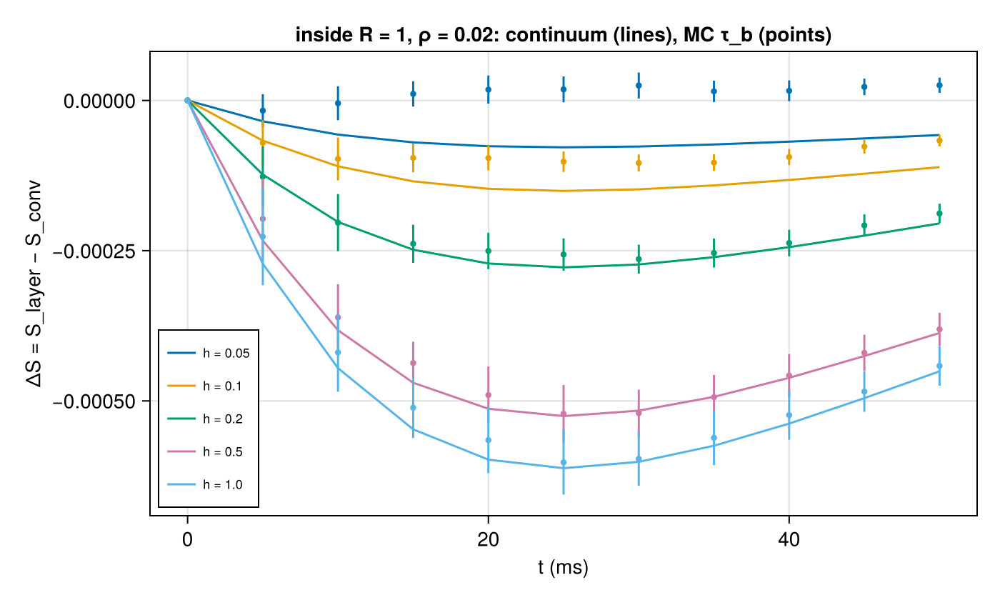

**Conclusion.**
- **The continuum is validated.** It reproduces the Monte Carlo S(t) of every model within 3 SEM at a converged τ. For h ≥ 0.1 it also reproduces the small paired difference ΔS.
- **Review C1 recurs on cylinders.** At fixed ρ, the default τ = 1e-2 biases the thin-layer difference so much that its sign flips (h = 0.05: +1.95e-4 against −5.75e-5). For h ≤ 0.1 it still matters at τ = 2.5e-3.
- **h = 0.05 still fails at τ = 6.25e-4** (z = 4.1), but it converges towards the continuum: the error from the continuum shrinks from 2.5e-4 to 8.3e-5 to 2.9e-5 for each fourfold reduction in τ (∝ τ^0.8). A linear-in-τ Richardson estimate from the last two passes gives −4.6e-5 (h = 0.05) and −1.081e-4 (h = 0.1, continuum −1.109e-4).
- **Consequence.** Inside single cylinders, fixed-ρ differences use the continuum. Monte Carlo differences for h ≲ 0.1 need τ ≲ 1e-3 or an extrapolation in τ. This feeds P3.6.2: for comparison studies, set τ from the error in the difference, not in R.

## P3.4.8: attenuation vs h at fixed ρ (step)

**Design.**
- **Why fixed ρ.** With ρ fixed, the mean exponent E[−ln M⊥] = ρ(S/V)t is the same for every h (P3.4.3). The h dependence of S is then entirely the Jensen term of Phase 2 (M3):

  S(t) = e^(−ρ(S/V)t)·e^(J(t)),  J = ln E[e^(−X)] + E[X] ≥ 0,  J ≈ Var[X]/2.

- **Limits.** The two ends of the sweep are known: h → 0 tends to the conventional surface model, and h = R inside is uniform (J = 0).
- **Sign.** The direction of the change with h is recorded, not assumed.
- **Range.** h ≥ 0.05 µm for Monte Carlo (user request 2026-10-25: thin layers force τ ∝ h). The continuum covers h/R = 0.005–1 at no extra cost.

### Inside single cylinders (continuum)

Script [p3_4_8_h_sweep_inside.jl](phase3/p3_4_8_h_sweep_inside.jl) → [results/phase3/p3_4_8_h_sweep_inside/](results/phase3/p3_4_8_h_sweep_inside/) (`sweep.csv`, `steps.csv`).
- R = 0.5, 1, 2; D = 3; ρ = 0.02; t = 50 ms. E[X] = 0.02·(2/R)·50 = 4, 2, 1 for R = 0.5, 1, 2.
- Curvature of ln S from a quadratic fit over 0:5:50.
- Grid error: |S(N = 2000) − S(N = 4000)| ≤ 5.2e-08 for the layers. For the conventional model, |S(N = 1000) − S(N = 2000)| ≤ 7e-09, with the Robin condition on the face.
- Correction (final review I3): the first version put the Robin sink on the outer ring's centre, a first-order error of ≈ 5e-7 in S_conv(50). That changed ΔS vs conventional by 10–20 % at h/R ≤ 0.01; the numbers below are corrected.

| h/R | S(50), R = 1 | J(50), R = 0.5 / 1 / 2 | ΔS(50) vs conventional, R = 0.5 / 1 / 2 |
|---|---|---|---|
| 0.005 | 0.135781 | 3.287e-03 / 3.285e-03 / 3.278e-03 | -8.1e-7 / -6.0e-6 / -1.6e-5 |
| 0.02 | 0.135763 | 3.156e-03 / 3.154e-03 / 3.148e-03 | -3.2e-6 / -2.4e-5 / -6.4e-5 |
| 0.05 | 0.135729 | 2.904e-03 / 2.902e-03 / 2.897e-03 | -7.9e-6 / -5.8e-5 / -1.6e-4 |
| 0.1 | 0.135675 | 2.510e-03 / 2.508e-03 / 2.504e-03 | -1.5e-5 / -1.1e-4 / -3.0e-4 |
| 0.2 | 0.135581 | 1.818e-03 / 1.817e-03 / 1.815e-03 | -2.8e-5 / -2.1e-4 / -5.6e-4 |
| 0.3 | 0.135505 | 1.251e-03 / 1.251e-03 / 1.250e-03 | -3.8e-5 / -2.8e-4 / -7.6e-4 |
| 0.5 | 0.135399 | 4.712e-04 / 4.714e-04 / 4.710e-04 | -5.2e-5 / -3.9e-4 / -1.1e-3 |
| 0.7 | 0.135349 | 9.790e-05 / 9.775e-05 / 9.761e-05 | -5.9e-5 / -4.4e-4 / -1.2e-3 |
| 1.0 (uniform) | 0.135335 | ≈ 0 (−2e-7 … −7e-9, roundoff) | -6.1e-5 / -4.5e-4 / -1.2e-3 |
| conventional | 0.135787 | 3.331e-03 / 3.329e-03 / 3.322e-03 | 0 |

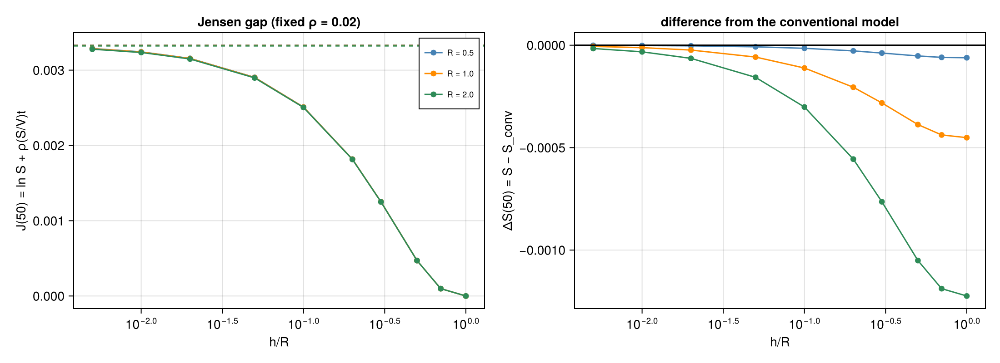

**Result.**
- **Monotone.** All 27 neighbouring steps are resolved (more than 10× the grid error), and in every one S(50) falls as h grows. Every layer has S below the conventional model.
- **Single-exponential.** The curvature of ln S is ≤ 2.6e-9 ms⁻² everywhere.

**Conclusion.**
- **Ordering.** At fixed ρ, spreading the relaxation deeper into the cylinder lowers the spin-to-spin variance of the exponent and so lowers S. In order: the conventional surface sink has the largest J and the highest S; the uniform layer (h = R) has J = 0 and the lowest S, e^(−2ρt/R). This is the same ordering as on walls.
- **J depends on h/R almost only.** At the same ρ, t and D (only R was varied), J is the same function of h/R for R = 0.5, 1 and 2 to within 0.3 %, although E[X] differs by a factor of 4. A small systematic trend remains: J falls slightly as R grows at every h/R, e.g. 3.287 / 3.285 / 3.278e-3 at h/R = 0.005. It is far above the grid error, and is presumably a finite-t or higher-cumulant term. This is consistent with Var[X] ∝ (ρ²t/D)·f(h/R): the rate fluctuation of a spin scales as ρ/R and its correlation time as R²/D, so R cancels. Consequences:
  - ΔS ≈ S·(J − J_conv) grows with R here only because S = e^(−2ρt/R) is larger for larger R;
  - the relative difference ΔS/S, ≈ −3.3e-3 between the uniform layer and the conventional model, is the same for every R at the dimensionless ρ²t/D = 6.7e-3.
- **Observability.** The largest difference is |ΔS(50)| = 1.2e-3 (R = 2, h = R), against 0.01 at SNR 200. Inside single cylinders at this ρ the h dependence is not observable from a single curve. Where it might become observable is P3.7.

### Outside, square arrays (paired Monte Carlo)

Scripts [p3_4_8_h_sweep_outside.jl](phase3/p3_4_8_h_sweep_outside.jl) and [p3_4_8b_outside_tau16.jl](phase3/p3_4_8b_outside_tau16.jl) → [results/phase3/p3_4_8_h_sweep_outside/](results/phase3/p3_4_8_h_sweep_outside/) (`sweep.csv`, `steps.csv`, `steps_tau16.csv`).

**Method.**
- **Geometry:** outer layer only, R = 1, ρ = 0.02, D = 3, in two arrays:
  - s = 2.5 (gap 0.5): h = 0.05–0.5; layers overlap for h > 0.25;
  - s = 3.0 (gap 1.0): h = 0.05–1.0; layers overlap for h > 0.5.
- **Why Monte Carlo.** There is no continuum outside.
- **Pairing.** All h and the conventional model of one array share τ, so their trajectories are identical (checked from the final positions and recorded: true). Neighbouring h are compared by paired per-seed differences d = S(50; h_{k+1}) − S(50; h_k).
- **Timesteps:**
  - τ_a = 1e-2 and τ_b = 2.5e-3: seeds 1–10, 2·10⁴ spins per seed;
  - τ_c = 6.25e-4 for the conventional model and h ≤ 0.2: 10⁴ spins per seed.

  The thin end was rerun at τ_c because P3.4.6 showed a Review C1 bias for h ≤ 0.1.
- **Resolved step:** |z| > 3. The sign is recorded, not assumed.

**Result.**
- E[−ln M⊥] = ρ(S/V)t within noise for every h and τ: 2.0213 at s = 2.5 and 1.0725 at s = 3.0, a re-check of P3.4.3.
- Each neighbour step below is reported at the smallest τ run for it: τ_c for the steps involving h ≤ 0.2, τ_b otherwise.
  - Thin end: the shift from τ_b to τ_c is ≤ 2.1σ. That test has little power, because τ_c used half the spins and its shift z treats the two runs as independent although they share initial positions.
  - Inside, at the same τ_c and h = 0.05, about half of the true difference was still timestep bias (P3.4.6). The thin-end steps outside are therefore probably biased towards zero, by up to tens of percent.
  - Thicker steps: the τ_a → τ_b shift is ≤ 1.5σ, except s = 2.5, 0.4 → 0.5 (2.6σ).

| array | step | paired ΔS(50) ± SEM | z | τ |
|---|---|---|---|---|
| s = 2.5 | conventional → h 0.05 | −2.34e-5 ± 9.8e-6 | −2.4 | τ_c |
| | 0.05 → 0.1 | −4.77e-5 ± 1.2e-5 | −3.9 | τ_c |
| | 0.1 → 0.2 | −9.32e-5 ± 1.7e-5 | −5.4 | τ_c |
| | 0.2 → 0.3 (overlap begins) | −4.69e-5 ± 8.9e-6 | −5.3 | τ_b |
| | 0.3 → 0.4 | −2.75e-5 ± 4.5e-6 | −6.1 | τ_b |
| | 0.4 → 0.5 (= gap) | −2.29e-5 ± 4.4e-6 | −5.2 | τ_b |
| s = 3.0 | conventional → h 0.05 | −4.36e-5 ± 2.4e-5 | −1.8 | τ_c |
| | 0.05 → 0.1 | −5.49e-5 ± 2.4e-5 | −2.3 | τ_c |
| | 0.1 → 0.2 | −1.19e-4 ± 1.4e-5 | −8.5 | τ_c |
| | 0.2 → 0.3 | −1.37e-4 ± 1.0e-5 | −13.3 | τ_b |
| | 0.3 → 0.5 | −1.67e-4 ± 2.2e-5 | −7.8 | τ_b |
| | 0.5 → 0.7 (overlap) | −8.24e-5 ± 1.4e-5 | −6.0 | τ_b |
| | 0.7 → 1.0 (= gap) | −4.27e-5 ± 6.8e-6 | −6.3 | τ_b |

Total difference from the conventional model at τ_b: S(50) − S_conv(50) = −2.57e-4 at s = 2.5, h = 0.5 (−0.19 % of S) and −6.52e-4 at s = 3.0, h = 1.0 (−0.19 %). These τ_b totals contain the thin-end step at τ_b. With the τ_c thin-end steps they are ≈ −0.20 to −0.21 %, and the residual bias at the thin end would make them slightly larger again.

**Curvature of ln S outside** ([p3_4_8c_outside_curvature.jl](phase3/p3_4_8c_outside_curvature.jl), `curvature.csv`; added after the final review, I2).
- Method: per seed, a fit ln S = a + bt + ct² over 0:5:50 at τ = 1e-2, 2·10⁴ spins.
- Result: c is zero within noise for the conventional model and every h in both arrays: |c| ≤ 1.9e-7 ms⁻², |z| ≤ 1.91.
- Conclusion: outside, as inside, the curves are single-exponential at this precision.

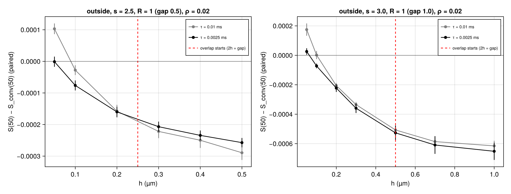

**Conclusion.**
- **Same ordering as inside, resolved from h = 0.05 on.** Outside, S falls with h through every layer step. 10 of the 13 steps are resolved beyond 3σ, and every layer step from 0.1 → 0.2 on is resolved.
- **The outside position of the conventional model is consistent but not resolved.** conventional → 0.05 has z = −2.4 (s = 2.5) and −1.8 (s = 3.0), and at τ_b the s = 3.0 step was even positive (+2.6e-5). The step 0.05 → 0.1 at s = 3.0 has z = −2.3. That the conventional model has the highest S outside rests on the inside result (continuum) and on these unresolved steps, whose residual timestep bias works towards zero.
- **Overlap** changes nothing qualitatively: the decrease simply continues more slowly once the layers overlap.
- **The relative effect is smaller than inside.** −0.19 % of S at h = gap, against −0.33 % for the uniform layer inside. Outside, even h = gap leaves the cell corners far from every surface, so the rate never becomes uniform.
- **Timestep.** At the default τ = 1e-2 the thin-end steps are biased, reversing the sign of conventional → 0.05: +1.03e-4 and +1.75e-4. At τ_c = 6.25e-4 they agree with τ_b within 2.1σ, but by the inside evidence a residual bias of the order of the step itself may remain.

**Overall conclusion (P3.4.8).**
- At fixed ρ on cylinders, S(t) decreases monotonically with h: resolved at every step inside (continuum), and from h = 0.05 on outside (paired MC). It lies between two limits:
  - the conventional surface model, the h → 0 limit, has the largest J and the highest S;
  - the most spread-out layer has the lowest S.
- All the differences are ≤ 0.33 % of S at ρ = 0.02 (ρ²t/D = 6.7e-3), far below single-measurement noise.
- Inside, J depends on h/R almost alone (to 0.3 %, at fixed ρ, t and D). The comparison over R, D and ρ, and the apparent T₂, belong to P3.7.

## Linear and exponential profiles on cylinders (P3.3.1–P3.3.4, D3.3, D3.5; P3.6.3)

Plan [2026-11-06-cylinders-linear-exponential.md](../docs/superpowers/plans/2026-11-06-cylinders-linear-exponential.md), Group 1 (package core). Code: [layers.jl](../src/geometries/internal/layers.jl) (`quad_adaptive`, `disk_interval`, `shell_profile_integral`, `cylinder_side_exponent`) and [fix.jl](../src/geometries/user/fix.jl) (`cylinder_layers`, `surface_gaps`). Tests: [test_layer_cylinders.jl](../test/test_layer_cylinders.jl).

**Design.**
- **No closed form along a piece.** For the step profile, the exponent of a piece follows exactly from the time spent in the shell. For non-step profiles, d(s) = R ∓ √(as² + bs + q) is not linear in s, so g(d(s)/h) has no closed form for the exponential profile. The linear profile does have one, but writing a closed form per profile does not scale.
- **D3.3 (decided):** one numerical path for all non-step profiles, with the linear closed form as an independent test. The step profile keeps its exact closed form.
- **Why Gauss–Legendre.** The support of a piece is cut at the exact shell roots (from the step code's quadratic) and at the closest approach to the axis, s* = −b/2a. On each part r(s) is smooth and monotone. Gauss–Legendre therefore converges very fast and needs no special handling of the kink at r = 0, which only the inner exponential reaches.
- **Exponential support (D3.5).**
  - Inside, the exponential reaches the axis (support R, c = R/h).
  - Outside, its support is the new field `layer_cutoff`. The default is the smallest surface gap to any neighbouring cylinder or image, the wall analogue (cutoff = spacing).
  - A cylinder with no neighbours and an outer exponential must set `layer_cutoff`; validation errors otherwise.
- **Support, not h.** Image reach, the outer-reach validation and the timestep bound all use the support L: h for step and linear, the cutoff for the exponential. An exponential with a short decay length but a long support is therefore summed wherever it reaches.

**Method.** For one side of a cylinder, over a straight piece of duration dt,

  E = (ρ/h)/κ · dt · ∫₀¹ g(d(s)/h) ds,  d(s) = R − r(s) inside,  r(s) − R outside,  r(s)² = as² + bs + q,

with:
- κ = 1 ∓ c̄/R, where c̄ = h/2 (step), h/3 (linear), h(1 − (c + 1)e^(−c))/(1 − e^(−c)) (exponential, c = L/h);
- the integral over the support taken as the sum of its parts {s : r_lo ≤ r(s) ≤ r_hi}, bounded by the roots of r(s)² = r_lo² and r(s)² = r_hi², each further split at s*;
- each part integrated by 8-point Gauss–Legendre, the nodes computed with Golub–Welsch (no new dependency), halving until the whole-interval and two-halves estimates agree within LAYER_QUAD_TOL·(length). The default LAYER_QUAD_TOL is 1e-10.

**Verification (package tests, all pass; full suite without plots 3553/3553).**
- **Linear against its closed form:** ∫g ds = ∫(2 − 2(R − r)/h) ds, with ∫√(as² + bs + q) ds = (2as + b)√Q/(4a) + (4aq − b²)/(8a^(3/2))·ln|2√a√Q + 2as + b|. Agreement within 1e-10 on chords, pieces through the core, and pieces inside the shell.
- **Wall regression:** along a radial piece, d(s) is exactly linear, so the cylinder integral must equal the wall closed form (`side_exponent`) for linear and exponential. Agreement within rtol 1e-9.
- **Brute force:** 300 random pieces × 4 cases (linear and exponential, inside and outside), 2·10⁵ samples each; max error < 2e-4, the sampling bound.
- **Through the axis:** the inner exponential reaches r = 0, and a radial piece through it gives exactly h, since ∫₀¹ g ds = h∫g du.
- **Tangent and grazing pieces:** tangent to r = R, to r = R − h, and to the exponential's support edge. All finite and correct.
- **Simulation:** a hand-computed radial step with a reflection, inside, for linear (κ = 1 − h/3R) and exponential (∫g dt from e^(−d/h) on each straight piece), to rtol 1e-9 and 1e-8.
- **Layer exponent against an independent brute-force summed rate:** square array with overlapping outer layers, both profiles.
- **Support-based reach:** an outer exponential with h = 0.05 and support 0.5 contributes at 0.4 from the surface. The timestep bound counts the 4 neighbours whose supports intersect.
- **Side-specific and bulk:** both hold for the new profiles.
- **Validation:** shapes, default and explicit cutoff, cutoff larger than the gap, an isolated cylinder without a cutoff, h_inner > R for linear. JSON and CLI round trips.
- **Step results bit-identical:** in the reference run (square array, 1000 spins, 20 ms) the summed M⊥ is 447.8892123934866 both at the base commit (3bcd2c6) and after this plan.

**Tolerance and cost (P3.3.4, P3.6.3).** Script [p3_3_quadrature.jl](phase3/p3_3_quadrature.jl) → [results/phase3/p3_3_quadrature/](results/phase3/p3_3_quadrature/).
- Accuracy: 2·10⁴ random pieces, compared with a tolerance-1e-14 reference.
- Runtime: square array s = 2.5, ρ = 0.02, h = 0.2 on both sides, τ = 1e-2, 10⁴ spins × 1000 steps.

Accuracy is measured against the same algorithm at tol 1e-14 (self-convergence). The linear profile is also checked against its independent closed form ([p3_3b_linear_closed_form.jl](phase3/p3_3b_linear_closed_form.jl), 2·10⁴ pieces): max error 8.2e-14 for h = 0.3 and 9.3e-11 for h = R, where pieces pass through the axis and the shell reaches r = 0.

The values below were measured after the allocation fix (Group 1 review); the first version allocated 200–400 B per piece and was ≈ 1.2–2× slower. Times are single-shot wall times on a shared machine (±20 %).

| case | max error vs tol-1e-14 reference at tol = 1e-4 / 1e-6 / 1e-8 / 1e-10 / 1e-12 | ns per piece at 1e-6 / 1e-10 |
|---|---|---|
| linear, inside (h = 0.3) | ≤ 6.1e-16 at every tolerance | 243 / 240 |
| linear, outside | ≤ 6.7e-16 at every tolerance | 244 / 244 |
| exponential, inside (h = 0.2, support R) | 2.3e-7 / 2.3e-7 / 2.1e-8 / 3.2e-11 / 8.5e-13 | 613 / 1206 |
| exponential, outside (h = 0.15, support 0.5) | ≤ 2.2e-14 / … / 3.9e-16 | 580 / 622 |

| profile | µs per spin-step (tol 1e-10) | at tol 1e-6 | relative to step |
|---|---|---|---|
| step | 0.089 | — | 1 |
| linear | 0.106 | 0.107 | ×1.2 |
| exponential | 0.221 | 0.222 | ×2.5 |

**Conclusion.**
- **Linear is converged at the first level.** Its integrand, a linear function of √(quadratic), is so smooth on each part that 8-point Gauss–Legendre needs no bisection. The result agrees with the independent closed form to 8e-14, or 9e-11 for pieces through the axis when h = R.
- **The exponential's error is controlled by the tolerance.** At the default 1e-10 the worst error, 3.2e-11, occurs for inner pieces through the steep part near the surface. Pieces outside are exact to roundoff.
- **What 1e-10 means for the signal.** The error of a piece's exponent is ≤ (ρ/h)/κ·dt·3.2e-11, i.e. ≲ 1e-10 of the per-step exponent ΔR₂(0)·τ. That is far below the timestep error of R (≈ 1e-3) and the Monte Carlo noise.
- **No reason to relax it.** In the simulation a looser tolerance saves no measurable runtime (0.221 against 0.222 µs per spin-step). Diffusion-length pieces are short and converge at the first level, so the cost is dominated by the fixed 3 × 8 evaluations per part. Only long random pieces through the steep inner exponential get cheaper at 1e-6 (1206 → 613 ns), and such pieces are rare in the simulation. So 1e-10 stays (P3.6.3).
- **Cost.** The non-step profiles cost ×1.2 (linear) and ×2.5 (exponential) per spin-step relative to step in this array, on top of the step layer's own ×1.6 over no layer (C-B5). After the fix the quadrature path allocates nothing (tested).

**Rulings (Group 1).**
- Two old assertions from the step-only stage ("linear must be rejected", "centroid(:linear) throws") were replaced by the new behaviour.
- **Unrelated test failure.** One full test-suite run had a single failure in `test_known_sequences.jl`, "PGSE in realistic scanner with free diffusion": 37677.5 against 36787.9 ± 2 %.
  - That test is not seeded and uses no geometry, so the layer code is never entered.
  - It passed 3/3 times when run on its own, and in every earlier full run on this branch.
  - A second full run passed 3553/3553, including that test.

## Verification of linear and exponential on cylinders (Group 2: P3.4.1, P3.4.3, P3.4.6 per profile)

### Radial continuum for all profiles (exact ring averages)

Solver [continuum_radial.jl](phase3/continuum_radial.jl); tests [test_continuum_radial.jl](phase3/test/test_continuum_radial.jl).

**Design.** The first version averaged non-step profiles over each ring by sub-sampling. Layers thinner than a ring then lost part of their integral, ∫ΔR₂ dA = 0.996·2πRρ at h = 1e-4 (a deferred minor of the P3.4.6 review). Every profile has an elementary antiderivative of g((R − r)/h)·r, so the ring averages can be exact.

**Method.** The ring integral ∫_lo^hi g((R − r)/h)·r dr is clipped to the support [R − L, R]:
- step: r²/2;
- linear: 2[(1 − R/h)r²/2 + r³/(3h)];
- exponential: h·e^((r − R)/h)(r − h)/(1 − e^(−c)), with c = L/h and support L = R inside (D3.5).

The ring rate is V_i = (ρ/(hκ))·2π·∫/A_i, with κ = ∫_{R−L}^R g·r dr/(hR) from the same exact integral.

**Ruling.** κ was first computed by a midpoint rule over u ∈ [0, c]. That failed for thin exponential layers, where c = R/h = 10⁴ and a step of 0.1 in u gives an error of ≈ 1e-4. κ now comes from the exact ring integral. The κ tests against the closed forms (step 1 − h/2R, linear 1 − h/3R, exponential 1 − c̄/R) remain the independent check.

**Tests (156/156 in the research suite after the Group 2 review):**
- **ring_integral against an independent fine midpoint rule** of g((R − r)/h)·r on 90 random sub-intervals inside the support (linear h = 0.3; exponential h = 0.2 and 1.5), rtol 1e-9. This test was added after the Group 2 review: since κ comes from the same ring integral, ∫ΔR₂ dA = 2πRρ and the initial slope −2ρ/R hold by construction for any antiderivative. A deliberately wrong exponential antiderivative passed them and failed this test (60 failures).
- ∫ΔR₂ dA = 2πRρ for linear and exponential, including h = 1e-4 (below the grid spacing). This is by construction now, so it only guards the ring summation. The tolerance is 1e-8 because the test extracts V as a difference of diagonals ≈ D/dr².
- κ of the exponential with support R.
- The initial slope −2ρ/R and the Jensen bound.
- Grid convergence: N = 1000 against 2000 within 2e-8.
- The step results are unchanged, including the exact Bessel eigenvalue tests.

### Harness for any profile

[harness.jl](phase3/harness.jl): `g_profile`, `side_prefactor` (ρ/h)/κ with κ by quadrature, and `brute_rate_profile` (summed rate over 5 × 5 images). All are written independently of the package.

### P3.4.1 and P3.4.3 for linear and exponential

Scripts [p3_4_1_trace.jl](phase3/p3_4_1_trace.jl) and [p3_4_3_identity.jl](phase3/p3_4_3_identity.jl) with `SHAPE` → `results/phase3/p3_4_1_trace_<shape>/`, `results/phase3/p3_4_3_identity_<shape>/`. Configurations are as for the step profile:
- **trace:** square array s = 2.5, R = 1, h = 0.3, ρ = 0.03. For the exponential, h is the decay length, the support is R inside and the default cutoff 0.5 (the gap) outside;
- **identity:** ρ = 0.02, t = 50 ms, τ = 1e-2 and 4e-2. For the exponential the outer cutoff is the gap: 0.5 in the square array, 0.4 in the rectangular one. Single cylinders set `layer_cutoff = 1.0` for their irrelevant outer side (ruling).

**Method.**
- **Trace:** each step's M⊥ is predicted from the simulator's reflected path. The exponent of each piece is τ·ℓ_j/Σℓ times the mean of the brute-force summed rate over 10⁴ points.
- **Identity:** E[−ln M⊥] = ρ(S/V)t, which is exact for any profile because ρ is per unit surface area (D3.1) and every shell integrates to 2πRρ.

| profile | trace: max \|M⊥,sim/M⊥,pred − 1\| | reflected steps with a layer exponent / steps through an overlap (gates, see note) | identity: rows passing, max \|z\| |
|---|---|---|---|
| step (P3.4.1/3, for reference) | 1.0e-7 | 9808 / 2978 | 12/12, 1.25 |
| linear | 6.7e-12 | 9808 / 2946 | 12/12, 1.17 |
| exponential | 2.4e-8 | 9808 / 12599 | 12/12, 1.27 |

**Note on the count columns.** Both counts are gates (> 0), not comparable statistics.
- "Reflected steps with a layer exponent" counts every reflecting step with a non-zero exponent: 9808 for every shape. For the exponential (support R) this is every reflection.
- The overlap count for linear and exponential samples every 100th point. Linear and step share paths and supports, so its 2946 against step's 2978 is a detector difference.

**Conclusion.**
- **Trace.** Both profiles agree with brute force on real reflected paths; the tolerance is 1e-6.
  - **Linear, 7e-12:** far below the step's 1e-7, because the linear profile has no jump, so midpoint sampling is nearly exact.
  - **Exponential, 2.4e-8:** comes from the jump at the outer truncation r = R + 0.5 (≈ 7e-6 relative per crossing at 10⁴ samples). That edge coincides with a neighbour's surface only along the axes; elsewhere spins cross it. Smooth near-surface pieces sample to ≈ 3e-10.
- **Overlap.** The exponential passes through overlapping outer layers in 4× more steps than the others, because its default support reaches the neighbouring surfaces.
- **Identity.** It holds for both profiles in every configuration, inside and outside, at both τ.
  - For linear, the outside rows include separated (h = 0.2 < gap/2) and overlapping layers.
  - For the exponential every outside row overlaps, since its default support is the full gap. The row named "square_sep_out" is therefore not separated for the exponential.
  - This confirms the κ normalisation, the supports and the quadrature path end to end.

### P3.4.6 for linear and exponential: Monte Carlo against the continuum (inside)

Script [p3_4_6d_profiles.jl](phase3/p3_4_6d_profiles.jl) → [results/phase3/p3_4_6d_profiles/](results/phase3/p3_4_6d_profiles/).

**Design.** The comparison is the same as for the step profile (P3.4.6): single cylinder R = 1, D = 3, ρ = 0.02, with the conventional model at the same ρ.
- **Layers:** linear h = 0.3 and 0.6 (centroids 0.1 and 0.2); exponential h = 0.1 and 0.2 (support R; centroids ≈ 0.1 and 0.2).
- **No thin layers** (user, 2026-10-25): the largest surface rate, 0.23 ms⁻¹, allows τ_a = 1e-2.
- **Pairing:** all models share τ (trajectories identical, checked), and ΔS = S_layer − S_conv is paired per seed.
- **Timesteps:** τ_a = 1e-2 and τ_b = 2.5e-3; seeds 1–10, 2·10⁴ spins in the box.
- **Criterion:** at τ_b, max over readouts |z| ≤ 3 for S and for ΔS.

**Result.**

| model | S(50) MC at τ_b ± SEM | continuum | max \|z\| S | ΔS(50) MC τ_a | ΔS(50) MC τ_b | ΔS continuum | max \|z\| ΔS at τ_b |
|---|---|---|---|---|---|---|---|
| conventional | 0.135777 ± 3.3e-5 | 0.135787 | 0.73 | — | — | — | — |
| linear h = 0.3 | 0.135585 ± 2.2e-5 | 0.135576 | 1.02 | −1.43e-4 ± 1.5e-5 | −1.92e-4 ± 1.5e-5 | −2.11e-4 | 1.27 |
| linear h = 0.6 | 0.135443 ± 1.3e-5 | 0.135444 | 0.83 | −3.28e-4 ± 1.6e-5 | −3.34e-4 ± 2.3e-5 | −3.43e-4 | 0.81 |
| exponential h = 0.1 | 0.135593 ± 2.5e-5 | 0.135578 | 0.90 | −1.28e-4 ± 1.5e-5 | −1.84e-4 ± 1.2e-5 | −2.08e-4 | 2.09 |
| exponential h = 0.2 | 0.135473 ± 1.7e-5 | 0.135470 | 0.93 | −2.85e-4 ± 1.5e-5 | −3.04e-4 ± 1.9e-5 | −3.16e-4 | 0.79 |

→ **PASS** at τ_b for every model.

**Conclusion.**
- **The continuum is validated for linear and exponential** inside a cylinder, for S and for the small difference from the conventional model. It stands in for Monte Carlo inside single cylinders for every profile.
- **The Review C1 timestep effect recurs.**
  - **At the default τ = 1e-2:** |ΔS| is underestimated by 32 % (linear h = 0.3), 4 % (linear h = 0.6, not significant, z 1.9), 38 % (exponential h = 0.1) and 10 % (exponential h = 0.2). S itself also fails there for every model, including the conventional one (max |z| 2.05–5.37).
  - **At τ = 2.5e-3:** the criterion passes, but every layer's |ΔS| is still below the continuum, by 9 %, 2.5 %, 12 % and 4 % (z 1.27, 0.37, 2.09, 0.65; all the same sign). The shrinkage from τ_a is roughly proportional to τ.
  - **What this means.** The residual bias is not resolved at τ = 2.5e-3, consistent with the step profile at h = 0.05 still failing at 6.25e-4 (P3.4.6). Monte Carlo differences of surface-concentrated profiles at τ = 2.5e-3 should be taken as ≈ 10 % low. The continuum is the reference inside.
- **Centroid comparison.** The two profiles have similar ΔS at similar centroids, but this is only an indication:
  - c̄ ≈ 0.1: −2.11e-4 (linear) and −2.08e-4 (exponential);
  - c̄ ≈ 0.2: −3.43e-4 and −3.16e-4, 8 % apart. The exponential h = 0.2 with support R has c̄ = 0.193, not 0.2.

  It rests on two continuum points per profile; the systematic comparison is P3.4.8 (Group 3).

## Attenuation vs h and the centroid comparison for all profiles (Group 3: P3.4.8 per profile)

### Inside single cylinders (continuum)

Script [p3_4_8d_profiles_inside.jl](phase3/p3_4_8d_profiles_inside.jl) → [results/phase3/p3_4_8d_profiles_inside/](results/phase3/p3_4_8d_profiles_inside/) (`sweep.csv`, `steps.csv`, `centroid.csv`).

**Design.**
- **Question.** On walls (Phase 2, P2.5.6/7 and Review C1), the three profiles differed by up to 69 % of the effect at the same h, but agreed within 11 % at the same centroid c̄ = h∫u g du. Does that hold on cylinders, where κ and the shell geometry depend on curvature?
- **Why the continuum.** Inside single cylinders it gives exact S(t) for every profile (validated in P3.4.6), so the comparison has neither noise nor timestep bias.

**Method.**
- Fixed ρ = 0.02, D = 3, t = 50 ms, R = 0.5, 1 and 2.
- h sweep: step and linear h/R = 0.005–1; exponential h/R = 0.005–5 (support R).
- ΔS(50) = S − S_conv. Neighbouring h steps count as resolved when they exceed 10× the grid error.
- **Same centroid:** for c̄/R = 0.02, 0.05, 0.1 and 0.2, h is chosen per profile so that it has that centroid: step 2c̄, linear 3c̄, exponential by bisection with support R.
- **Spread:** max over profile pairs of |ΔS_a − ΔS_b|/max(|ΔS_a|, |ΔS_b|). For comparison the same is computed at the same h (h = 2c̄).

**Result.**
- **Monotone:** all 84 neighbouring h steps (3 profiles × 3 radii) are resolved, and S(50) falls with h in every one.
- **Thick limits (R = 1):**
  - step at h = R is uniform: ΔS = −4.51e-4;
  - linear at h = R is not uniform (unlike step at h = R): ΔS = −4.21e-4;
  - exponential approaches the uniform limit as h grows: −4.40e-4 at h = R, −4.48e-4 at 2R, −4.51e-4 at 5R.

| R | c̄/R | ΔS(50) step / linear / exponential | spread, same centroid | spread, same h |
|---|---|---|---|---|
| 1 | 0.02 | −4.67e-5 / −4.88e-5 / −5.15e-5 | 0.093 | 0.663 |
| 1 | 0.05 | −1.11e-4 / −1.16e-4 / −1.19e-4 | 0.065 | 0.618 |
| 1 | 0.10 | −2.05e-4 / −2.11e-4 / −2.08e-4 | 0.026 | 0.527 |
| 1 | 0.20 | −3.42e-4 / −3.43e-4 / −3.22e-4 | 0.060 | 0.339 |
| 0.5 | 0.02–0.20 | (scaled by S, same pattern) | 0.094 / 0.065 / 0.026 / 0.059 | 0.663 / 0.618 / 0.527 / 0.339 |
| 2 | 0.02–0.20 | (scaled by S, same pattern) | 0.093 / 0.065 / 0.026 / 0.060 | 0.663 / 0.618 / 0.528 / 0.339 |

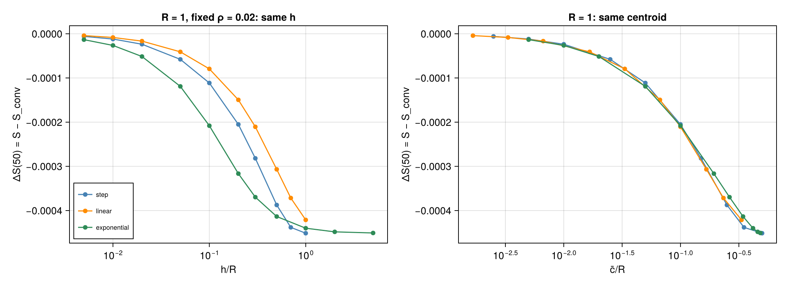

**Conclusion.**
- **The centroid collapse of Phase 2 holds on cylinders.** At fixed ρ, the three profiles' differences from the conventional model agree within 2.6–9.4 % at the same centroid, against 34–66 % at the same h.
  - To first order, the centroid is the quantity that S responds to: how far, on average, the relaxation sits from the surface.
  - The remaining spread is largest for thin layers (9 % at c̄/R = 0.02, where the exponential is the most negative) and at c̄/R = 0.2 (6 %, where the exponential is the least negative). It reflects the profiles' different spread around the centroid.
- **The spreads are the same for R = 0.5, 1 and 2,** consistent with the h/R scaling of J found for the step profile (P3.4.8). The relative comparison depends on c̄/R, not on R itself.
- **S falls monotonically with h at fixed ρ for every profile,** as for the step profile. All lie between the conventional model (h → 0) and the uniform limit.

### Outside, square array s = 3.0 (paired Monte Carlo)

Scripts:
- [p3_4_8e_profiles_outside.jl](phase3/p3_4_8e_profiles_outside.jl) → `results/phase3/p3_4_8e_profiles_outside_<shape>/`;
- thin-end pass [p3_4_8g_outside_tau16.jl](phase3/p3_4_8g_outside_tau16.jl) (`steps_tau16.csv`, `vs_conv_tau16.csv`);
- centroid analysis [p3_4_8h_outside_centroid.jl](phase3/p3_4_8h_outside_centroid.jl) → [results/phase3/p3_4_8h_outside_centroid/](results/phase3/p3_4_8h_outside_centroid/).

**Design.**
- **Geometry and h.** Outer layer only, R = 1, gap 1.0, ρ = 0.02, the same seeds, spins and τ as the step run at s = 3.0 (P3.4.8), so all three profiles can be compared:
  - linear h = 0.1–1.0, starting at 0.1 because its surface rate 2ρ/(hκ) at 0.05 would force τ < 1e-2;
  - exponential h = 0.05–1.0, with support equal to the gap, so the outer layers always overlap.
- **Timesteps.** Each profile is paired with its own conventional run at τ = 1e-2 and 2.5e-3. There is no continuum outside, and inside, |ΔS| of surface-concentrated profiles was still ≈ 10 % low at τ = 2.5e-3 (Group 2). So a third timestep, τ = 6.25e-4, was run at the thin end: the conventional model plus the 3 thinnest h per profile, 10⁴ spins per seed (option B, user decision 2026-11-07).

**Result: monotonicity.**
- **The identity holds.** E[−ln M⊥] = ρ(S/V)t = 1.0725 within noise for every h at τ = 1e-2 and 2.5e-3. The τ = 6.25e-4 pass did not record it.
- **Linear.** All layer steps from 0.1 → 0.2 on are resolved and negative at τ = 2.5e-3 (|z| 7.7–15.3). Conventional → 0.1 is not resolved at τ = 2.5e-3 (z −1.4; at τ = 1e-2 it even has the wrong sign, +8.9e-5), but is resolved at τ = 6.25e-4: −7.0e-5 ± 2.2e-5 (z −3.2).
- **Exponential.** All 6 steps are resolved and negative at τ = 2.5e-3, including conventional → 0.05 (z −5.5). The thin-end steps are confirmed at τ = 6.25e-4 (z −5.3, −19.1, −9.7).
- **Timestep shifts at the thin end.**
  - **Against the conventional model:** the shifts of ΔS from τ = 2.5e-3 to 6.25e-4 are within 1.6σ, and the SEM at τ = 6.25e-4 is 10–31 % of the value.
  - **Between neighbouring h (paired):** the exponential's thin-end steps shift by about 3σ: 0.05 → 0.1 from −1.64e-4 to −1.22e-4 (z −2.99), and 0.1 → 0.2 from −1.97e-4 to −1.32e-4 (z −3.14). That is 26–33 % of each step, so a τ dependence of the exponential thin end is resolved at ≈ 3σ.
  - **Direction:** |ΔS| gets smaller as τ decreases, the opposite of the inside C1 bias. Whether τ = 6.25e-4 is converged is not established.

**Result: the centroid comparison outside.** Centroids: step h/2, linear h/3, exponential h(1 − (c + 1)e^(−c))/(1 − e^(−c)) with c = 1/h. ΔS(50) against the conventional model uses τ = 6.25e-4 at the thin end and τ = 2.5e-3 otherwise, interpolated in c̄.

| c̄ (µm) | ΔS step | ΔS linear | ΔS exponential | spread (same c̄) |
|---|---|---|---|---|
| 0.05 | −9.85e-5 | −1.12e-4 | −1.26e-4 | 0.22 |
| 0.10 | −2.18e-4 | −2.37e-4 | −2.48e-4 | 0.12 |
| 0.15 | −3.59e-4 | −3.68e-4 | −3.19e-4 | 0.13 |
| 0.20 | −4.43e-4 | −4.65e-4 | −3.96e-4 | 0.15 |
| 0.30 | −5.68e-4 | −5.75e-4 | −5.74e-4 | 0.01 |

**Sensitivity to the timestep.** With the exponential's thin-end values taken at τ = 2.5e-3 instead of 6.25e-4, the spread at c̄ = 0.05 / 0.1 / 0.15 / 0.2 becomes 0.12 / 0.18 / 0.03 / 0.06, against 0.22 / 0.12 / 0.13 / 0.15 above.

**Same h.** At the same h the spread is much larger: 0.72, 0.60, 0.57, 0.32 and 0.07 at h = 0.1, 0.2, 0.3, 0.5 and 1.0 (`same_h_outside.csv`).

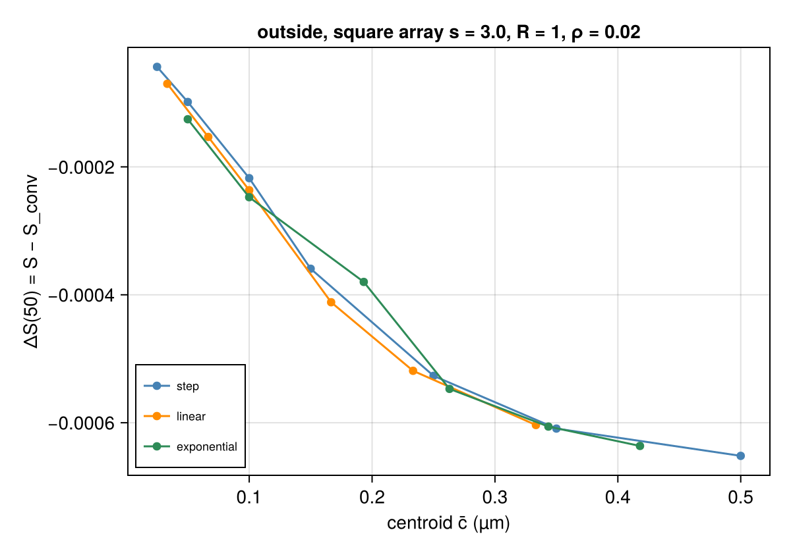

**Conclusion (outside).**
- **Ordering.** For linear and exponential, S decreases with h from the conventional model on, and every step is resolved (the thin end at τ = 6.25e-4). For the step profile outside, the thin end stays unresolved even at τ = 6.25e-4 (conventional → 0.05: z −1.8; 0.05 → 0.1: z −2.3; see P3.4.8).
- **The centroid collapse is approximate outside, and its size is not pinned down.**
  - At the same h the profiles differ by 7–72 %; at the same centroid by 1–22 %.
  - At c̄ = 0.15–0.2 the same-centroid spread is 13–15 % with the exponential's τ = 6.25e-4 thin-end values, but 3–6 % with its τ = 2.5e-3 values. The exponential thin end shows a ≈ 3σ τ dependence (above), and no SEM of the spread was computed, so which value is right is undetermined.
  - So the collapse outside is consistent with the inside result (3–9 %) but not established at that precision.
- **Possible real reasons for a looser collapse.**
  - Outside, the exponential's support always overlaps its neighbours', so its profile is not a single-surface profile.
  - The planar centroid h∫u g du ignores the r/R area weighting of a curved shell.
- **What would resolve it.** Per-seed values and a paired cross-profile SEM (the profiles share trajectories at each τ), more spins at τ = 6.25e-4 or smaller, or an outside 2D continuum.
- **Timestep.** Outside fixed-ρ differences at the default τ = 1e-2 are biased enough to flip a sign (linear thin end). For comparison studies, τ ≤ 2.5e-3 is needed, and τ ≤ 6.25e-4 for thin layers (P3.6.2).

## Timestep on cylinders (P3.6.1, P3.6.2, P3.6.4)

Plan [2026-11-08-timestep-cylinders.md](../docs/superpowers/plans/2026-11-08-timestep-cylinders.md).
- Scans: [p3_6_1_tau_scan.jl](phase3/p3_6_1_tau_scan.jl) → `results/phase3/p3_6_1_tau_scan_{thin,profiles,radius,rate}/`.
- Analysis: [p3_6_2_analysis.jl](phase3/p3_6_2_analysis.jl) with the helpers in [analysis.jl](phase3/analysis.jl) (tested: power-law fit with slope SE; threshold with censoring status) → [results/phase3/p3_6_2_analysis/](results/phase3/p3_6_2_analysis/) (`errors.csv`, `fits.csv`, `thresholds.csv`).

**Design.**
- **Two errors that need different rules.**
  - The error in **one model's decay rate** R = −ln S(T)/T is what the timestep constraint was built for. On walls it is controlled by the per-step exponent ΔR₂(0)τ, and the default c = 0.005 keeps it near 0.1 % (P2.6).
  - The error in the **difference between models at fixed ρ**, ΔS = S_layer − S_conv, is the quantity Phase 2 and Phase 3 compare. It has kept failing at the default τ (Review C1, P3.4.6, P3.4.6d, P3.4.8).
- **Reference.** Inside a single cylinder the radial continuum is exact, so both errors are measured directly against it.
- **Scans** (paired: all models of a scan share τ):
  - **thin:** step h = 0.05, 0.1, 0.2 down to τ = 3.1e-4;
  - **profiles:** linear h = 0.3, exponential h = 0.1;
  - **radius:** R = 0.5 and 2 with h = 0.1R;
  - **rate:** step h = 0.1 at ΔR₂(0) = 0.5 and 2 ms⁻¹, T = R/ρ so that E[X] = 2.

  Earlier runs with identical settings were reused (P3.4.6, P3.4.6d). The analysis requires bit-identical S_mc for repeated runs: 63 rows, 58 unique, 5 identical duplicates.

**Method.**
- **Errors:**
  - e_R = (R_mc − R_cont)/R_cont;
  - e_ΔS = (ΔS_mc − ΔS_cont)/|ΔS_cont|, where > 0 means |ΔS| is underestimated;
  - σ from the MC SEM (paired for ΔS).
- **Variables:** ΔR₂(0)·τ_eff, √(2Dτ)/h and √(Dτ)/R. τ_eff is the step the simulator actually takes, slightly below τ in the rate scan.
- **Fits:** power laws per series on points with |e| > 2σ (sensitivity 3σ), exponent ± SE.
- **Thresholds:** per series, with a status:
  - crossed;
  - below range (never reached: a lower bound);
  - above range (exceeded even at the smallest τ: the threshold is below the scanned range).

  Only the 10 % ΔS level is resolvable: with 2·10⁴ spins × 10 seeds, σ(e_ΔS) is 4–8 % at small τ.
- **Caveats:**
  - Rows at different τ share seeds and initial positions, so they are nearly but not strictly independent.
  - The largest rate-scan τ (√(Dτ)/R = 0.55) also includes a reflection error.

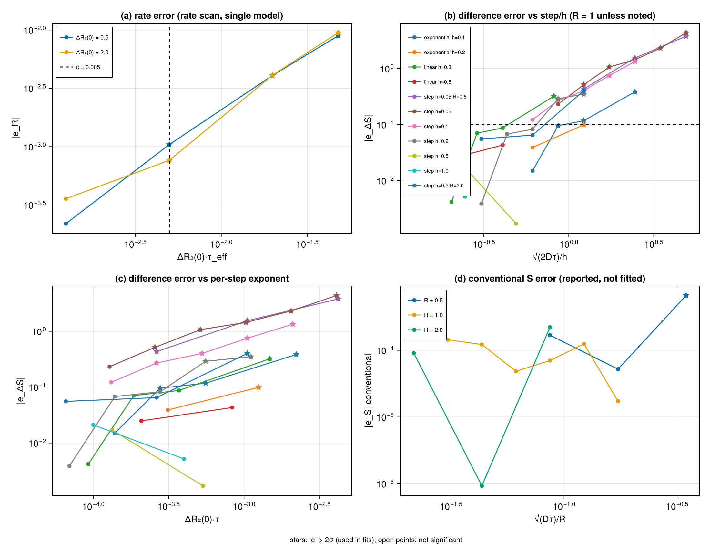

**Result 1: the rate error is controlled by ΔR₂(0)τ, as on walls** (panel a).
- e_R ∝ (ΔR₂(0)τ)^p with p = 0.95 ± 0.03 (ΔR₂(0) = 0.5) and 1.12 ± 0.07 (ΔR₂(0) = 2). At the same ΔR₂(0)τ the two series agree, although √(2Dτ)/h differs by 2×.
- e_R = 0.1 % is reached at ΔR₂(0)τ = 0.0048 and 0.0062; e_R ≈ 1 % at 0.048 (the top of the scan).
- The default c = 0.005 therefore gives ≈ 0.1 % in R on cylinders too.

**Result 2: the difference error is controlled by the step length relative to the layer, √(2Dτ)/h, not by ΔR₂(0)τ** (panels b, c).
- **Collapse.** The thin step series (h = 0.05 and 0.1 at R = 1; h = 0.05 at R = 0.5) fall on one curve against √(2Dτ)/h. Against ΔR₂(0)τ they spread 4–6× (significant step points at ΔR₂(0)τ ≈ 1–2e-3).
- **Per-series fits** of |e_ΔS| against √(2Dτ)/h (`fits.csv`, 2σ filter):

  | series | n | selection range of \|e_ΔS\| | p ± SE |
  |---|---|---|---|
  | step h = 0.05, R = 1 | 5 | ≈ 0.5–4.4 | 1.46 ± 0.11 |
  | step h = 0.1, R = 1 | 4 | ≈ 0.4–1.3 | 1.56 ± 0.10 |
  | step h = 0.05, R = 0.5 | 3 | ≈ 0.4–3.7 | 1.56 ± 0.16 |
  | exponential h = 0.1 | 3 | ≈ 0.1–0.4 | 1.39 ± 0.28 |
  | step h = 0.2, R = 1 | 2 | ≈ 0.1–0.3 | 0.54 (2 points, no SE) |
  | others | ≤ 1 | — | not fitted |

  The p ≈ 1.5 law describes thin step layers at large errors (|e_ΔS| ≳ 40 %, where the MC difference may already have the wrong sign). Near the 10 % level the one 2-point step series is flatter, so no single law is claimed.
- **Sign flip.** At large steps the MC difference has the wrong sign (|e_ΔS| > 1). Where that happens depends on the series: step h = 0.05 from √(2Dτ)/h ≈ 1.2; step h = 0.1 is still at 0.75 at 1.73 and flips by 2.45.
- **3σ sensitivity.** The 3σ filter changes only the ΔR₂(0) = 2 rate fit: 1.12 ± 0.07 becomes 0.95 with 2 points.
- **10 % thresholds:**

| series | threshold √(2Dτ)/h (status, z of first exceedance) | same in √(2Dτ)/c̄ | τ at the threshold (ms) |
|---|---|---|---|
| step h = 0.2, R = 1 | 0.65 (crossed, z 5.5) | 1.3 | 2.8e-3 |
| step h = 0.2, R = 2 | 0.72 (crossed, z 3.8) | 1.4 | 3.5e-3 |
| linear h = 0.3 | 0.44 (crossed, z 4.6) | 1.3 | 2.9e-3 |
| exponential h = 0.1 (c̄ ≈ 0.10) | 0.93 (crossed, z 2.1) | 0.93 | 1.4e-3 |
| step h = 0.05, h = 0.1 (R = 1) | above range: > 10 % at the smallest τ (3.1e-4, 6.25e-4), but **not significant** (23 ± 15 %, 12 ± 8 %; z 1.6) | (< 1.7, < 1.2 if real) | not established |
| step h = 0.5, 1.0; linear h = 0.6; exponential h = 0.2 | below range: < 10 % everywhere scanned (√(2Dτ)/h up to 0.49, 0.24, 0.41, 1.22) | ≥ 0.98, ≥ 0.49, ≥ 1.22, ≥ 1.27 | ≥ 1e-2 (lower bound) |

- **What the thresholds show.**
  - **One curve in √(2Dτ)/c̄.** At matched √(2Dτ)/c̄ the three profiles (all at c̄ = 0.1) agree within 1σ at every scanned point:

    | √(2Dτ)/c̄ | step h = 0.2 | linear h = 0.3 | exponential h = 0.1 |
    |---|---|---|---|
    | 0.87 | 0.068 ± 0.042 | 0.070 ± 0.039 | 0.096 ± 0.035 |
    | 1.22 | 0.083 ± 0.079 | 0.087 ± 0.069 | 0.118 ± 0.056 |
    | 2.45 | 0.35 ± 0.08 | 0.32 ± 0.07 | 0.38 ± 0.07 |

  - **No profile split.** The interpolated crossings (1.3 for step and linear, 0.93 for the exponential) differ only because each crossing interpolates between points that are within 1σ of 10 %. That difference is not resolved. The centroid collapse found for the signal (P3.4.8) holds for the timestep error too: one curve in √(2Dτ)/c̄ that crosses 10 % somewhere around 0.9–1.3.
  - **Measured at one centroid only.** All four crossed thresholds have c̄ = 0.1 µm. The thin step layers (c̄ = 0.025, 0.05) only bound it, and those bounds are not significant (z 1.6).
  - The radius series (h = 0.1R, so h/R fixed) gives the same error at the same √(2Dτ)/h for R = 0.5, 1 and 2 (e.g. 0.43, 0.40, 0.40 at 1.22). It tests scaling at fixed h/R, not curvature. In the R = 1 thin series, h/R = 0.05, 0.1 and 0.2 differ only weakly at the same √(2Dτ)/h (0.23, 0.27, 0.29 at 0.87). No curvature effect is resolved.

**Result 3: the conventional model's own error.** Resolved at one point only: R = 0.5, τ = 1e-2 (√(Dτ)/R = 0.35), e_S = +6.6e-4 (z 3.4). Elsewhere |z| ≤ 1.1.
- **Not the source of the difference error.** At R = 0.5, τ = 1e-2 the conventional bias is +0.81 ± 0.24 |ΔS_cont| of the h = 0.05 layer, opposite in sign to that layer's e_ΔS.
- **Still relevant for small cylinders.** Its size matters for comparisons at small R at the default τ.
- Panel d is reported, not fitted.

**Conclusion.**
- **Two rules, two purposes.**
  - The existing constraint τ ≤ c/ΔR₂(0) with c = 0.005 controls the **rate** error, ≈ 0.1 %, also on cylinders.
  - It does **not** control the **difference** between models at fixed ρ, which depends on how many steps resolve the layer: √(2Dτ) against the layer's centroid. That is why fixed-ρ comparisons kept failing at the default τ. For thin layers, ΔR₂(0)τ is tiny while √(2Dτ)/h is large.
- **The data support τ ≤ 0.135·c̄² (µm, ms) at D = 3, i.e. √(2Dτ) ≤ 0.9·c̄.** This is the conservative end of the 0.9–1.3 range where the curve crosses 10 %.
  - **Expected error at that point:** about 10 % (measured 7–10 % ± 4 % at √(2Dτ)/c̄ = 0.87; 2σ ≈ 17 %). It is not a margin below 10 %, and levels below 10 % are not resolved by these data.
  - **Range of validity:** measured at c̄ = 0.1 µm and confirmed at c̄ = 0.05 µm (below). For c̄ < 0.05 it rests on the √(2Dτ)/h collapse of the thin step series, seen only at larger errors (≳ 25 %).
  - **Confirmation at c̄ = 0.05 (user request 2026-11-08).** Step h = 0.1 (c̄ = 0.05) was run exactly at the rule's operating point, τ = 0.135·0.05² = 3.375e-4 (√(2Dτ)/c̄ = 0.90), paired with the conventional model, 10⁵ spins × 10 seeds (`results/phase3/p3_6_1_tau_scan_confirm/`; script committed before the run, `deba008`). Result:
    - ΔS(50) = −1.065e-4 ± 4.2e-6 against −1.114e-4 from the continuum, so **e_ΔS = 4.3 ± 3.8 %** (z 1.14);
    - S of both models agrees with the continuum (z 0.51 and 1.06).

    The rule therefore holds at c̄ = 0.05 as well, at about half the error seen at c̄ = 0.1 (2σ upper bound ≈ 12 %). The extension to c̄ = 0.05 is now measured; c̄ = 0.025 remains an extrapolation.

### Runtime summary (P3.6.4; existing data, no new runs)

| case | µs per spin-step (τ = 1e-2) | source |
|---|---|---|
| walls, no layer / step layer | 0.0169 / 0.0236 (×1.40) | Phase 2 P2.6.8 |
| cylinders, single R = 1, no layer / step layer | 0.044 / 0.067 (×1.51) | `p3_1_5_runtime/runtime.csv` |
| cylinders, square array, no layer / step layer | 0.049 / 0.081 (×1.63) | same |
| square array, step / linear / exponential | 0.089 / 0.106 / 0.221 | `p3_3_quadrature/runtime.csv` (separate run; ±20 %) |
| n² cylinders per cell, 1 / 9 / 100 / 400, layer ratio | ×1.0 / ×1.4 / ×2.7 / ×6.7 | `p3_1_5_runtime/runtime_many.csv` |

Cylinders cost ≈ 2.6–3× walls per spin-step without a layer. The layer adds ×1.5–1.6 (step), and linear and exponential add ×1.2 and ×2.5 on top. The cost grows with the number of cylinders per cell. The cell list of layer indices, which would make it scale with cylinders within reach, remains **open** (P3.6.4).

### P3.6.2: decision (user, 2026-11-08): option (b)

**Rule for comparison studies.** Monte Carlo runs that compare models or profiles at fixed ρ (differences ΔS, apparent T₂ differences) use

  τ ≤ 0.135·c̄_min²  (µm, ms; D = 3),  in general  √(2Dτ) ≤ 0.9·c̄_min,

where c̄_min is the smallest layer centroid in the run. The expected error of the difference is ≲ 10 %: 7–10 % ± 4 % at c̄ = 0.1, and 4.3 ± 3.8 % at c̄ = 0.05.

**What does not change.**
- The package default stays τ ≤ c/ΔR₂(0)_max with c = 0.005. It controls the error of a single model's decay to ≈ 0.1 %.
- No package option is added; option (c) is not pursued.
- Where the continuum exists (inside single cylinders, walls), it remains the reference, option (d).

**Applies from Phase 3.5/3.7 on.** Runs set `timestep = 0.135·c̄_min²` explicitly. The rule is extrapolated for c̄ < 0.05 µm.

### P3.6.2: the options as presented

Costs refer to one inside reference run (10 seeds × 2·10⁴ spins × 50 ms) at the default τ = 1e-2: ≈ 1–2 min for a step layer.

| option | what it does | cost |
|---|---|---|
| (a) keep c = 0.005 for single-model runs | rate error ≈ 0.1 % (Result 1) | none, current behaviour |
| (b) documented rule for comparison studies: τ ≤ 0.135·c̄_min² (D = 3; in general √(2Dτ) ≤ 0.9 c̄) | difference error ≲ 10 %: ≈ 7–10 % ± 4 % at c̄ = 0.1, 4.3 ± 3.8 % at c̄ = 0.05 | c̄ = 0.1 µm: τ ≤ 1.35e-3 (×7 steps, measured); c̄ = 0.05: 3.4e-4 (×30, measured); c̄ = 0.025: 8.4e-5 (×120, ≈ 2–4 h per reference run, extrapolated) |
| (c) package option implementing (b), e.g. `timestep=(layer_resolution=0.9,)` → τ ≤ (0.9 c̄_min)²/(2D) | makes (b) automatic | a later plan (package code + tests) |
| (d) use the continuum wherever it exists (single cylinders inside, walls) | exact, no timestep | only for symmetric geometries; arrays and outside still need MC with (b) |

The data support (a) together with (b); (b) is measured at c̄ = 0.1 and confirmed at c̄ = 0.05 (4.3 ± 3.8 %). Option (d) remains the best reference where it applies. (c) is a convenience whose value depends on how much of Phase 3.7 runs in arrays. The user decides.

## Comparison with the conventional model inside cylinders (P3.7a)

Plan `docs/superpowers/plans/2026-11-08-comparison-inside-cylinders.md`. Single cylinders, inside only, no RF. Arrays, packing density and the annulus model are P3.7b.

### Design

- **Question.** Where, inside a single cylinder, does the distributed layer ΔR₂(d) = (ρ/h)·g(d/h)/κ become distinguishable from the conventional surface model (MCMR θ = ρ√(π/D), P3.1.6), and by which measurement?
- **Three tests, from weakest to strongest assumption:**
  1. **Apparent T₂ at fixed ρ** (P3.7.1). Here ρ is known, as in the paper's Fig. 9.
  2. **Best-fit conventional model** (P3.7.3). The conventional ρ_c is fitted freely to the layer curve, which is the realistic single-condition test.
  3. **D-dependence signature** (P3.7.3). The same ρ is measured at two D, as found on walls (P2.5.9).
- **Reference, not truth.** The conventional model is the comparison baseline, and no fast-diffusion or Brownstein–Tarr limit is assumed (rd-model framing).
- **Methods.** Monte Carlo is primary (user, 2026-11-08). The exact radial continuum (P3.4.6, all profiles) runs alongside every Monte Carlo condition and gives the dense curves and maps.
- **Matchings.** The *same centroid* matching sets c̄ = ∫u g du / ∫g du · h equal across profiles (step h/2, linear h/3, exponential by bisection with support R). The *same h* matching keeps h equal. Phase 2 showed that the centroid collapses the profiles; here it is rechecked inside cylinders.

### Method

**Paired Monte Carlo** (`p3_7_mc.jl`, `run_condition`):
- Every model of a condition runs with the same seeds (1–10), the same τ and 2·10⁴ spins per seed, started uniformly in the box [−R, R]³; only spins inside the cylinder are kept.
- The trajectories are therefore identical across models, which is checked on the final positions (true in every condition). Differences ΔS = S_layer − S_conv are formed per seed, so SEM_ΔS = std_seeds(ΔS)/√10.
- **Timestep.** τ = min(0.135·c̄_min², 0.005/ΔR₂(0)_max), from the comparison rule (P3.6.2; √(2Dτ) ≤ 0.9 c̄ at D = 3) and the package rate limit. The rule is kept at D = 3 values for D < 3 (ruling, Group A review M1), which is conservative there.
- **Resume.** The driver `p3_7_run.jl` skips conditions already written (Group A review M3).

**Apparent T₂.** The echo time is TE* = the continuum conventional T₂ of the condition (S_conv(TE*) = e⁻¹), taken as an exact readout (readout 11 of 0:TE*/10:1.5·TE*).
- T₂_app = −TE*/ln S(TE*), with σ(T₂) = TE*·SEM_S/(S ln² S) to first order;
- ΔT₂/T₂ = (T₂_layer − T₂_conv)/T₂_conv, with σ ≈ TE*·SEM_ΔS/(S_layer ln² S_layer)/T₂_conv (paired);
- **detectability**: the two-point relative noise of T₂ is n(r) = √(1 + r²)/(SNR·r·|ln r|), r = S(TE). At r = e⁻¹ the 2σ level is 2n = 2.90 % at SNR 200 and 5.79 % at SNR 100.

**Best fit.** ρ_c = argmin over ρ_c of max_t |S_layer(t) − S_conv(t; ρ_c)|, where S_conv is the continuum conventional family:
- log-grid over e⁻⁴…e⁸ × ρ, then golden-section refinement (`best_fit_conventional`);
- **flags.** `at_edge` is set when the minimum lies at, or on a plateau reaching, the end of the grid (Group A review I1). `ceiling` is set when the layer's lowest continuum rate exceeds λ_max = D·j₀₁²/R² (17.35 ms⁻¹ at R = 1, D = 3), the decay of a perfectly absorbing wall, which no conventional ρ can exceed. Flagged fits report no ρ_c and no residual. A flag is not by itself a separation: it says only that the layer's slowest rate is out of the conventional range, not how far the curve is from the nearest conventional curve on the readout window (see Result 3);
- the residual's noise floor is max_t SEM(S_layer); the threshold is 0.01 (2σ at SNR 200, single curve).

**D signature.** q = T₂(D = 0.5)/T₂(D = 3) − 1 at fixed ρ, with TE fixed per ρ (the continuum conventional T₂ at D = 3). The layer-specific part is q_layer − q_conv. It is compared with the two-measurement band 2·√(n(S₀.₅)² + n(S₃)²) at SNR 200.

**Runs** (all `identical_trajectories = true`; all on an Apple M1 Pro, 8 threads):

| task | conditions | τ (ms) | wall time |
|---|---|---|---|
| fig9a (Task 3) | R ∈ {0.5, 1, 2} same centroid c̄ = 0.1; R = 1 same h = 0.2 | 1.35e-3; 6.0e-4 | 5.0 h |
| params (Task 4) | R = 1: D ∈ {0.5, 1, 2}, ρ ∈ {1/280, 1/70, 1/35, 0.1}, c̄ ∈ {0.05, 0.25} | 1.35e-3; 3.4e-4 (c̄ 0.05); 8.4e-3 (c̄ 0.25) | 12.2 h |
| seed check | fig9a R = 1 reference with seeds 11–20 | 1.35e-3 | 1.4 h |
| map (Task 5) | R = 1, D = 3, no bulk: ρR/D ∈ {0.1, 1, 10} × h/R ∈ {0.1, 0.25, 0.5} × 3 profiles | 1.5e-4; 8.1e-5; 8.1e-6 | 4.2 h |
| ddep (Task 6) | R = 1, ρ ∈ {0.1, 1} × D ∈ {0.5, 1, 2, 3} × h/R ∈ {0.25, 0.5, 1} × 3 profiles | 9.4e-4; 5.7e-4 | 1.3 h |

Reference values: ρ = 1/140 µm/ms, D = 3 µm²/ms, R2_bulk = 1/2000 ms⁻¹ (except the map).

### Result 1: apparent T₂ against radius (Fig. 9A analogue, P3.7.1)

Scripts `p3_7_run.jl` (TASK=fig9a), [p3_7_fig9a_analysis.jl](phase3/p3_7_fig9a_analysis.jl) → [results/phase3/p3_7_fig9a_analysis/](results/phase3/p3_7_fig9a_analysis/).

| condition | T₂,conv at TE* (ms) | ΔT₂/T₂ MC: step / linear / exponential | continuum |
|---|---|---|---|
| R = 0.5, c̄ = 0.1 | 34.41 | −0.018 / −0.018 / −0.016 % (± 0.003–0.004) | −0.022 / −0.022 / −0.021 % |
| R = 1, c̄ = 0.1 | 67.67 | −0.025 / −0.025 / −0.024 % (± 0.002) | −0.026 / −0.027 / −0.027 % |
| R = 2, c̄ = 0.1 | 130.99 | −0.024 / −0.026 / −0.027 % (± 0.002) | −0.027 / −0.028 / −0.029 % |
| R = 1, h = 0.2 | 67.68 | −0.029 / −0.020 / −0.044 % (± 0.003–0.004) | −0.026 / −0.019 / −0.040 % |

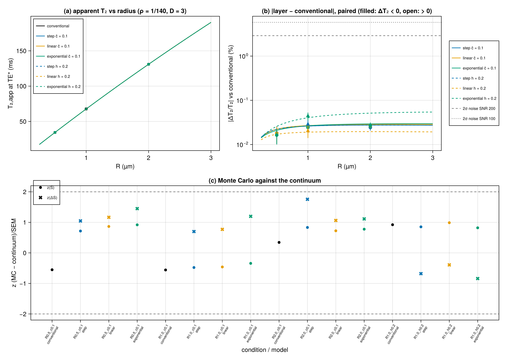

- **T₂ follows the radius** as in the paper's Fig. 9A: T₂_conv ≈ 1/(R2_bulk + 2ρ/R) = 34.40, 67.63, 130.84 ms, within 0.03–0.11 % of the measured values.
- **The layer is invisible here.** Every ΔT₂/T₂ is negative (the layer attenuates more, as on walls) and |ΔT₂/T₂| ≤ 0.044 %. That is 70–180× below the 2σ noise of 2.9 % at SNR 200. The continuum curves over R = 0.25–3 stay within 0.014–0.030 % (same centroid) and 0.013–0.054 % (same h).
- **Profiles.** At the same centroid the three profiles agree within the Monte Carlo error. At the same h they order exponential > step > linear, which is the order of their centroids (0.19, 0.10, 0.067 µm at h = 0.2; the exponential's support is R).
- **Monte Carlo against the continuum.** |z_S| ≤ 1.0 and |z_ΔS| ≤ 1.8. The ratio ΔS_mc/ΔS_cont was 0.78–0.94 at every same-centroid point with seeds 1–10. The fresh-seed check (seeds 11–20, R = 1) gives 1.04–1.12 (± 0.15–0.19). Combining the two seed sets by inverse-variance weighting of their 10-seed means gives 0.97 ± 0.07, 0.97 ± 0.07 and 0.94 ± 0.06 (step, linear, exponential); equal weights give 1.03 ± 0.10, 1.02 ± 0.09 and 0.98 ± 0.08. Both are consistent with 1. **There is no evidence of a Monte Carlo bias at the ±7 % level; a bias up to ≈ 14 % (2σ) is not excluded.** The uniformly low ratios with seeds 1–10 are explained by shared seed noise: every fig9a/params condition reuses seeds 1–10, and conditions with D = 3 and the same τ have identical trajectories, so they are not independent (Group B review I1). Only R = 1 was rechecked with fresh seeds; the R = 0.5 ratios (0.78–0.82 ± 0.15–0.18) were not. The σ values are 10-seed estimates; with seeds 11–20, SEM_ΔS was 2.4× larger than with seeds 1–10.

### Result 2: parameter sweeps at R = 1 (P3.7.1)

[p3_7_params_analysis.jl](phase3/p3_7_params_analysis.jl) → [results/phase3/p3_7_params_analysis/](results/phase3/p3_7_params_analysis/). One parameter is varied at a time from the reference (fig9a R = 1, c̄ = 0.1).

| sweep | value | TE* (ms) | ΔT₂/T₂ MC (step / linear / exp) | continuum (step) |
|---|---|---|---|---|
| D | 0.5 / 1 / 2 / 3 | 67.9 / 67.8 / 67.7 / 67.7 | −0.142 / −0.073 / −0.035 / −0.025 % (step) | −0.156 / −0.078 / −0.039 / −0.026 % |
| ρ | 1/280 / 1/140 / 1/70 / 1/35 / 0.1 | 130.9 / 67.7 / 34.4 / 17.4 / 5.0 | −0.013 / −0.025 / −0.050 / −0.106 / −0.349 % (step); −0.361 % linear at ρ = 0.1 | −0.013 / −0.026 / −0.053 / −0.107 / −0.375 %; −0.385 % linear at ρ = 0.1 |
| c̄ | 0.05 / 0.1 / 0.25 | 67.7 | −0.010 / −0.025 / −0.048 % (step; exponential −0.011 / −0.024 / −0.042 %) | −0.014 / −0.026 / −0.049 % |

Continuum-only points: ρ = 1/560 gives −0.006 %; c̄ = 0.01 gives −0.003 % and c̄ = 0.025 gives −0.007 to −0.008 %.

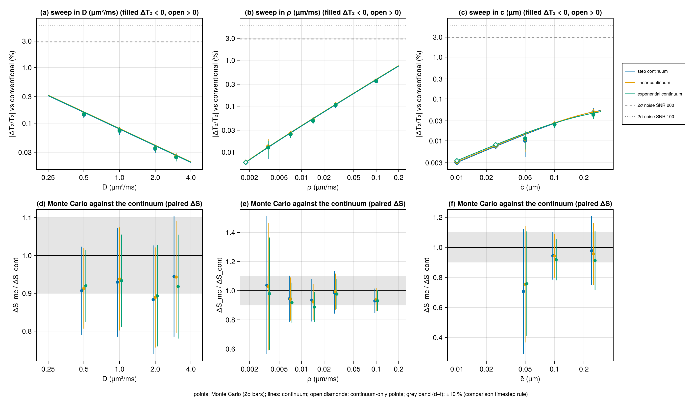

- **Scaling.** |ΔT₂/T₂| grows as 1/D (×5.7 from D = 3 to 0.5, against ×6) and as ρ (|ΔT₂/T₂|/ρ = 3.5–3.7 % per µm/ms throughout; TE* changes with ρ), and with the centroid. The same scalings were found on walls (Review C1 follow-up).
- **Largest effect:** 0.36 % (MC, linear, ρ = 0.1; continuum 0.385 %). That is ≥ 8× below the 2σ noise at SNR 200. **No configuration of the sweep is detectable at SNR 100 or 200.**
- **Profiles at the same centroid** agree only to about 10 %, and the order changes with c̄: exponential is highest at c̄ = 0.01 (continuum 3.36e-5 against step 3.03e-5) and lowest at c̄ = 0.25 (MC 0.042 % against 0.048 %).
- **Monte Carlo against the continuum.** ΔS_mc/ΔS_cont = 0.88–1.04 with σ 0.04–0.24. These are not independent of fig9a (shared seeds, see Result 1). The c̄ sweep does **not** test the timestep: √(2Dτ)/c̄ = 0.9 at every D = 3 condition by construction. Only the D sweep varies it (0.37 / 0.52 / 0.73 / 0.9), and the ratio shows no trend with it (Group B review I2).

### Result 3: dimensionless map and the best-fit conventional model (P3.7.3)

[p3_7_map_analysis.jl](phase3/p3_7_map_analysis.jl) → [results/phase3/p3_7_map_analysis/](results/phase3/p3_7_map_analysis/). R = 1, D = 3, no bulk; 41 readouts to t_end = ln 100/λ₁,conv. The continuum map covers ρR/D = 0.003–30 × h/R = 0.01–1.

**Monte Carlo points** (max_t |ΔS| at fixed ρ; best fit):

| ρR/D | max\|ΔS\| MC (range over 9 models) | z against continuum | ρ_c/ρ | best-fit residual | flagged |
|---|---|---|---|---|---|
| 0.1 | 0.0014–0.0082 | +0.4 … +2.6 | 1.004–1.023 | 7.5e-5 – 1.2e-4 (floor 0.7–2.5e-4) | 0/9 |
| 1 | 0.012–0.073 | +2.0 … +5.1 (MC 1–7 % low) | 1.04–1.27 | 7.2e-4 – 8.2e-3 | 0/9 |
| 10 | 0.048–0.344 | −0.9 … +2.0 | 1.72 (linear h/R 0.1), 2.33 (step h/R 0.1) | 3.1e-3, 6.2e-3 | 7/9 (λ₁ > λ_max) |

**Thresholds** (first ρR/D at which the quantity reaches 0.01; continuum; "> x" means that it stays below 0.01 among the valid fits up to x, with the next point flagged or the end of the map):

| profile | h/R | fixed ρ: max\|ΔS\| ≥ 0.01 | best fit: residual ≥ 0.01 |
|---|---|---|---|
| step | 0.01 / 0.025 / 0.05 / 0.1 | > 30 / 3.0 / 1.08 / 0.50 | > 30 / > 30 / > 10 / > 10 |
| step | 0.25 / 0.5 / 1 | 0.21 / 0.13 / 0.11 | 2.4 / 1.25 / > 1 (flagged from 3) |
| linear | 0.01 / 0.025 / 0.05 / 0.1 | > 30 / 6.6 / 1.8 / 0.74 | > 30 / > 30 / > 30 / > 10 |
| linear | 0.25 / 0.5 / 1 | 0.29 / 0.16 / 0.12 | > 3 / 1.7 / 1.1 |
| exponential | 0.01 / 0.025 / 0.05 / 0.1 | 3.7 / 0.95 / 0.46 / 0.25 | > 30 / > 10 / 9.2 / 2.8 |
| exponential | 0.25 / 0.5 / 1 | 0.14 / 0.12 / 0.11 | 1.4 / 1.1 / > 1 (flagged from 3) |

The Monte Carlo fixed-ρ thresholds agree with the continuum to within 10 %: step 0.54 / 0.22 / 0.13, linear 0.81 / 0.31 / 0.17 and exponential 0.26 / 0.15 / 0.12 at h/R = 0.1 / 0.25 / 0.5.

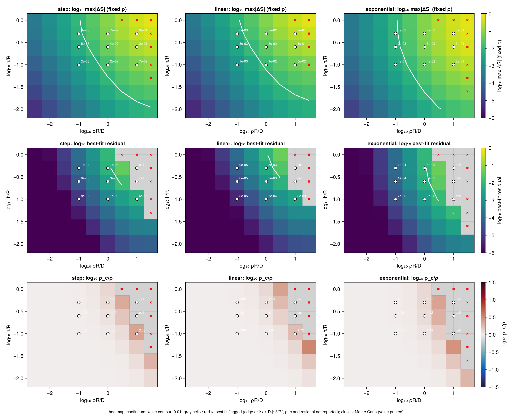

- **Fixed ρ.** The layer becomes visible from a single curve at SNR 200 once ρR/D ≈ 0.1–0.75 for h/R ≥ 0.1, and later for thinner layers. The exponential profile, whose support is R, is visible earliest.
- **Free ρ.** A fitted conventional model hides the layer up to ρR/D ≈ 1. ρ_c then exceeds ρ by up to 27 %, so the conventional ρ absorbs the layer's extra attenuation. The single curve separates at SNR 200 from ρR/D ≈ 1–3 for h/R ≥ 0.25 (exponential from h/R = 0.1, and from ρR/D ≈ 9 at h/R = 0.05). Among valid fits it never separates for h/R ≤ 0.05 (step, linear).
- **Ceiling.** For ρR/D ≳ 3–10 and thick layers the layer's slowest rate λ₁ exceeds λ_max = D·j₀₁²/R², which no conventional ρ can reach (the cylinder version of the wall ceiling D·π²/w²). In the Monte Carlo, 7 of 9 layer models at ρR/D = 10 are flagged. **A flagged curve is not automatically distinguishable.** The minimax residual at the end of the search (ρ_c = e⁸·ρ, an effectively absorbing wall; an upper bound on the distance to the conventional family) is ≥ 0.012 in 26 of the 27 flagged continuum cells, and ≥ 0.045 in 23. These are separable at SNR 200. The exception is step h/R = 0.05 at ρR/D = 30: λ₁ = 17.41 is only 0.3 % above λ_max, and an interior fit (ρ_c/ρ = 30) reproduces the curve to 0.0016. Marginal cases: linear h/R = 0.25 at ρR/D = 10 (0.020) and exponential h/R = 0.025 at ρR/D = 30 (0.012).
- **Checks:**
  - continuum grid at h/R = 0.01, ρR/D = 1: |S(N = 2000) − S(N = 4000)| ≤ 9e-7;
  - fit family at N = 1000 against 2000, at the most demanding valid (unflagged) fit, step h/R = 0.1 at ρR/D = 10: ρ_c = 69.8997 against 69.8993, residual 6.163e-3 for both;
  - conventional Monte Carlo at strong per-hit attenuation (θ√τ = 0.004 / 0.028 / 0.087): max|S_mc − S_cont| = 2.0e-4 / 8.7e-4 / 1.3e-3, i.e. relative 0.06 / 0.2 / 0.2 % (z −1.0 / −2.6 / +2.1);
  - Monte Carlo max|ΔS| at ρR/D = 1 is 1–7 % below the continuum (z up to 5.1), largest for the thinnest layer (linear h/R = 0.1, √(2Dτ)/c̄ = 0.66). This is within the rule's ≲ 10 %, but the map's c̄_min = 0.033 < 0.05, so the rule itself is extrapolated there (added after the 3.7 final review).

### Result 4: D-dependence signature (P3.7.3)

[p3_7_ddep_analysis.jl](phase3/p3_7_ddep_analysis.jl) → [results/phase3/p3_7_ddep_analysis/](results/phase3/p3_7_ddep_analysis/). R = 1; TE = 5.03 ms (ρ = 0.1) and 0.54 ms (ρ = 1).

| ρ | q_conv | q_layer (9 models) | q_layer − q_conv | two-measurement band (SNR 200) |
|---|---|---|---|---|
| 0.01 (continuum only) | 0.0041 | 0 – 0.0024 | −0.0016 … −0.0041 | — |
| 0.1 | 0.041 ± 0.001 | 0 – 0.025 | −0.016 … −0.041 | 0.041: at the band edge for h = R (0.97–0.999×), below it otherwise |
| 1 | 0.355 ± 0.003 | 0 – 0.215 | −0.14 … −0.36 | 0.041: detectable (3.4–8.7×) |

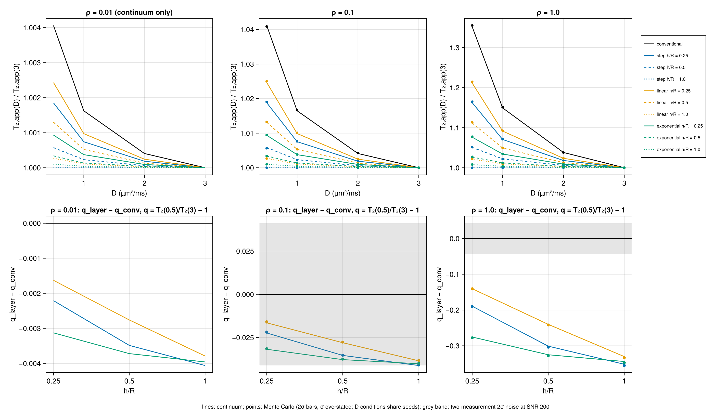

- **The conventional T₂ depends on D, the layer's much less.** A surface sink is diffusion-limited, so its T₂ rises as D falls. A layer that relaxes spins inside the volume depends less on diffusion, and not at all when it is uniform (step at h = R: q = 0 exactly). q_layer falls with h and is smallest for the exponential (support R).
- **Observability** at SNR 200 with two measurements: from ρ ≈ 1 µm/ms (ρR/D = 0.33 at D = 3, conventional T₂ ≈ 0.54 ms) for every profile and h/R ≥ 0.25. At ρ = 0.1 the conventional q itself (0.041) is about the size of the band, so |q_layer − q_conv| ≤ q_conv can at most reach the band edge, which happens only for the near-uniform layers at h = R (step 0.999×, exponential 0.97×).
- **Monte Carlo against the continuum:** |z_q| ≤ 1.5. σ_q adds the two T₂ errors in quadrature, which overstates it because the D conditions share seeds and scaled draws.
- **Caveats.** The layer is compared with the conventional model at the same ρ, not with a conventional ρ_c fitted to T₂(D = 3); refitting shifts q_conv by ≈ 0.03 at ρ = 1, small against differences of 0.14–0.36. ρ is assumed independent of D, so MCMR's θ = ρ√(π/D) changes with D. If θ were fixed instead, q_conv would differ. The band is single-SNR two-point noise; a fit across several D would be stronger.

### Comparison with walls (P3.7.4, inside part)

Phase 2 used walls with gap w = 2 µm (Review C1 follow-up map; P2.5.9), and this section uses cylinders with R = 1 µm (diameter 2 µm), both at D = 3. To compare the same physical layer, thresholds are converted to ρ in µm/ms (walls ρ = x·D/w = 1.5x, cylinders ρ = y·D/R = 3y) at equal absolute h. **Both maps are thresholded with the same convention** (final review C1): `threshold_status`, the log-log interpolated first crossing of 0.01, applied to the two continuum maps, with best fits flagged at the grid edge (and, for cylinders, over the ceiling) excluded. The Phase 2 table quotes instead the first grid point at or above 0.01 on a ×3.16 grid, which is coarser. Script [p3_7_walls_comparison.jl](phase3/p3_7_walls_comparison.jl) → [results/phase3/p3_7_walls_comparison/](results/phase3/p3_7_walls_comparison/).

| threshold ρ (µm/ms), h (µm) | walls: step / linear / exponential | cylinder inside: step / linear / exponential |
|---|---|---|
| fixed ρ, max\|ΔS\| ≥ 0.01, h = 0.1 | 1.51 / 2.37 / 0.67 | 1.50 / 2.21 / 0.74 |
| fixed ρ, h = 0.5 | 0.34 / 0.44 / 0.26 | 0.39 / 0.49 / 0.36 |
| fixed ρ, h = 1 | 0.25 / 0.28 / 0.25 | 0.33 / 0.36 / 0.34 |
| best fit, residual ≥ 0.01, h = 0.1 | > 45 / > 45 / 10.6 | > 30 / > 30 / 8.3 |
| best fit, h = 0.5 | 4.05 / 6.12 / 3.04 | 3.76 / 5.13 / 3.43 |
| best fit, h = 1 | 2.89 / 3.22 / 2.90 | > 3.0 / 3.37 / > 3.0 (flagged from ρR/D = 3) |

| other quantity | walls (w = 2) | cylinder inside (R = 1) |
|---|---|---|
| S/V | 2/w = 1 µm⁻¹ | 2/R = 2 µm⁻¹ |
| ceiling | D·π²/w² = 7.40 ms⁻¹ | D·j₀₁²/R² = 17.35 ms⁻¹ |
| D signature, thick layer (h ≳ w/2, h ≳ R/2) | q_layer ≤ 0.5 % / 4.6 % vs q_conv 5.5 % / 47 % (ρ = 0.1 / 1) | q_layer ≤ 1.3 % / 11 % (h = R/2) vs q_conv 4.1 % / 36 % |

- **At fixed ρ the layer becomes observable at about the same physical ρ on both geometries.** For thin layers (h = 0.1 µm) the thresholds agree within 10 % (1.5–2.4 µm/ms, exponential 0.7). For thick layers (h = 0.5–1 µm) the cylinder needs 10–40 % larger ρ (0.33–0.49 against 0.25–0.44 µm/ms). The doubled S/V of the cylinder at the same size therefore does **not** make the layer visible earlier; at the same ρ both the conventional sink and the layer relax faster, and the difference between them is what matters.
- **With a free conventional ρ** the thresholds agree within about 20 % (h = 0.5: 3.0–6.1 µm/ms on walls, 3.4–5.1 in the cylinder). Thin layers (h = 0.1 µm) are separable only for the exponential, at about 8–11 µm/ms on both.
- **The ceiling is higher in the cylinder** (17.4 vs 7.4 ms⁻¹), and the layer reaches it at a similar ρ because the layer's own rate also scales with S/V. On both geometries a flagged (over-ceiling) curve is usually, but not always, far from every conventional curve (Result 3).
- **The D signature is weaker in the cylinder** at the same ρ: the conventional q is 4.1 % / 36 % against 5.5 % / 47 % on walls. It is detectable at ρ = 1 in both. At ρ = 0.1 it is not detectable in the cylinder (at most 0.999× the band), but on walls the thick layers (h/w ≥ 0.5: q_layer ≤ 0.0054 vs q_conv 0.0545) give |Δq| ≈ 0.049–0.054, ≈ 1.2–1.3× the Phase 3 band (≈ 0.041) — marginally detectable (P2.5.9 calls it marginal; corrected after the 3.7 final review).
- **In the physiological range** at D = 3 (ρ ≲ 0.03 µm/ms, R ≈ 0.5–2 µm, ρR/D ≲ 0.02) none of the three tests separates the models in a single cylinder at SNR 200: |ΔT₂/T₂| ≤ 0.11 %, and the best fit absorbs the layer. At lower D the effect grows as 1/D (0.14 % at D = 0.5, ρ = 1/140), still ≥ 20× below the noise.

### Conclusion

- **Fixed ρ** (ρ known): the distributed layer is distinguishable inside a cylinder only where ρR/D ≳ 0.1–0.75 (h/R ≥ 0.1). At the reference ρ = 1/140 and R = 0.5–2 µm, ρR/D ≈ 0.001–0.005 and the effect on T₂ is ≤ 0.05 %.
- **Free conventional ρ:** a single decay curve separates only from ρR/D ≈ 1–3 with h/R ≳ 0.25, or further beyond the ceiling D·j₀₁²/R², where most layer curves (26 of 27 flagged map cells) stay ≥ 0.012 from every conventional curve; just above the ceiling a conventional curve can still reproduce a thin layer (step h/R = 0.05 at ρR/D = 30: 0.0016).
- **D dependence:** this is the most sensitive signature at strong ρ, detectable from ρ ≈ 1 µm/ms (T₂ ≲ 1 ms); at ρ = 0.1 only near-uniform layers reach the band edge.
- **Monte Carlo agrees with the continuum** within the timestep rule wherever both exist. The uniformly low ΔS ratios with seeds 1–10 are explained by shared seed noise (fresh seeds at R = 1: consistent with 1); no bias is seen at the ±7 % level, and one up to ≈ 14 % is not excluded.
- **Walls and cylinders** (same convention): at fixed ρ the layer becomes observable at about the same physical ρ (thin layers within 10 %, thick ones 10–40 % later in the cylinder); with a free conventional ρ within about 20 %.
- **Open for P3.7b:** arrays and packing density (Fig. 9B analogue), the outside compartment and overlapping layers between neighbours. There the continuum does not exist and Monte Carlo with the comparison rule is the only method.

## Comparison with the conventional model in arrays and outside cylinders (P3.7b)

Plan `docs/superpowers/plans/2026-11-09-comparison-arrays-outside.md`. Square arrays of cylinders (R = 1 µm, centre spacing s, gap s − 2R), outside compartment, intra + extra summed signal, no RF.

### Design

- **Questions.** The same three as inside (P3.7a): apparent T₂ at fixed ρ (here against packing density, the paper's Fig. 9B), the best-fit conventional model, and the D-dependence signature. They are answered for the **extra-axonal** compartment and the **summed** signal.
- **Compartments.**
  - The cylinders are impermeable, so the inside layer cannot act on outside spins. Outside runs set only the outer layer, and the inside run only the inner layer (user, 2026-11-09).
  - The summed signal is S = f·S_in + (1 − f)·S_out, with f = πR²/s². This is exact for impermeable walls; the SEMs of the independent runs add in quadrature.
- **Outer layer.** ΔR₂(d) = (ρ/h)·g(d/h)/κ_out with κ_out = 1 + c̄/R. The exponential's support is the cutoff, which by default equals the gap (D3.5). In a narrow gap, the layers of neighbouring cylinders overlap and add.
- **Support model: the annulus continuum.** No exact continuum exists outside. The support is a Krogh-type cell R ≤ r ≤ R_out with equal area (π R_out² = s²) and a reflecting outer edge, solved like the radial continuum ([continuum_annulus.jl](phase3/continuum_annulus.jl); exact Bessel references for the Robin rate and the ceiling). It is an **approximation**: it has no square-cell corners and no neighbour layers. It is used only where it is validated against Monte Carlo (Method).
- **Lessons from P3.7a built in:**
  - each condition has its own seeds (conditions independent);
  - one threshold convention (`threshold_status`);
  - a ceiling flag is not separation;
  - the statistics wording states what the data exclude.

### Method

- **Paired Monte Carlo** (`p3_7b_mc.jl`, `run_condition_outside`): as in P3.7a.
  - 10 seeds × 2·10⁴ spins in the periodic array, outside spins only;
  - the same τ and seeds for every model of a condition, so trajectories are identical (checked: true in every condition);
  - seeds 1000·k + (1:10), with k unique per task and condition;
  - τ = min(0.135·c̄_min², 0.005/ΔR₂(0)_max) over the layer models.
- **Crash-safe driver** ([p3_7b_run.jl](phase3/p3_7b_run.jl)): curves are written before conditions, each via a temporary file and rename; resume takes only labels present in both files.
- **Annulus validation** (Task 3, [p3_7b_validate_analysis.jl](phase3/p3_7b_validate_analysis.jl)): s ∈ {2.5, 4.0} × ρ ∈ {0.02, 0.2} (ρR/D ≤ 0.067), conventional + three profiles at c̄ = 0.1. The rule was fixed before the run:
  - every model: |S_mc − S_ann| ≤ 1 %·S_ann + 2·SEM at every readout. The 2·SEM term was added before any data existed, because late readouts at S ≈ 0.01 make 1 % comparable to the noise;
  - every layer: ΔS ratio at the readout of max|ΔS_ann| within [0.8, 1.2] within 2σ;
  - **full** support if both hold; **partial** if only the conventional model passes; otherwise **failure**, where the annulus sets only TE and readout windows.
- **Validation outcome and decisions:**
  - The overall verdict was failure, for two different reasons:
    1. **Truncation.** The annulus cut the exponential layer at R_out (kept fraction 0.985 at s = 2.5) without renormalising. A 1.5 % loss of ∫ΔR₂ dA alone gave ΔS_ann = +5.3e-3 against MC −2.65e-4.
    2. **Cell shape.** At s = 2.5, ρ = 0.2, the conventional model's rate is 0.35 % off, giving e_S up to 1.5 % at S ≈ 0.01 and max|S_mc − S_ann| = 1.05e-3. The relative rate error grows with ρ (0.044 % at ρ = 0.02), consistent with the square cell's corners lying beyond the Krogh circle.
  - **User decision (2026-11-09): "fix + per spacing". Both parts are post hoc** (taken after seeing the failure):
    - The cut layer is renormalised by 1/kept, so ∫ΔR₂ dA = 2πRρ, the mean-exponent identity. That this fixes the exponential was checked post hoc, on the same validation data.
    - The same rule is applied per spacing instead of as one overall verdict: **s = 4 full**, **s = 2.5 failure**.
    - s ≤ 3 is therefore MC-only. s = 3 was not validated and is treated as dense.
  - After renormalisation every ΔS ratio passes (exponential at s = 2.5: 1.06 ± 0.11 and 0.96 ± 0.04).
  - At s = 4, ρ = 0.2 the annulus nevertheless **overestimates |ΔS| by 8 ± 3 %** (ratios 0.913–0.921, z ≈ −3): resolved, within the band (Group A review I2).
  - **Group C (user, 2026-11-10): "map MC decides".** At s = 4 each map condition validates the annulus with the same rule, which extends or limits its use.
- **Apparent T₂, noise, best fit, D signature:** as in P3.7a, except that the ddep band is evaluated at the conventional model's S (P3.7a used each model's own S; the difference is small).
  - TE for the summed signal is TE_sum*, where f·S_in,cont + (1 − f)·S_out,ann = e⁻¹ for the conventional model; all compartments are read at it.
  - In the D signature, Δq = (1 + q_conv)[(1 + δ₀.₅)/(1 + δ₃) − 1] with δ the paired ΔT₂/T₂ per D. Its σ comes from the paired errors, since the D conditions are independent.

**Runs** (Apple M1 Pro, 8 threads; all `identical_trajectories = true`):

| task | conditions | τ (ms) | wall time |
|---|---|---|---|
| validate (Task 3) | s ∈ {2.5, 4} × ρ ∈ {0.02, 0.2}, c̄ = 0.1 | 1.35e-3 | 1.7 h |
| inside (Task 4) | R = 1, c̄ = 0.1, readouts = union of the density grids | 1.35e-3 | 2.6 h |
| density (Task 4) | s ∈ {2.3, 2.5, 3.0, 4.0}, ρ = 1/140, c̄ = 0.1 | 1.35e-3 | 6.7 h |
| ddep (Task 6) | s = 2.5, ρ ∈ {0.1, 1} × D ∈ {0.5, 1, 2, 3}, h/R ∈ {0.25, 0.5} | 9.4e-4; 6.8e-4 | 1.0 h |
| map (Task 5) | s ∈ {2.5, 4} × ρR/D ∈ {0.1, 1, 10} × h/R ∈ {0.1, 0.25, 0.5} | 1.5e-4; 8.6e-5; 8.6e-6 | 16.2 h |

- **Cost decisions (user, 2026-11-10).** ddep dropped h/R = 0.1 (its linear c̄ = 0.033 forced τ = 1.5e-4). The map at s = 4, ρR/D ∈ {0.1, 10} used 5 seeds.
- **Bug.** An exact floating-point test (ρR/D = 0.1 is 0.1000…02) made s = 4, ρR/D = 0.1 run 10 seeds (8.0 h instead of ≈ 4 h). It is fixed with `isapprox`, and that condition has the smaller SEM.
- **Timestep validity.** The map's c̄_min = 0.033 < 0.05, so the τ rule is extrapolated there. Overlapping outer layers at s = 2.5 raise the summed rate (step ×2, exponential up to ×1.37), but every summed peak stays below the rate of the τ-setting layer (map 9.24ρ ≤ 19.36ρ, ddep 7.11ρ ≤ 7.39ρ), so ΔR₂τ ≤ 0.005 everywhere.

### Result 1: apparent T₂ against packing density (Fig. 9B analogue, P3.7.1 arrays, P3.7.2)

[p3_7b_density_analysis.jl](phase3/p3_7b_density_analysis.jl) → [results/phase3/p3_7b_density_analysis/](results/phase3/p3_7b_density_analysis/). ρ = 1/140, D = 3, bulk 1/2000, same centroid c̄ = 0.1 on both sides.

| s (f) | TE_sum* (ms) | T₂ conventional, intra / extra / sum (ms) | ΔT₂/T₂ intra | ΔT₂/T₂ extra | ΔT₂/T₂ sum |
|---|---|---|---|---|---|
| 2.3 (0.594) | 58.3 | 67.7 / 46.8 / 58.3 | −0.027 % | −0.024 % | −0.025 % |
| 2.5 (0.503) | 67.3 | 67.7 / 67.0 / 67.3 | −0.026 % | −0.013 % | −0.020 % |
| 3.0 (0.349) | 99.9 | 67.7 / 122.6 / 99.9 | −0.026 % | −0.018 … −0.021 % | −0.020 … −0.022 % |
| 4.0 (0.196) | 202.8 | 67.7 / 250.8 / 202.8 | −0.025 % | −0.026 … −0.028 % | −0.022 … −0.024 % |

The σ values are 0.0014–0.006 %, and ranges are over the three profiles.

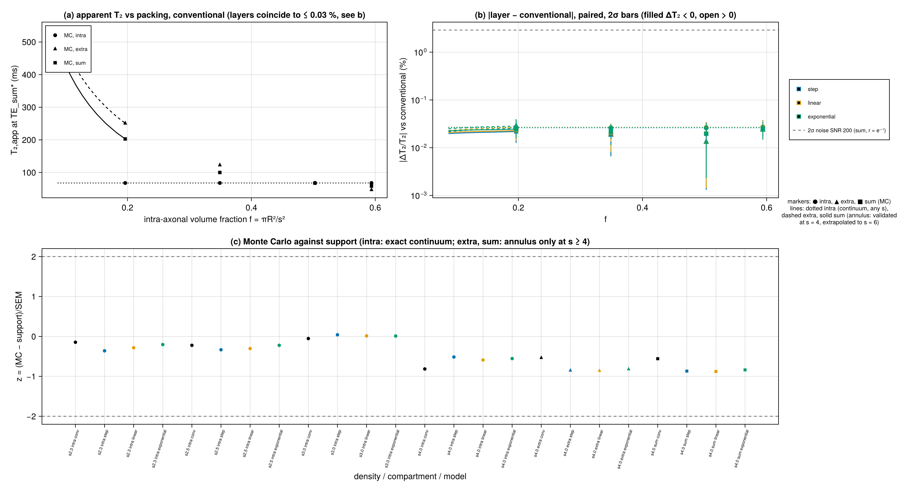

- **The Fig. 9B trend.**
  - The extra-axonal T₂ rises steeply as packing loosens: 46.8 → 250.8 ms, because S/V = 2πR/(s² − πR²) falls from 2.92 to 0.49 µm⁻¹.
  - The intra T₂ is the single-cylinder value, 67.7 ms.
  - The summed T₂ lies between, weighted by f.
  - At s = 2.5, extra ≈ intra (67.0 vs 67.7 ms) because the two compartments' S/V are nearly equal (2.02 vs 2.00 µm⁻¹).
- **The layer is invisible at this ρ in every compartment.** Every ΔT₂/T₂ is negative, and |ΔT₂/T₂| ≤ 0.028 % (2σ upper bound ≈ 0.04 %), ≈ 100× below the 2σ two-point noise at SNR 200 (2.9 % for the sum at r = e⁻¹). The noise differs per compartment because r = S_conv(TE_sum*) does: e.g. intra at s = 4 has r = 0.05 and 2σ = 6.7 %.
- **Read with care:**
  - The extra range (−0.013 … −0.028 %) is noise-limited, not a density trend. The s = 2.5 value is one shared fluctuation of the three profiles, ≈ 1.7σ from the annulus estimate (context only there).
  - Profile differences are not resolved by Monte Carlo; the profiles share trajectories, so overlapping σ is not a test. The support predicts exponential ≥ linear ≥ step by ≤ 13 % (extra, s = 4) and ≈ 2.5 % (intra).
  - The inside run is shared by all densities, so the intra columns, and the 16 intra z values of panel (c), are one measurement read at four TEs, not independent agreements.
  - **Overlap.** With c̄ = 0.1 outside, neighbouring outer layers overlap and add at s = 2.3 (every profile: step 0.2, linear 0.3, exponential support 0.3 in a 0.3 µm gap), at s = 2.5 for the linear (0.3 in 0.5) and exponential, and for the exponential at every s (support = gap).
- **Monte Carlo against support.**
  - Intra against the radial continuum: |z| ≤ 0.82.
  - Extra and sum at s = 4 against the annulus: S agrees to −5e-5 relative (|z| ≤ 0.9). For ΔS the point estimates differ by 0.6–1.9 %, but SEM_ΔS/ΔS ≈ 22 %, so only differences beyond ≈ ±45 % (2σ) are excluded.
  - The dense annulus curves for s ∈ [4, 6] are extrapolated beyond the validated s = 4, justified by ρR_out/D ≤ 0.008 ≪ 0.067.

### Result 2: outside dimensionless map (P3.7.3 outside)

[p3_7b_map_analysis.jl](phase3/p3_7b_map_analysis.jl) → [results/phase3/p3_7b_map_analysis/](results/phase3/p3_7b_map_analysis/). R = 1, D = 3, no bulk; 41 readouts to ln 100/λ₁,conv.

**Fixed ρ: first ρR/D with max|ΔS| ≥ 0.01** (MC, `threshold_status` over the three decade points):

| profile | h/R | inside (P3.7a MC) | outside s = 2.5 | outside s = 4 |
|---|---|---|---|---|
| step | 0.1 / 0.25 / 0.5 | 0.54 / 0.22 / 0.13 | 0.54 / 0.25 / 0.18 | 0.58 / 0.21 / 0.11 |
| linear | 0.1 / 0.25 / 0.5 | 0.81 / 0.31 / 0.17 | 0.79 / 0.32 / 0.20 | 0.88 / 0.30 / 0.15 |
| exponential | 0.1 / 0.25 / 0.5 | 0.26 / 0.15 / 0.12 | 0.28 / 0.20 / 0.19 | 0.23 / ≈ 0.1 (unresolved) / < 0.1 (annulus 0.079) |

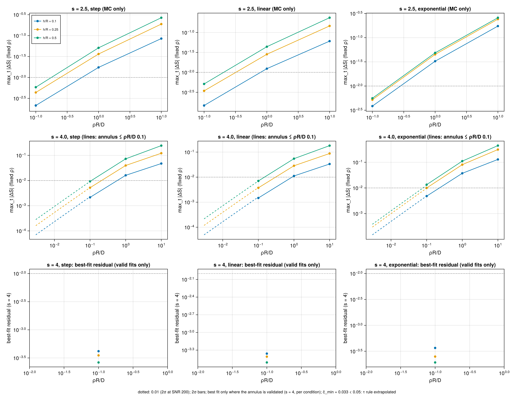

- **Outside ≈ inside at fixed ρR/D.** Two method biases apply:
  - interpolating between decade points overestimates a threshold by up to 7.2 % (h/R = 0.1), 6.7 % (h/R = 0.25) and 2.6 % (h/R = 0.5), checked on the s = 4 annulus used as a smooth test curve ([p3_7b_interp_bias.jl](phase3/p3_7b_interp_bias.jl));
  - MC and annulus ΔS differ by 3–8 % at ρR/D = 1 (ratios 0.92–1.04; the annulus is not validated there and overestimates |ΔS| by ≈ 8 % at ρR/D = 0.067), and τ is extrapolated at c̄ = 0.033.
- So outside–inside differences ≲ 10 % are **not resolved**. That covers every h/R = 0.1 value and most others.
- Two clear differences remain:
  - **exponential at s = 4 is visible earlier** (≈ 0.1 and < 0.1 vs 0.15 and 0.12), because its support is the 2 µm gap, not R;
  - **h/R = 0.5 at s = 2.5 is later** (0.18–0.20 vs 0.12–0.17): there the outer layers overlap across the 0.5 µm gap.
- Equal ρR/D does not mean equal S/V: 2.02 µm⁻¹ at s = 2.5, 0.49 at s = 4, and 2 inside.
- **Overlap.** At s = 2.5 the h/R = 0.25 step layers just touch, while the h/R = 0.5 step and every exponential (support 0.5) overlap and add. The s = 2.5 results therefore describe summed overlapping layers, not single-surface profiles.
- **Best fit and support.**
  - **Annulus validation per condition.** At s = 4 the annulus passes at ρR/D = 0.1 and fails at ρR/D = 1 and 10 on the S criterion. There the conventional model differs by 3.7e-3 and 1.1e-2 (z 8 and 17 at the readout of max |S_mc − S_ann|; maxima over readouts 12.4 and 26.7), comparable to the 0.01 threshold (at ρR/D = 1 the failure is marginal: 3.65e-3 against a tolerance of 3.38e-3), although the ΔS ratios pass (0.92–1.04).
  - **Where the fit is possible.** The outside best fit is therefore available only at s = 4, ρR/D = 0.1. The fitted conventional model reproduces every layer curve to 1.9e-4 – 4.4e-4, with ρ_c/ρ 1.001–1.036 (1.004–1.039 relative to the conventional self-fit).
  - **These residuals sit at the method floor.** The conventional Monte Carlo itself fits the annulus family only to 4.23e-4 (ρ_c/ρ 0.997; MC − annulus 1.27e-3, z 7.8, passing via the 1 %·S tolerance). They are upper bounds dominated by the square cell vs Krogh circle, not the layer's distance from a conventional curve.
  - **Not determinable.** The best-fit threshold outside is "> 0.1" at s = 4 and cannot be determined beyond, nor at s = 2.5.
- **Checks:**
  - annulus grid at h/R = 0.1, ρR/D = 1 and 30: ≤ 1.8e-7;
  - fit family N = 1000 vs 2000 at the most demanding valid fit: identical;
  - conventional θ√τ 0.004 / 0.028 / 0.090.

### Result 3: outside D-dependence signature (P3.7.3 outside)

[p3_7b_ddep_analysis.jl](phase3/p3_7b_ddep_analysis.jl) → [results/phase3/p3_7b_ddep_analysis/](results/phase3/p3_7b_ddep_analysis/). s = 2.5, MC only. TE = annulus conventional T₂ at D = 3 for every D.

| ρ | q_conv | q_layer (6 models) | Δq = q_layer − q_conv | two-measurement band (SNR 200) |
|---|---|---|---|---|
| 0.1 | 0.032 ± 0.001 | 0.006 – 0.017 | −0.015 … −0.026 (± ≤ 0.001) | 0.041: below (0.38–0.64×) |
| 1 | 0.257 ± 0.003 | 0.034 – 0.125 | −0.13 … −0.22 (± ≤ 0.002) | 0.042: detectable (3.1–5.3×) |

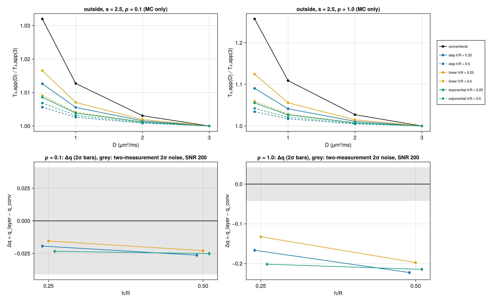

- **Same mechanism as inside.** The conventional T₂ outside rises as D falls, while the layers' depends far less on D. Δq is detectable from ρ ≈ 1 µm/ms and not at ρ = 0.1.
- **Weaker than inside at the same ρ:** q_conv is 0.032 / 0.257 outside against 0.041 / 0.355 inside (P3.7a).
- **No band-edge cases.** This is partly because h/R = 1 cannot exist in a 0.5 µm gap; inside, the band edge was reached only at h/R = 1.
- The comparison assumes ρ independent of D (MCMR's θ = ρ√(π/D) changes with D), and the s = 2.5 layers overlap (Result 2).

### Inside, outside and walls (P3.7.4)

All thresholds below are in physical ρ (µm/ms; cylinders ρ = y·D/R = 3y, walls ρ = x·D/w = 1.5x) at equal absolute h, all by `threshold_status`. Inside and outside are Monte Carlo over decade points (biases ≈ ±10 %, above). Walls are the Phase 2 continuum map re-thresholded by [p3_7_walls_comparison.jl](phase3/p3_7_walls_comparison.jl).

| fixed ρ, max\|ΔS\| ≥ 0.01 | step | linear | exponential |
|---|---|---|---|
| h = 0.1 µm: walls / inside / outside s 2.5 / s 4 | 1.51 / 1.63 / 1.63 / 1.74 | 2.37 / 2.42 / 2.38 / 2.65 | 0.67 / 0.79 / 0.84 / 0.68 |
| h = 0.5 µm: walls / inside / outside s 2.5 / s 4 | 0.34 / 0.40 / 0.53 / 0.33 | 0.44 / 0.51 / 0.61 / 0.44 | 0.26 / 0.37 / 0.56 / < 0.3 |

- **At fixed ρ** (known ρ, single free-decay curve, SNR 200), a near-surface layer becomes visible at about the same physical ρ on walls, inside cylinders and outside cylinders:
  - ≈ 1.5–2.7 µm/ms for h = 0.1 µm (exponential 0.67–0.84);
  - ≈ 0.26–0.61 µm/ms for h = 0.5 µm (outside s = 4 exponential < 0.3).
  - Many differences are within the ≈ 10 % method bias of the Monte Carlo decade-point thresholds (which does not apply to the walls continuum). Three clear exceptions remain:
    - **walls vs inside for thick layers:** at h = 0.5 µm the cylinder needs 16–42 % larger ρ than walls (step 0.40 vs 0.34, linear 0.51 vs 0.44, exponential 0.37 vs 0.26), as already found on one convention in P3.7a ("thick 10–40 % later in the cylinder");
    - the exponential reaches further when the gap is wide (outside s = 4: < 0.3 at h = 0.5 µm);
    - overlapping layers in the narrow gap delay visibility (outside s = 2.5, h = 0.5 µm: 0.53–0.61).
- **With a free conventional ρ** the layer stays hidden much longer:
  - inside it separates from ρ ≈ 3.4–5.1 µm/ms at h = 0.5 µm (ρR/D ≈ 1–3 in general);
  - on walls from ρ ≈ 3–6 µm/ms (h = 0.5 µm);
  - outside the test is only available at s = 4, ρR/D = 0.1, where the layer is absorbed down to the method floor.
- **D signature** (two D, SNR 200, same convention in all geometries: D 0.5 vs 3, TE = conventional T₂ at D = 3, same ρ): detectable at ρ = 1 µm/ms in all three geometries. At ρ = 0.1 it is not detectable in cylinders (inside ≤ 0.999×, outside s = 2.5 ≤ 0.64× the band) but marginally detectable on walls for thick layers (≈ 1.2–1.3×). The conventional q, and with it the signature, is largest on walls (0.055 / 0.47), then inside (0.041 / 0.355), then outside s = 2.5 (0.032 / 0.257).

### Conclusion

- **Physiological range** (ρ ≈ 1/140 µm/ms, D = 3, R = 1, any packing f = 0.20–0.59). The distributed layer changes the apparent T₂ by ≤ 0.03 % (2σ upper bound ≈ 0.04 %) in the intra, extra and summed signals, ≈ 100× below single-measurement noise at SNR 200. Packing density does not make it visible. This is at D = 3; the effect grows as 1/D (inside 0.14 % at D = 0.5, P3.7a), and at dense packing the outer layers overlap.
- **Fixed ρ.** Outside the cylinders the layer becomes visible from a single curve at about the same ρR/D as inside (0.1–0.9 depending on profile and h/R). The clear exceptions are geometric: the exponential in a wide gap is visible earlier, and overlapping layers in a narrow gap later.
- **Free conventional ρ.** Outside, the comparison is limited by the support model. Where the annulus is valid (s = 4, ρR/D = 0.1), the fitted conventional model reproduces the layer to the method floor (≈ 4e-4). Beyond it, outside best fits are not determined.
- **D dependence.** This is the most robust signature in every geometry, detectable at SNR 200 from ρ ≈ 1 µm/ms (T₂ ≲ 1 ms). It is weaker outside than inside.
- **Annulus model.** It is a useful support only at wide spacing and weak relaxation (validated s = 4, ρR/D ≤ 0.1, after renormalising truncated layers). At dense packing or strong ρ the square cell differs from the Krogh circle by as much as the effect being measured.
- **Monte Carlo against support.** Intra: agrees with the exact radial continuum (|z| ≤ 0.82). Annulus: passes the pre-registered tolerance where used, but with two resolved systematics: at s = 4, ρ = 0.2 the annulus overestimates |ΔS| by 8 ± 3 %; at s = 4, ρR/D = 0.1 (validated map condition) the conventional MC differs from the annulus by 1.27e-3 (z 7.8), within the 1 %·S tolerance (this sets the best-fit floor, Result 2). At ρ = 1/140 (density, s = 4) S agrees to 5e-5. The comparison timestep rule holds, except where c̄_min = 0.033 (extrapolated, flagged).

## Overlapping layers in arrays (P3.5)

Plan `docs/superpowers/plans/2026-11-11-overlapping-layers-arrays.md`. Outer layers of neighbouring cylinders in square and rectangular arrays, R = 1 µm, no RF.

### Design

- **Question.** When the outer layers of neighbouring cylinders overlap, four things are checked:
  - Is the summed rate still a realistic near-surface profile?
  - Does the package add the layers exactly?
  - How does the layer-vs-conventional difference change with the overlap degree?
  - Does overlap remove the D dependence, as found on walls (P2.5.9)?
- **Overlapping layers add** (package convention, D3.4): the rate at a point is the sum over every cylinder within its support.
- **Supports.** Step and linear: L = h, which must be ≤ the smallest gap (`check_outer_reach`). Exponential: L = the default cutoff, the smallest surface gap (D3.5).
- **Overlap degree** varied through h at fixed spacing (user, 2026-11-11):
  - square s = 2.5: gap 0.5, overlap in two directions;
  - rectangle 2.5 × 4.0: gaps 0.5 and 2.0, overlap in one direction;
  - h/gap = 0.3 (separated), 0.5 (touching), 0.7 and 1.0 (overlapping).
- The signal study is at ρR/D = 1 only, where differences are resolvable (user). There is no continuum for overlapping arrays: Monte Carlo only.

### Method

**Configurations (P3.5.1, [p3_5_configs.jl](phase3/p3_5_configs.jl)).** For each geometry and support L, on a 600 × 600 grid of the unit cell:
- overlap per direction (L > gap/2);
- the fold at the cell corner (interstitial point);
- the maximum number of supports covering one point;
- the fluid fraction covered by ≥ 2 supports (overlap) and by ≥ 1 support (coverage);
- the largest distance of a fluid point from every surface.

**Realism (P3.5.2, [p3_5_realism.jl](phase3/p3_5_realism.jl)).**
- **Criterion.** No interior maximum above the surface value (tracker; the walls analogue "never higher mid-gap", P2.5.9). In 2D it is tested along rays: from every surface point along its outward normal, up to the cylinder's own Voronoi cell (the unit rectangle, the analogue of the walls' half gap), the summed rate must never exceed its value at that surface point (excess ≤ 1e-9).
- **Sampling.** 1800 angles plus refinement to ±1e-6 rad around each facing direction; t log-spaced from 1e-9 µm, then every 2e-4 µm. For the exponential the analytic excess is reported, and the sampled one is checked to reach it.
- **Rulings** (2026-11-11):
  - The plan's first wording compared the peak with the **single-cylinder** surface value. That is not the spec: the exponential fails it trivially through its neighbour's tail at the facing surface.
  - A global max/max comparison was replaced by the ray test (a neighbour's support circle cuts into the gap).
  - Rays were cut at the own Voronoi cell, and the sampling refined near the surface (Group A review).

**Exact summation (P3.5.3, package `test/test_layer_cylinders.jl`).** New tests against an exact brute force:
- stationary points: the exponent equals rate·dt, to 1e-12;
- segments: split at every crossing of r = R and r = R + L of every image, 64-point Gauss–Legendre per smooth piece, to 1e-10;
- cases: (a) the rectangle (one-direction overlap), linear and exponential; (b) the 4-fold interstitial exponential at s = 4 (cutoff 2); (c) h = gap; (d) `max_layer_rate` ≥ the brute-force peak.

**Signal against overlap (P3.5.4, [p3_5_run.jl](phase3/p3_5_run.jl), [p3_5_overlap_analysis.jl](phase3/p3_5_overlap_analysis.jl)).** Paired MC:
- conventional + three profiles × four h per geometry, 10 seeds × 2·10⁴ spins, own seeds per condition;
- τ = min(0.135·c̄_min², 0.005/ΔR₂,max), with ΔR₂,max the package's **summed** bound. That bound sets τ (5.5e-5 square, 9.1e-5 rectangle; ΔR₂,max·τ = 0.005). It is conservative, 5× the true peak at s = 2.5, which cost runtime but not accuracy;
- 41 readouts to ln 100/λ₁ of the equal-area annulus (window only);
- quantity: max_t |ΔS|, ΔS = S_layer − S_conv.

**D dependence (P3.5.4, [p3_5_ddep_analysis.jl](phase3/p3_5_ddep_analysis.jl)).**
- Square 2.5, ρ = 1, bulk 1/2000, D 0.5 vs 3, TE = annulus conventional T₂ at D = 3 (0.517 ms).
- New h ∈ {0.15, 0.35}, combined with the 3.7b ddep h ∈ {0.25, 0.5} (same geometry, TE, grid and formulas; independent seeds; each curve paired with and normalised by its own conventional run). The two sources ran at different τ: 1.64e-4 here (summed bound) against 6.77e-4 in 3.7b (single-layer bound); both keep ΔR₂·τ ≲ 0.005.
- q = T₂(0.5)/T₂(3) − 1, Δq = q_layer − q_conv, against the two-measurement band 2√(n² + n²). The band ignores the (1 + q) factor in the noise of q, so it is understated by ≤ 15 %. This is inherited from 3.7b.

### Result 1: configurations (P3.5.1)

| geometry | support L (µm) | configuration | max fold | fluid covered ≥ 2 / ≥ 1 | farthest point from every surface (µm) |
|---|---|---|---|---|---|
| square 2.5 | 0.15 / 0.25 / 0.35 / 0.5 | separated / touching / two-direction / two-direction | 1 / 2 (point) / 2 / 2 | ≥ 2: 0 / 0 / 0.088 / 0.362; ≥ 1: 0.326 / 0.569 / 0.743 / 0.901 | 0.765 |
| rect 2.5 × 4.0 | same | separated / touching / one-direction / one-direction | ≤ 2 | ≥ 2: 0 / 0 / 0.020 / 0.082; ≥ 1: 0.148 / 0.258 / 0.357 / 0.491 | 1.355 |
| square 4.0 | step/linear 0.15–0.5; exponential 2.0 | separated; exponential 4-fold at the corners | 1; 4 | ≥ 2: 0 (exponential 0.883); ≥ 1: 0.079 / 0.137 / 0.201 / 0.305 (exponential 1.000) | 1.824 |

At s = 2.5 the corner point is 0.77 µm from every surface, beyond any allowed support, so overlaps there are at most pairwise. Four-fold overlap needs wide spacing and a long support (exponential at s = 4).

### Result 2: realism of the summed rate (P3.5.2)

| profile | square 2.5 | rectangle 2.5 × 4 | square 4.0 |
|---|---|---|---|
| linear, h = 0.15–0.5 | realistic | realistic | realistic |
| step, h ≤ gap/2 | realistic (h = gap/2: touching point only, measure zero; this ruling overrides `realistic=false` in realism.csv, as on walls) | same | realistic |
| step, h > gap/2 | **not**: the rate doubles in the overlap (74 % of the surface at h = gap) | **not** (37 % at h = gap) | — |
| exponential (L = gap) | **not**: excess e^(−gap/h) = 0.036 / 0.135 / 0.240 / 0.368 (h 0.15 … 0.5) | same | **not**: e^(−2/h) = 1.6e-6 … 0.018 |

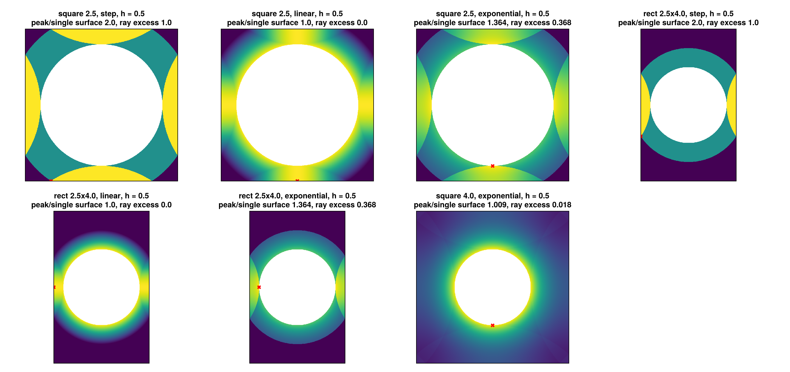

- **Linear** is realistic in every configuration, including full overlap (h = gap). Across the gap the two linear layers sum to a constant along the line of centres and decrease off it. This is the same as on walls.
- **Step** is the counter-example: wherever two supports overlap the rate doubles.
- **Exponential with the default cutoff L = gap is never strictly realistic on curved arrays.**
  - The neighbour's support (a circle of radius R + L around it) touches the facing surface only at one point. Off the line of centres it cuts into the gap, so the neighbour's truncated tail switches on with a jump of e^(−L/h) relative to the surface value, inside the fluid.
  - The excess equals e^(−gap/h) exactly; the sampled values reach it to 4 significant figures.
  - On walls the cut falls exactly on the opposite wall, so this cannot happen there.
  - It is small when h ≪ gap (1.6e-6 at s = 4, h = 0.15) but up to 0.37 when h = gap.
  - **The jump is wider than the ray excess shows.** Along the whole boundary of a neighbour's support inside the fluid (the lens edge) the rate jumps by e^(−L/h) times the surface value. Relative to the local rate this reaches ×2 where the two support circles meet on the bisector. The ray excess only measures the part near the surface.
  - **It is not specific to narrow gaps, nor to L = gap.** It occurs at any spacing and is large when h is comparable to L. Under `check_outer_reach` (L ≤ gap) every truncated exponential on a curved array has an interior jump. A shorter cutoff moves it away from the surface: at L = gap/2 the line-of-centres excess is 2e^(−gap/2h) − 1, which is ≤ 0 for h ≤ gap/(2 ln 2) ≈ 0.72·gap. The bound 0.37 holds for h ≤ gap, as in every run so far; the package allows h > gap, where the excess tends to 1.
  - **Design decision D3.5 (exponential support = smallest gap) therefore produces a non-physical jump on curved arrays. This is a modelling choice for the user to revisit, not a code defect.** Options:
    1. a smooth taper to zero at L;
    2. a shorter cutoff (e.g. L = gap/2, which removes the near-surface excess for h ≤ 0.72·gap but not the interior jump);
    3. accept it as is, where it is small (h ≪ gap: 1.6e-6 at s = 4, h = 0.15).

### Result 3: exact summation in the package (P3.5.3)

All new tests pass, on their first run: the package already sums overlapping layers exactly.
- **Agreement:** stationary rates to ≤ 1e-12, segment exponents to ≤ 1e-10.
- **What the tests guard against:** a wrong cutoff (smallest gap) in rectangular arrays, a truncated image reach for 4-fold overlap, and a non-summed τ bound.
- **Full package suite** without the display-dependent plots (`test_args=["no-plots"]`): 3579/3579 (+24). With plots, the one failure was the visual regression "Plot walls in 3D", which needs a display (CI uses xvfb).

### Result 4: signal against the overlap degree at fixed ρ (P3.5.4)

ρR/D = 1, outside, max_t |ΔS| (paired; SEM ≤ 5e-4):

| h/gap | square 2.5: step / linear / exponential | rectangle 2.5 × 4: step / linear / exponential |
|---|---|---|
| 0.3 (separated) | 0.026 / 0.019 / 0.040 | 0.023 / 0.016 / 0.043 |
| 0.5 (touching) | 0.037 / 0.029 / 0.046 | 0.037 / 0.027 / 0.052 |
| 0.7 | 0.044 / 0.037 / 0.048 | 0.049 / 0.036 / 0.056 |
| 1.0 (full overlap) | 0.052 / 0.045 / 0.049 | 0.065 / 0.050 / 0.059 |

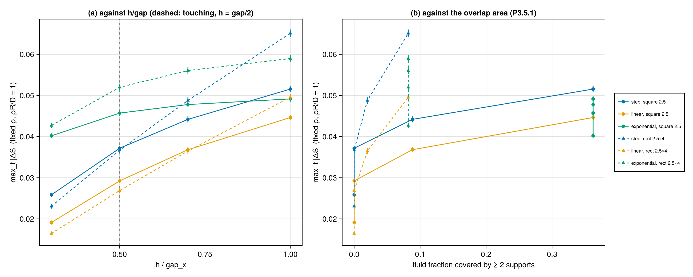

- **Every ΔS is negative** (the layer attenuates more), and every step in h is resolved (z ≥ 2.9 with a conservative unpaired σ; the h models share trajectories but only per-model SEMs are stored).
- **Step and linear keep growing through touching into full overlap**: overlap does not cap the difference. But the growth is **sublinear in the square** (per µm of h: step 0.113 → 0.070 → 0.049, linear 0.101 → 0.076 → 0.052) and nearly linear in the rectangle (step 0.136 → 0.121 → 0.109). There is no same-h control without overlap, so the damping cannot be attributed to overlap alone.
- **The exponential's flattening (+14 / +5 / +3 % in the square) is not an overlap effect.** Its support, and so its overlap area (0.362 / 0.082), is the same at every h; the profile flattens within a fixed support.
- **Wider spacing.** The 3.7b map at s = 4 (no step/linear overlap) gives larger values (step h = 0.5: 0.073). S/V (0.49 vs 2.02 µm⁻¹) and the time window differ, so this is not an "overlap penalty".
- On walls (P2.5.9), overlap saturated the fixed-ρ difference. On cylinders at these h the growth of step and linear slows (square) but does not saturate.

### Result 5: D dependence of overlapping layers (P3.5.4)

Square 2.5, ρ = 1; q_conv = 0.254 / 0.257 (the two sources):

| h/gap | q_layer / q_conv: step / linear / exponential | absolute q_layer | Δq / band |
|---|---|---|---|
| 0.3 | 0.55 / 0.66 / 0.30 | 0.139 / 0.168 / 0.077 | 2.7 / 2.0 / 4.2 |
| 0.5 | 0.35 / 0.48 / 0.22 | 0.090 / 0.125 / 0.055 | 3.9 / 3.1 / 4.8 |
| 0.7 | 0.24 / 0.36 / 0.19 | 0.062 / 0.092 / 0.048 | 4.5 / 3.8 / 4.9 |
| 1.0 | 0.13 / 0.23 / 0.16 | 0.034 / 0.060 / 0.042 | 5.3 / 4.7 / 5.1 |

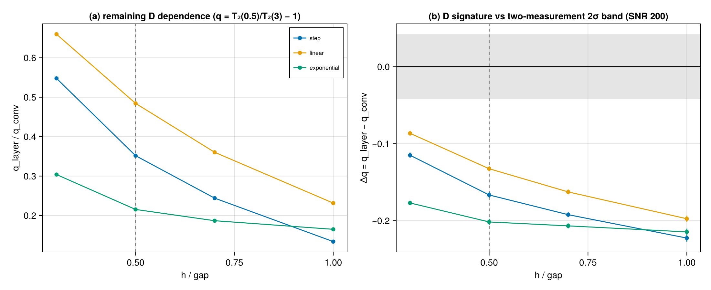

- **The layers' D dependence falls monotonically with h**, and Δq is detectable at SNR 200 everywhere (2.0–5.3× the band). Thickness and overlap are confounded: for step and linear the drop from h/gap 0.3 to 0.5 happens without any overlap, and the exponential's overlap area is the same at every h. So this is not shown to be an overlap effect.
- **It is not removed at full overlap:** q_layer ≥ 0.034, ≥ 0.13 q_conv. On walls (P2.5.9, same D pair and TE convention, ρ = 1, w = 2) thick or overlapping layers kept ≤ 4.6 % against q_conv = 47 %, and the bound was set at linear h/w = 0.5, where the layers only touch.
  - The comparison is not like for like in strength: q_conv is 0.25 here against 0.47 on walls (ρ·gap/D 0.17 against ρw/D 0.67).
- **Hypothesis (untested) for the difference.** It is not partial overlap, because walls lose the D dependence without overlap. It is coverage: on walls with h/w ≥ 0.5 every fluid point is within h of a surface, while here at h = gap 9.9 % of the fluid lies beyond every support (farthest point 0.765 µm from every surface). So the rate is not spread over the whole fluid. For step and linear at s = 2.5 full coverage is impossible under the reach rule (farthest point 0.765 µm, L ≤ 0.5). A direct test would be a geometry with full coverage: the exponential at s = 4 covers 100 % of the fluid (L = 2), but was not run in the D check.

### Conclusion

- **Profiles.** Linear layers remain realistic profiles when they overlap, in every configuration. Step layers are the known counter-example (doubling). Exponential layers truncated at L ≤ gap jump inside the fluid on curved arrays (near the surface by e^(−gap/h), ≤ 0.37 for h ≤ gap; at the lens edges up to ×2 relative to the local rate), an artefact of truncation that walls do not have. **D3.5 deserves a user decision** (taper, shorter cutoff, or accept).
- **Package.** It sums overlapping layers exactly; the summed τ bound is valid but conservative (up to 5× in the square array).
- **Signal.** At fixed ρ, overlap does not cap the layer-vs-conventional difference for step and linear layers; in two-direction overlap their growth with h is sublinear.
- **D dependence.** It falls monotonically with h (thickness and overlap confounded) but is not removed on cylinders (≥ 13 % of the conventional value at h = gap), unlike walls. The suggested reason, incomplete coverage of the fluid, is a hypothesis.

## Phase 3 close (P3.8)

### Documentation (P3.8.2)

User documentation of the near-surface layer for walls and cylinders: [docs/src/near_surface_layer.md](../docs/src/near_surface_layer.md), linked from `docs/make.jl` as "Near-surface R2 layer". It covers:
- the model and its normalisation (κ, ρ per unit area, the mean-exponent law and θ = ρ√(π/D));
- the profiles and supports, the keywords for both geometries, the CLI flags and the limits;
- additive overlap, the integration path, the default timestep (`timestep=(layer=0.005,)`) and the comparison timestep rule;
- what is unsupported (finite RF, stuck spins);
- the caveats (step doubling, the truncated-exponential jump).

The docs build passes (`julia --project=docs -e 'using Pkg; Pkg.instantiate(); include("docs/make.jl")'`). Its one warning lists 12 internal module docstrings that are not in the manual, as before.

### Open items carried out of Phase 3

- **D3.5, exponential support (user decision).** On curved arrays a truncated exponential (L ≤ gap) jumps inside the fluid (P3.5.2).
  - Options: a smooth taper, a shorter cutoff, or accept it as is.
  - A change would need a package change and a rerun of the affected exponential results (P3.4.8e–h, P3.7b, P3.5).
- **◐ P3.1.3, P3.4.6, P3.4.8.** Left as they are (user, 2026-10-25).
- **P3.6.4 cell list.** The layer cost per spin-step scales with the number of cylinders per cell (×6.7 at 400); a cell list of layer indices is open.
- **`max_layer_rate`.** For cylinders a valid but conservative summed bound, up to 5× the true peak in the s = 2.5 array; it costs runtime, not accuracy.
- **Walls timestep bound is not summed** (found in the P3.8 review, verified): for walls `max_layer_rate` is the largest single-layer rate, so where two wall layers overlap the default ΔR₂·τ can reach 0.01 instead of 0.005 (e.g. `Walls(repeats=1, layer_rho=0.1, layer_h=0.8)`: bound 0.125 /ms, summed rate 0.25 /ms at mid-gap). The Phase 2 overlap study (P2.5.9) is continuum-based, and its Monte Carlo check set τ = 0.005/(summed peak rate)/4 explicitly (`research/phase2/p2_5_overlap_mc_check.jl:18`), so no committed result is affected; whether the package bound should sum overlapping sides is a design decision for the user.

### Deferred minors (from the plan reviews; none changes a result)

- **P3.5:** package test (c) does not probe d = L exactly; (d) cannot detect a valid but loose bound; the rectangular brute force should throw for one infinite spacing; 3-fold overlaps are not labelled; the ddep band ignores the (1 + q) factor (≤ 15 %, disclosed).
- **P3.7a/b:** listed in the final messages of those plans and largely fixed in the deferred-minors pass (commit 7ec0b55); the rest are wording and labelling details recorded in the sections above.

### Carry-over from Phase 2

| item | status |
|---|---|
| Tags `rd-profiles-v1`, `rd-walls-v1` | not created (the Phase 2 commits are not re-tagged here); deferred to the user |
| P2.4.4 polynomial profile | not implemented (not needed by Phase 3); deferred |
| P2.4.6 quadrature path | done in Phase 3 (P3.3, D3.3) |
| Exponential `h > spacing` | NOT resolved for walls: `layer_h ≤ spacing` is still enforced for every profile, although for the exponential h is a decay length (cylinders inside explicitly allow exponential h > R); deferred — a design decision |
| `layer_cutoff` checks | done: `layer_cutoff` must not exceed the wall spacing; a lone wall or cylinder needs an explicit `layer_cutoff` (`src/geometries/user/fix.jl`) |
| `layer_cutoff` NaN message | NOT fixed: on a repeating wall `layer_cutoff = NaN` gives the message for a non-repeating wall (`fix.jl:94`); deferred |
| Stuck spins without the layer | done: warning for walls and cylinders when the surface density is > 0 |
| User docs | done (P3.8.2) |
